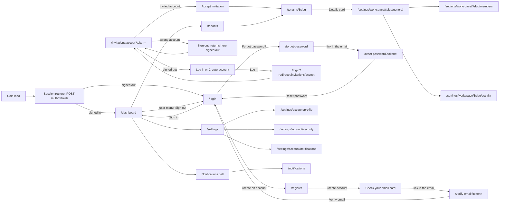

# React pages

This folder is the inventory of every route in the app: what each page is for, which file renders it, what guards it, which requests it waits on, which components it is built from, and what it looks like in its default, loading, error and empty states. The screenshots under `img/` are taken by the Playwright `capture` project in `e2e/capture/`: with the dev stack up (react on `:5173`, the API on `:4040`, Mailpit on `:8025`), run `pnpm capture:pages`, or `CAPTURE_ONLY=<areas> pnpm capture:pages` to redo some areas (for example `CAPTURE_ONLY=auth,system`). A route key in the same list, such as `CAPTURE_ONLY='/tenants/$slug/beta'` (quote it, or the shell expands `$slug`), redoes one route, for an area too large for one rate-limit window. Run it only through `pnpm capture:pages`: the script sets `E2E_CAPTURE=1`, which turns Playwright's `webServer` off, and a bare `pnpm exec playwright test --project=capture` without it starts `pnpm dev` and then skips every test. The run writes its records to `capture-records/` (gitignored, and outside `test-results/`, which Playwright empties at the start of every run, so separate runs keep each other's records): `report.json` for the page shots, `boot.json` for the boot frames and `navigation.json` for the in-app navigation shots. The boot capture's `nginx-` scenarios run against a production build and are skipped unless `E2E_NGINX_ORIGIN` points at one (for example `vite preview` of this worktree's build); `e2e/capture/navigation.test.ts` takes the in-app navigation shots (`<shot>--nav-route.jpg`, `<shot>--nav-sections.jpg`), and `e2e/capture/boot.test.ts` takes the boot frames; run both in one invocation, `pnpm capture:pages e2e/capture/boot.test.ts e2e/capture/navigation.test.ts`, to refresh them together. A 429 from the API stops the run with a message naming `CAPTURE_ONLY` and the 5-minute wait; the shot that saw the 429 may already be written under its real name, so restore it before the rerun with `git checkout -- docs/pages/img/<area>/<shot>--<state>.jpg`. The problems found are listed in [findings.md](findings.md). `tests/unit/docs-pages.test.ts` fails when a route is missing from the map below, when a screenshot is linked from no page, or when `img/` grows past 10 MiB.

The shots come from `vite dev`, so the TanStack Router and Query devtools buttons show in the bottom-right corner of some of them. Those buttons are dev-only (`src/components/dev/devtools.tsx`) and are not part of any page. The default shots are full-page, so the sticky sidebar ends at the viewport's height (900 px) with blank space below it; that is a capture artifact, not the page.

| Area                                 | Covers                                                                        |
| ------------------------------------ | ----------------------------------------------------------------------------- |
| [boot.md](boot.md)                   | The cold load, from `index.html` to the first page, frame by frame            |
| [auth.md](auth.md)                   | Sign-in, registration, password reset, email verification, invitation landing |
| [system.md](system.md)               | The root redirect and the not-found page                                      |
| [dashboard.md](dashboard.md)         | The signed-in landing page                                                    |
| [tenants.md](tenants.md)             | The tenant list, a tenant's overview and its beta page                        |
| [settings.md](settings.md)           | Account and workspace settings                                                |
| [notifications.md](notifications.md) | The notifications page and the bell                                           |
| [palette.md](palette.md)             | The ⌘K command palette, a shell feature with no route                         |
| [findings.md](findings.md)           | Every problem found, with its evidence and the work that fixes it             |

## Route map

Every full path of the route tree (`FileRoutesByFullPath` in `src/routeTree.gen.ts`). API paths are relative to `/api/v1`. "Awaited" requests hold the page (on a cold load, the boot shell) until they settle, at most 10 s for the flags; "started" requests run while the page renders, and the page shows its template or its sections' skeletons meanwhile.

| Route                                | Kind                                                                        | File                                                   | Guard                                         | Data (awaited / started)                                                                                                                                                                   | Doc                                                                    |
| ------------------------------------ | --------------------------------------------------------------------------- | ------------------------------------------------------ | --------------------------------------------- | ------------------------------------------------------------------------------------------------------------------------------------------------------------------------------------------ | ---------------------------------------------------------------------- |
| `/`                                  | redirect → `/dashboard` (signed in) or `/login`                             | `src/pages/index.tsx`                                  | none                                          | none                                                                                                                                                                                       | [system.md](system.md#--root-redirect)                                 |
| `/$`                                 | page (not found)                                                            | `src/pages/$.tsx`                                      | none                                          | none                                                                                                                                                                                       | [system.md](system.md#--not-found)                                     |
| `/login`                             | page                                                                        | `src/pages/_auth/login.tsx`                            | `_auth`: signed in → `/dashboard`             | started on submit: `POST /auth/login`                                                                                                                                                      | [auth.md](auth.md#login--sign-in)                                      |
| `/register`                          | page                                                                        | `src/pages/_auth/register.tsx`                         | `_auth`                                       | started on submit: `POST /auth/register`; `POST /auth/resend-verification`                                                                                                                 | [auth.md](auth.md#register--create-an-account)                         |
| `/forgot-password`                   | page                                                                        | `src/pages/_auth/forgot-password.tsx`                  | `_auth`                                       | started on submit: `POST /auth/forgot-password`                                                                                                                                            | [auth.md](auth.md#forgot-password--forgot-password)                    |
| `/reset-password`                    | page                                                                        | `src/pages/reset-password.tsx`                         | none (top level)                              | started on submit: `POST /auth/reset-password`                                                                                                                                             | [auth.md](auth.md#reset-password--choose-a-new-password)               |
| `/verify-email`                      | page                                                                        | `src/pages/verify-email.tsx`                           | none (top level)                              | started on submit: `POST /auth/verify-email`; `POST /auth/resend-verification`                                                                                                             | [auth.md](auth.md#verify-email--verify-your-email)                     |
| `/auth/callback`                     | redirect (in an effect) → `/dashboard` or `/login?error=google_auth_failed` | `src/pages/auth/callback.tsx`                          | none (top level)                              | none                                                                                                                                                                                       | [auth.md](auth.md#authcallback--google-sign-in-return)                 |
| `/auth/link`                         | page                                                                        | `src/pages/auth/link.tsx`                              | none (top level)                              | started: `POST /auth/link/verify` when signed out (once per load); on the dead link `POST /auth/link/request`; on switch account `POST /auth/logout`                                       | [auth.md](auth.md)                                                     |
| `/welcome`                           | page                                                                        | `src/pages/welcome.tsx`                                | own: signed out → `/login?redirect=/welcome`  | started: `GET /tenants` (a tenant → `/dashboard`); on submit `POST /tenants`; on sign-out `POST /auth/logout`                                                                              | [auth.md](auth.md#welcome--create-your-workspace)                      |
| `/invitations/accept`                | page                                                                        | `src/pages/invitations/accept.tsx`                     | none (top level)                              | started: `POST /invitations/preview`; on accept `POST /invitations/accept`; on sign-out `POST /auth/logout`                                                                                | [auth.md](auth.md#invitationsaccept--accept-an-invitation)             |
| `/invitations/confirm`               | page                                                                        | `src/pages/invitations/confirm.tsx`                    | none (top level)                              | started: `POST /invitations/confirm` when signed out or signed in as the link's address (once per load); on the dead link `POST /auth/link/request`; on switch account `POST /auth/logout` | [auth.md](auth.md)                                                     |
| `/dashboard`                         | page                                                                        | `src/pages/_app/dashboard.tsx`                         | `_app`: signed out → `/login?redirect=`       | awaited by `_app`: `GET /flags` (10 s cap); read after mount by `TenantSearchGuard`: `GET /tenants`                                                                                        | [dashboard.md](dashboard.md#dashboard--dashboard)                      |
| `/notifications`                     | page                                                                        | `src/pages/_app/notifications.tsx`                     | `_app`                                        | awaited by `_app`: `GET /flags` (10 s cap); read after mount: `GET /tenants`; started: `GET /notifications?limit=20`                                                                       | [notifications.md](notifications.md#notifications--notifications)      |
| `/profile`                           | redirect → `/settings/account/profile`                                      | `src/pages/_app/profile.tsx`                           | `_app`                                        | none: redirects before it loads                                                                                                                                                            | [settings.md](settings.md#redirects)                                   |
| `/settings`                          | layout (settings shell, `h1` from the active section)                       | `src/pages/_app/settings.tsx`                          | `_app`                                        | awaited by `_app`: `GET /flags` (10 s cap)                                                                                                                                                 | [settings.md](settings.md#settings--settings-shell)                    |
| `/settings/`                         | page                                                                        | `src/pages/_app/settings/index.tsx`                    | `_app`                                        | awaited by `_app`: `GET /flags` (10 s cap)                                                                                                                                                 | [settings.md](settings.md#settings--settings-home)                     |
| `/settings/account/`                 | redirect → `/settings/account/profile`                                      | `src/pages/_app/settings/account.index.tsx`            | `_app`                                        | none: redirects before it loads                                                                                                                                                            | [settings.md](settings.md#redirects)                                   |
| `/settings/account/profile`          | page                                                                        | `src/pages/_app/settings/account.profile.tsx`          | `_app`                                        | awaited by `_app`: `GET /flags` (10 s cap); the profile comes from the session restore                                                                                                     | [settings.md](settings.md#settingsaccountprofile--profile)             |
| `/settings/account/security`         | page                                                                        | `src/pages/_app/settings/account.security.tsx`         | `_app`                                        | started: `GET /auth/providers`                                                                                                                                                             | [settings.md](settings.md#settingsaccountsecurity--security)           |
| `/settings/account/notifications`    | page                                                                        | `src/pages/_app/settings/account.notifications.tsx`    | `_app`                                        | started: `GET /notifications/preferences`                                                                                                                                                  | [settings.md](settings.md#settingsaccountnotifications--notifications) |
| `/settings/workspace/$slug`          | layout (tenant gate, `h2`)                                                  | `src/pages/_app/settings/workspace.$slug.tsx`          | `_app`                                        | awaited by its loader: `GET /tenants/:slug/flags` (10 s cap); started: `GET /tenants/:slug`                                                                                                | [settings.md](settings.md#settingsworkspaceslug--workspace-gate)       |
| `/settings/workspace/$slug/`         | redirect → `/settings/workspace/$slug/general`                              | `src/pages/_app/settings/workspace.$slug.index.tsx`    | `_app`                                        | none: redirects before it loads                                                                                                                                                            | [settings.md](settings.md#redirects)                                   |
| `/settings/workspace/$slug/general`  | page                                                                        | `src/pages/_app/settings/workspace.$slug.general.tsx`  | `_app`                                        | started: `GET /tenants/:slug/settings`                                                                                                                                                     | [settings.md](settings.md#settingsworkspacesluggeneral--general)       |
| `/settings/workspace/$slug/members`  | page                                                                        | `src/pages/_app/settings/workspace.$slug.members.tsx`  | `_app`                                        | started: `GET /tenants/:slug/members`, `GET /tenants/:slug/invitations`                                                                                                                    | [settings.md](settings.md#settingsworkspaceslugmembers--members)       |
| `/settings/workspace/$slug/activity` | page                                                                        | `src/pages/_app/settings/workspace.$slug.activity.tsx` | `_app`                                        | started: `GET /tenants/:slug/members`, `GET /tenants/:slug/audit-log`                                                                                                                      | [settings.md](settings.md#settingsworkspaceslugactivity--activity)     |
| `/tenants/`                          | page                                                                        | `src/pages/_app/tenants/index.tsx`                     | `_app`                                        | awaited by `_app`: `GET /flags` (10 s cap); read after mount by `TenantSearchGuard`: `GET /tenants`                                                                                        | [tenants.md](tenants.md#tenants--tenants)                              |
| `/tenants/$slug`                     | layout (tenant gate, header, tabs)                                          | `src/pages/_app/tenants/$slug.tsx`                     | `_app`                                        | awaited by its loader: `GET /tenants/:slug/flags` (10 s cap); started: `GET /tenants/:slug`                                                                                                | [tenants.md](tenants.md#layout)                                        |
| `/tenants/$slug/`                    | page                                                                        | `src/pages/_app/tenants/$slug.index.tsx`               | `_app`                                        | started: `GET /tenants/:slug/onboarding`                                                                                                                                                   | [tenants.md](tenants.md#tenantsslug--overview)                         |
| `/tenants/$slug/beta`                | page                                                                        | `src/pages/_app/tenants/$slug.beta.tsx`                | `_app`; flag `example_beta_page` or not found | started: `GET /tenants/:slug/beta`                                                                                                                                                         | [tenants.md](tenants.md#tenantsslugbeta--beta)                         |
| `/tenants/$slug/activity`            | redirect → `/settings/workspace/$slug/activity`                             | `src/pages/_app/tenants/$slug.activity.tsx`            | `_app`                                        | none: redirects before it loads                                                                                                                                                            | [tenants.md](tenants.md#redirects)                                     |
| `/tenants/$slug/members`             | redirect → `/settings/workspace/$slug/members`                              | `src/pages/_app/tenants/$slug.members.tsx`             | `_app`                                        | none: redirects before it loads                                                                                                                                                            | [tenants.md](tenants.md#redirects)                                     |
| `/tenants/$slug/settings`            | redirect → `/settings/workspace/$slug/general`                              | `src/pages/_app/tenants/$slug.settings.tsx`            | `_app`                                        | none: redirects before it loads                                                                                                                                                            | [tenants.md](tenants.md#redirects)                                     |

Every page also sits under `__root`, whose `beforeLoad` awaits the session restore (`POST /auth/refresh`, then `GET /profile`), and whose `MaintenanceGate` starts `GET /status/maintenance`. The `_app` shell (`AppLayout`) starts `GET /notifications?limit=20` and the notifications stream for the bell. [boot.md](boot.md#what-happens) has the order.

## Journeys



## Per-route block

Every area file describes each route with the same block, so the docs stay comparable:

```markdown
### `/tenants/` — Tenants


|                     |                                                                          |
| ------------------- | ------------------------------------------------------------------------ |
| Purpose             | …                                                                        |
| File                | `src/pages/_app/tenants/index.tsx`                                       |
| Guard and redirects | …                                                                        |
| Layout              | `AppLayout` (sidebar)                                                    |
| Data                | `GET /tenants` (`['tenants']`) — read after mount by `TenantSearchGuard` |
| Sections            | Tenants list ← `GET /tenants`; Create a tenant (no request)              |
| Components          | `Card`, `Skeleton`, `LoadError`, … ; hand-rolled: …                      |
| Transitions         | row → `/tenants/$slug`; create → `/tenants/$slug`                        |

| Loading                             | Error                             | Empty                                   |
| ----------------------------------- | --------------------------------- | --------------------------------------- |
|  |  |        |
| skeleton · 2× `h-14`                | alert · `LoadError`               | "You do not belong to any tenants yet…" |

Findings: [F-tenants-1](findings.md#f-tenants-1) …
```

- The heading is the route in backticks, an em dash, and the page's name. The name differs between routes whose paths differ only by a trailing slash, so their anchors never collide.
- The `Data` row names each query's endpoint and its query key as the code defines it (`tenantKeys.list` is `['tenants']`), whether it is awaited or only started, and its `staleTime` when it is not the default 30 s (`src/router.tsx`). A row with mutations only says "no query".
- The `Loading` cell's first line is the report's `loadingUi` (`skeleton`, `spinner` or `shell`, or `none`), the `Error` cell's is its `errorUi` (`alert` or `none`). The second line names what is drawn.
- A state with no shot has no column. A route with no shot at all (a redirect) has no image.
- Dark and mobile shots go in a second table under the first, when the route has them.
- A route with a role gate has a `Role-denied` table: what an editor (the seed's `member` session) sees instead, with its shot `img/<area>/<shot>--role-denied.jpg`.
- The image paths are `img/<area>/<shot>--<state>.jpg`, with the area and shot stem from `e2e/capture/manifest.ts`; the example writes them as placeholders so it links no real screenshot.
- Findings ids are `F-<area>-<n>`, and each one has a heading in [findings.md](findings.md).
