# Auth

The signed-out pages and the pages a mailed link opens. Back to the [route map](README.md#route-map).

All of them render inside `AuthLayout` (`src/components/layouts/auth-layout.tsx`): a muted full-height page with one centred `AuthCard` (`src/components/layouts/auth-card.tsx`). The card has the page's `h1` and description over its content on the left, and the brand panel (app name and tagline on the primary colour) on the right; below `md` the brand panel is hidden and the card is one column. `/login`, `/register` and `/forgot-password` sit under the `_auth` layout route, whose `beforeLoad` sends a signed-in user to `/dashboard` (except while maintenance mode is `full`). `/reset-password`, `/verify-email`, `/auth/callback` and `/invitations/accept` are top-level routes outside `_auth`, because a signed-in user opens their links too; each renders `AuthLayout` itself. None of these pages awaits a request before it renders, beyond the boot's `POST /auth/refresh` ([boot.md](boot.md#what-happens)).

### `/login` — Sign in

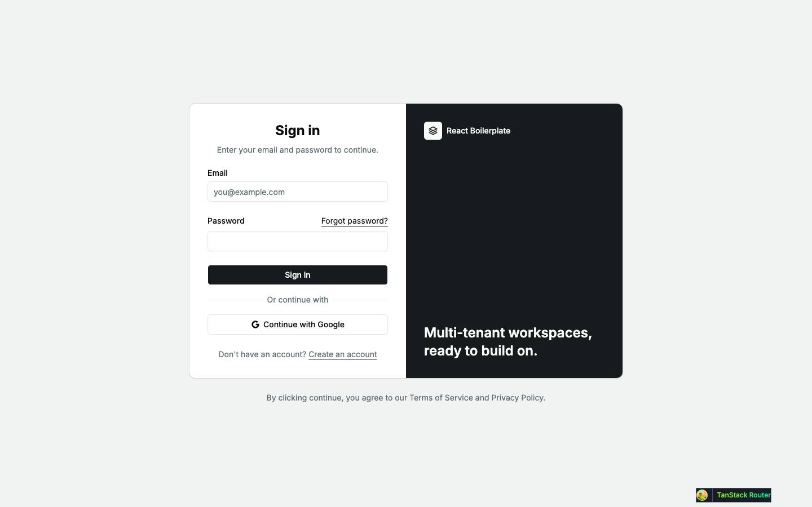

|                     |                                                                                                                                                                                                                       |
| ------------------- | --------------------------------------------------------------------------------------------------------------------------------------------------------------------------------------------------------------------- |
| Purpose             | Sign in with email and password, or with Google.                                                                                                                                                                      |
| File                | `src/pages/_auth/login.tsx`                                                                                                                                                                                           |
| Guard and redirects | `_auth`: signed in → `/dashboard`. After sign-in → `?redirect=` when `safeRedirect` accepts it (a same-origin path), else `/dashboard`. `?error=<code>` raises one error toast (Google failures, `MAINTENANCE_MODE`). |
| Layout              | `AuthLayout` + `AuthCard`, `TermsNote` under the card                                                                                                                                                                 |
| Data                | no query; `POST /auth/login` on submit                                                                                                                                                                                |
| Sections            | Email and password form (no request until submit); "Or continue with" and one link per social provider (`SocialSignIn`, a top-level navigation to `/api/v1/auth/google`)                                              |
| Components          | `Form`, `FormField`, `FormError`, `Input`, `Button`, `FieldGroup`, `FieldDescription`, `FieldSeparator`; hand-rolled: `AuthCard`'s brand panel, `TermsNote`                                                           |
| Transitions         | Forgot password? → `/forgot-password`; Create an account → `/register`; Sign in → `?redirect` or `/dashboard`; Continue with Google → the API's Google flow → `/auth/callback`                                        |

Pending state: the button reads "Signing in…" and is disabled. Errors: `FormError` above the button, field messages under the fields.

| Dark                                          | Mobile                                 |
| --------------------------------------------- | -------------------------------------- |
| 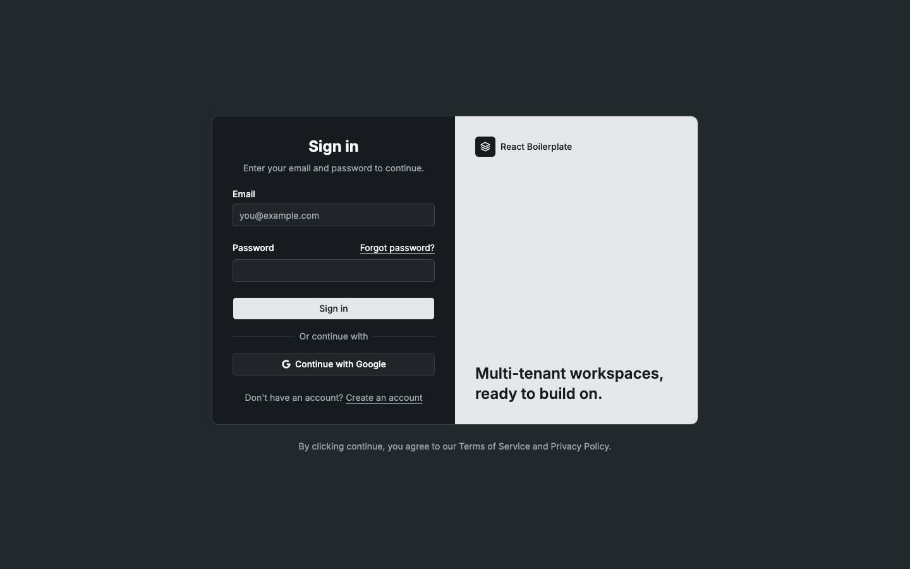                 | 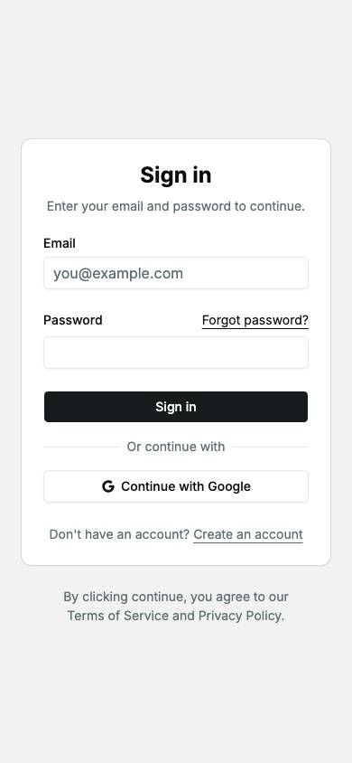        |
| The brand panel inverts to the light surface. | One column; the brand panel is hidden. |

Findings: [F-auth-5](findings.md#f-auth-5)

### `/register` — Create an account

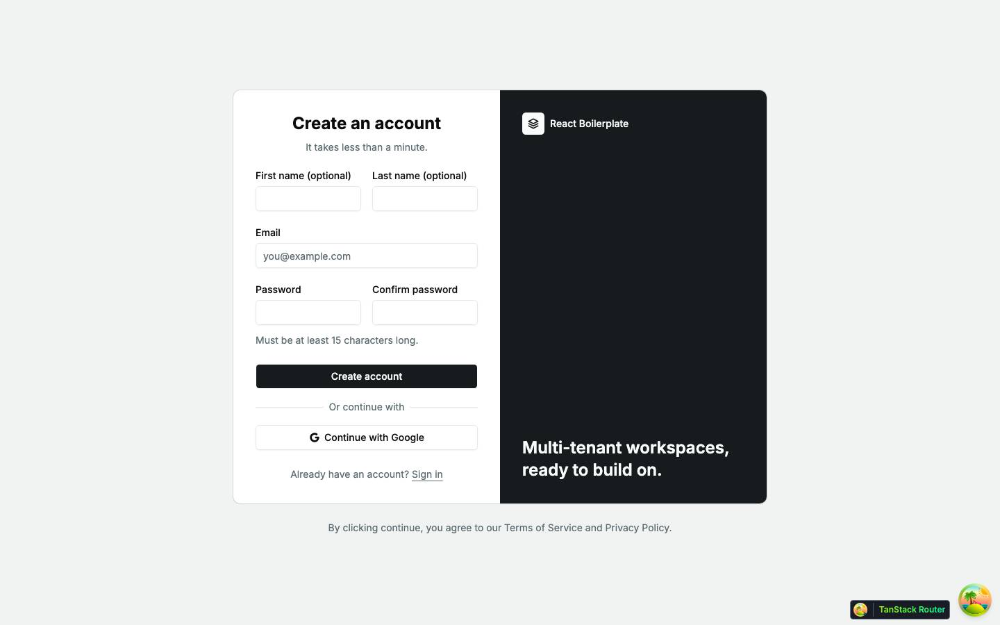

|                     |                                                                                                                                                                                                                                                 |
| ------------------- | ----------------------------------------------------------------------------------------------------------------------------------------------------------------------------------------------------------------------------------------------- |
| Purpose             | Register with email and password; then tell the user to verify the address.                                                                                                                                                                     |
| File                | `src/pages/_auth/register.tsx`                                                                                                                                                                                                                  |
| Guard and redirects | `_auth`: signed in → `/dashboard`. `?email=` prefills the address (an invitation's "Create account" sends it).                                                                                                                                  |
| Layout              | `AuthLayout` + `AuthCard`, `TermsNote` under the card                                                                                                                                                                                           |
| Data                | no query; `POST /auth/register` on submit; `POST /auth/resend-verification` from the "Check your email" card                                                                                                                                    |
| Sections            | First and last name (optional), email, password and confirmation, the minimum-length hint; social sign-in; after a successful submit the card is replaced by "Check your email" with a "Resend verification email" button and "Back to sign in" |
| Components          | `Form`, `FormField`, `FormDescription`, `FormError`, `Input`, `Button`, `Pii`; hand-rolled: `TermsNote`                                                                                                                                         |
| Transitions         | Sign in → `/login`; Create account → the "Check your email" card (same URL); the emailed link → `/verify-email?token=`                                                                                                                          |

Pending state: "Creating account…" on the button. The "Check your email" card is not shot.

Findings: [F-auth-5](findings.md#f-auth-5)

### `/forgot-password` — Forgot password

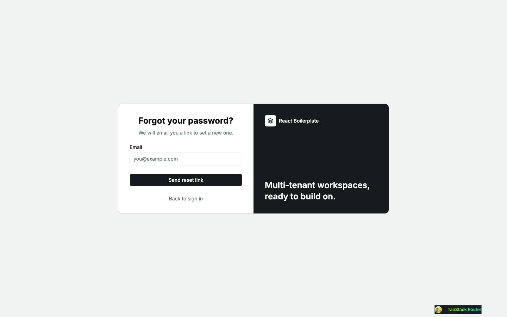

|                     |                                                                                                                                                                                                                                             |
| ------------------- | ------------------------------------------------------------------------------------------------------------------------------------------------------------------------------------------------------------------------------------------- |
| Purpose             | Ask for a password-reset email.                                                                                                                                                                                                             |
| File                | `src/pages/_auth/forgot-password.tsx`                                                                                                                                                                                                       |
| Guard and redirects | `_auth`: signed in → `/dashboard`                                                                                                                                                                                                           |
| Layout              | `AuthLayout` + `AuthCard`                                                                                                                                                                                                                   |
| Data                | no query; `POST /auth/forgot-password` on submit                                                                                                                                                                                            |
| Sections            | Email form; after submit, whatever the outcome, the fixed message "If that address has an account, a reset email has been sent." (`role="status"`). Server errors are never shown, so the page cannot reveal which addresses have accounts. |
| Components          | `Form`, `FormField`, `Input`, `Button`, `FieldDescription`                                                                                                                                                                                  |
| Transitions         | Back to sign in → `/login`; the emailed link → `/reset-password?token=`                                                                                                                                                                     |

### `/reset-password` — Choose a new password

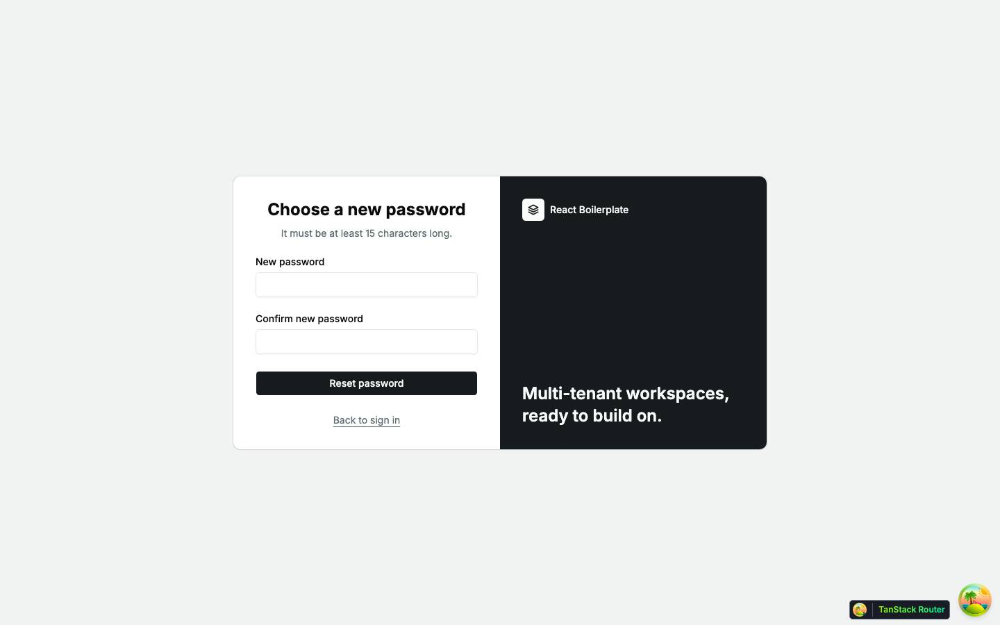

|                     |                                                                                                                                                            |
| ------------------- | ---------------------------------------------------------------------------------------------------------------------------------------------------------- |
| Purpose             | Set a new password with the token from the reset email.                                                                                                    |
| File                | `src/pages/reset-password.tsx`                                                                                                                             |
| Guard and redirects | none: top level, so a signed-in user can use a reset link. After a successful reset → toast "Your password has been reset. Sign in with it." and `/login`. |
| Layout              | `AuthLayout` + `AuthCard`, rendered by the page                                                                                                            |
| Data                | no query; `POST /auth/reset-password` on submit (the token rides in the form values, unrendered)                                                           |
| Sections            | New password and confirmation; `FormError` for a refused token                                                                                             |
| Components          | `Form`, `FormField`, `FormError`, `Input`, `Button`                                                                                                        |
| Transitions         | Reset password → `/login`; Back to sign in → `/login`; without a token, Request a new link → `/forgot-password`                                            |

| Empty                                                              |
| ------------------------------------------------------------------ |
| 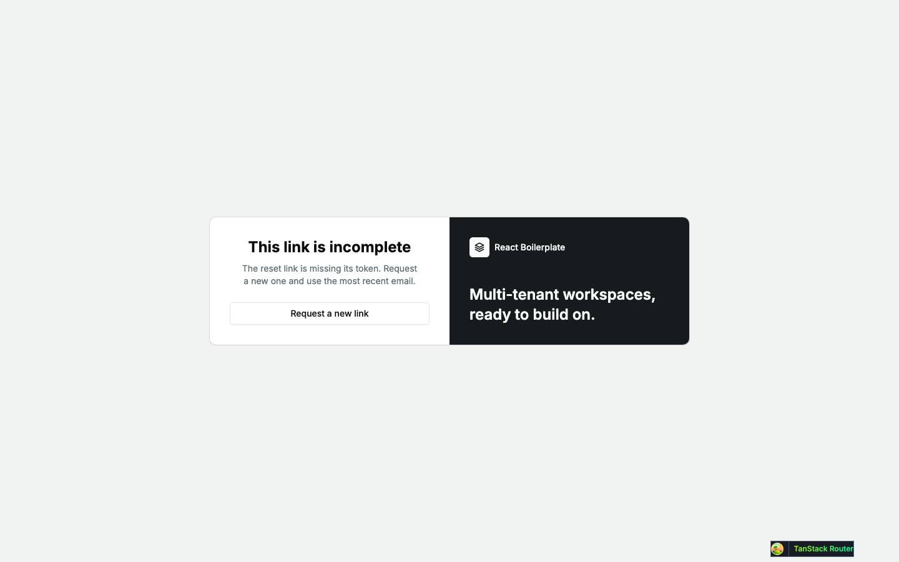                            |
| No `?token`: "This link is incomplete", with "Request a new link". |

### `/verify-email` — Verify your email

|                     |                                                                                                                                                                                                                                                                                  |
| ------------------- | -------------------------------------------------------------------------------------------------------------------------------------------------------------------------------------------------------------------------------------------------------------------------------- |
| Purpose             | Confirm the emailed verification token with the account's password.                                                                                                                                                                                                              |
| File                | `src/pages/verify-email.tsx`                                                                                                                                                                                                                                                     |
| Guard and redirects | none: top level. After success → toast "Your email is verified. Sign in to continue." and `/login`.                                                                                                                                                                              |
| Layout              | `AuthLayout` + `AuthCard`, rendered by the page                                                                                                                                                                                                                                  |
| Data                | no query; `POST /auth/verify-email` on submit; `POST /auth/resend-verification` from the resend form                                                                                                                                                                             |
| Sections            | A visible, editable "Verification token" field prefilled from `?token`, and a password field. After a failed try, a resend form ("Links expire. Enter your address and we will send a fresh one."). After `EMAIL_ALREADY_VERIFIED`, the server's message and a "Sign in" button. |
| Components          | `Form`, `FormField`, `FormError`, `Input`, `Button`, `FieldSeparator`                                                                                                                                                                                                            |
| Transitions         | Verify email → `/login`; Back to sign in → `/login`; Sign in (already verified) → `/login`                                                                                                                                                                                       |

| Empty                                                 |
| ----------------------------------------------------- |
|                  |
| No `?token`: the same form with an empty token field. |

Findings: [F-auth-1](findings.md#f-auth-1), [F-auth-2](findings.md#f-auth-2)

### `/auth/callback` — Google sign-in return

No shot: the page redirects as soon as it mounts.

|                     |                                                                                                                                                           |
| ------------------- | --------------------------------------------------------------------------------------------------------------------------------------------------------- |
| Purpose             | Where the API's Google callback lands; sends the user on.                                                                                                 |
| File                | `src/pages/auth/callback.tsx`                                                                                                                             |
| Guard and redirects | none (top level). In an effect: signed in → `/dashboard`, else `/login?error=google_auth_failed`, which toasts "Google sign-in failed. Please try again." |
| Layout              | `AuthLayout` + `AuthCard` titled "Signing in", with a spinner and "Completing sign-in…" (`role="status"`) for the instant before the redirect             |
| Data                | no query; the session restore has already used the cookie the API set                                                                                     |
| Components          | `AuthCard`, `IconLoader2`                                                                                                                                 |
| Transitions         | → `/dashboard` or `/login?error=google_auth_failed`                                                                                                       |

The walk confirmed both exits: signed in, `/auth/callback` landed on `/dashboard`; signed out, on `/login?error=google_auth_failed`.

### `/invitations/accept` — Accept an invitation

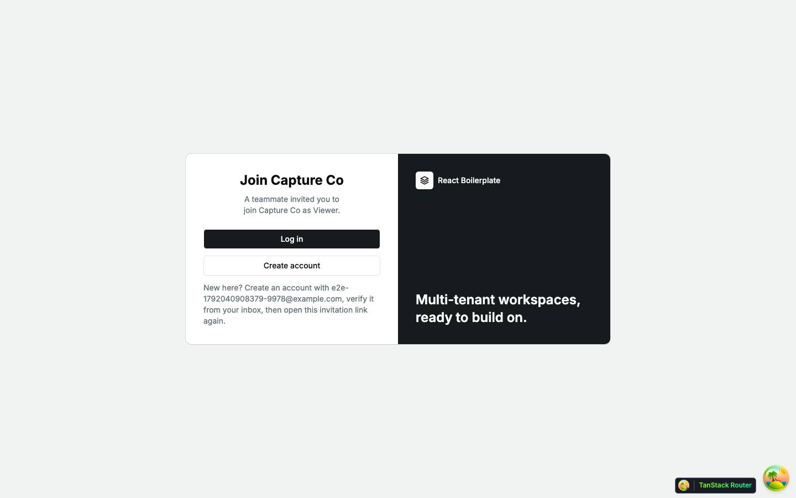

|                     |                                                                                                                                                                                                                       |
| ------------------- | --------------------------------------------------------------------------------------------------------------------------------------------------------------------------------------------------------------------- |
| Purpose             | The landing page of an invitation email: preview the invitation, then sign in, switch account or accept.                                                                                                              |
| File                | `src/pages/invitations/accept.tsx`                                                                                                                                                                                    |
| Guard and redirects | none: top level, opened signed out and signed in alike. Log in → `/login?redirect=/invitations/accept?token=…`; Create account → `/register?email=<invited address>`.                                                 |
| Layout              | `AuthLayout` + `AuthCard` (`InvitationCard`), rendered by the page                                                                                                                                                    |
| Data                | started: `POST /invitations/preview` (`['invitations', 'preview', token]`; no auth; a failure other than 404 is retried once); `POST /invitations/accept` on accept; `POST /auth/logout` from the wrong-account state |
| Sections            | Chosen by `?token` and who is signed in, below.                                                                                                                                                                       |
| Components          | `AuthCard`, `Skeleton`, `LoadError`, `Button`, `Pii`                                                                                                                                                                  |
| Transitions         | Log in → `/login` and back here; Create account → `/register`; Sign out → here, signed out; Accept invitation → `/tenants/$slug`; Go to the home page → `/`                                                           |

The page has these states (`AcceptInvitationPage` and `InvitationForToken`):

1. **No `?token`:** "This link is incomplete" and "Go to the home page" (shot: empty).
2. **Malformed token** (fails `invitationTokenSchema`): "This invitation can't be used" with the server's 404 copy, no request made. Seen in the walk with `?token=not-a-real-token`.
3. **Preview pending:** "Checking your invitation" over two skeleton bars (shot: loading).
4. **Preview failed with 404** (revoked, expired or used): "This invitation can't be used" with the server's message.
5. **Preview failed otherwise:** "We could not load this invitation", a `LoadError` with Try again, and "Go to the home page" (shot: error).
6. **Signed out** (`SignedOut`): "Join {tenant}", "{inviter} invited you to join {tenant} as {role}.", Log in, Create account, and a hint to create the account with the invited address (shot: default).
7. **Signed in as another address** (`WrongAccount`): the same title and sentence, "This invitation was sent to {invited}. You're signed in as {current}.", a Sign out button that returns here signed out, and "Go to the home page". Not shot.
8. **Signed in as the invited address** (`AcceptPanel`): the same title and sentence, Accept invitation ("Accepting…" while pending) and "Go to the home page". A 403 shows the refusal inline (`role="alert"`), with a hint to verify the email when the code is `INVITATION_EMAIL_UNVERIFIED`; a 404 replaces the panel with state 4; other failures toast. Success toasts "You joined {tenant}." and opens `/tenants/$slug`. Not shot.

| Loading                                      | Error                                      | Empty                                      |
| -------------------------------------------- | ------------------------------------------ | ------------------------------------------ |
| 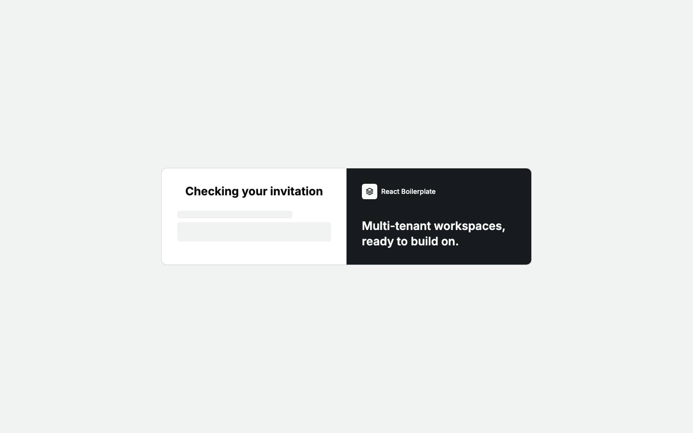 | 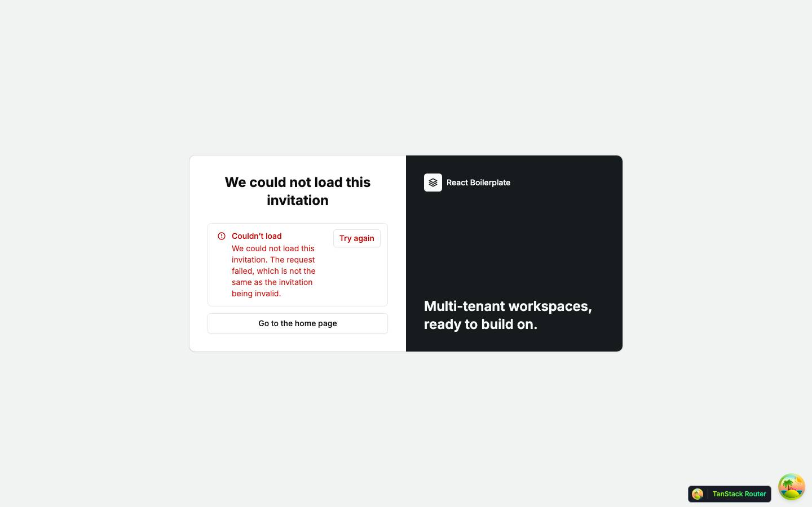 | 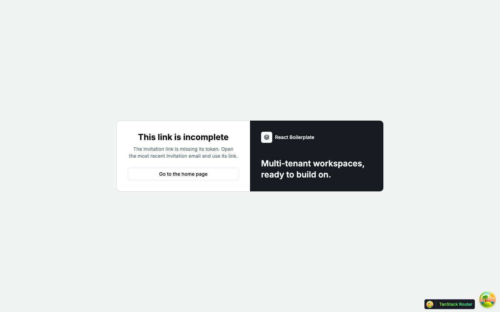 |
| skeleton · `h-4 w-3/4` + `h-10`              | alert · `LoadError`                        | No `?token`: "This link is incomplete"     |

Findings: [F-auth-3](findings.md#f-auth-3), [F-auth-4](findings.md#f-auth-4)
