# Boot

This file covers what a cold load of the app does, from `index.html` to the first page, and what the screen shows meanwhile. A cold load is a full page load with nothing in memory. Back to the [route map](README.md#route-map).

API paths below start with `/api/v1`, the application programming interface (API) prefix; the summaries drop it.

## What happens

1. The browser parses `index.html`. Its `<head>` runs three blocking scripts:
   - `/theme-init.js` sets the `dark` class on `<html>` from the stored theme or the system preference.
   - `/boot-variant.js` marks `<html data-boot="auth">` on an auth path.
   - `/runtime-config.js` holds the run-time settings.

   `#root` already holds the static boot shell: `.boot-shell` with `role="status"`, a visually hidden "Loading…", and the app or auth variant that `/boot-variant.js` picked. The inline `<style>` blocks in `<head>` style it.

2. `src/main.tsx` loads as a module. Its imports bring in the router (`src/router.tsx`) and `src/styles/globals.css`, and it calls `router.load()` before React mounts anything.
3. `__root`'s `beforeLoad` awaits `bootstrapSession()`: `POST /api/v1/auth/refresh` with the refresh cookie (a 401 when signed out). When the refresh succeeds, it then awaits `GET /api/v1/profile`.
4. The matched layout's guard runs. `_auth` sends a signed-in user to `/dashboard`. `_app` sends a signed-out user to `/login?redirect=<the URL>`.
5. `_app`'s loader awaits the flags, at most 10 s (`FLAGS_BOOT_WAIT_MS`): `GET /api/v1/flags`, or `GET /api/v1/tenants/:slug/flags` on a tenant page. The tenant layouts (`/tenants/$slug`, `/settings/workspace/$slug`) start `GET /api/v1/tenants/:slug` without waiting on it. `/tenants/$slug/beta` awaits the tenant's flags in its `beforeLoad`, under the same cap.
6. React mounts (`createRoot().render()`) once two things are true: `router.load()` has settled, resolved or rejected, and the pending templates' chunks have loaded. If the chunks have not loaded after `TEMPLATES_WAIT_MS` (3 s), React mounts anyway.
   - `loading.catch` logs a rejection of the load, and the mount chain's `.catch` logs a throw from the mount.
   - The first commit replaces the shell with the matched page, whose sections show their own skeletons.
   - Until this point the shell is the only thing on screen, however long steps 3 to 5 take.
7. After mount, on a page without `$slug`, `TenantSearchGuard` reads `GET /api/v1/tenants`. Until the list lands, the page slot shows the pending template of the route directly under `_app`: the dashboard template on `/dashboard`, the list template on `/tenants`. The guard then fixes `?tenant=` with a replace.
8. Also after mount:
   - `MaintenanceGate` (in `__root`) starts `GET /api/v1/status/maintenance`.
   - On `_app` pages, the bell starts `GET /api/v1/notifications?limit=20` and opens `GET /api/v1/notifications/stream`.
   - Analytics starts (`initAnalytics()`), and posthog-js fetches its config and extensions through `/api/v1/collect/…`.

A signed-in cold load of `/tenants` in the capture made these requests, in the order they were recorded:

1. Before React mounts: `POST /auth/refresh` 200, `GET /profile` 200, `GET /flags` 200.
2. After mount, in no fixed order: the notifications stream, `GET /status/maintenance`, `GET /tenants` and `GET /notifications`.

A signed-out load of any `_auth` page makes three requests of its own: `/runtime-config.js`, `POST /auth/refresh` 401 and `GET /status/maintenance`.

## Frame by frame

Each table below is a Chrome DevTools Protocol (CDP) screencast of one cold load (`e2e/capture/boot.test.ts`), unthrottled, with the cache disabled.

- Times are in milliseconds (ms) from the first distinct frame. Consecutive identical frames are dropped.
- Each scenario keeps a time-spread sample of its distinct frames, at most 16, so the gaps between rows are not frame intervals. The sample always includes four marked frames:
  - `first-paint`: the first distinct frame.
  - `shell`: the first frame at or after the shell's first appearance in `#root`.
  - `first-content`: the first frame at or after the shell's replacement.
  - `ready`: the last frame.
- The `first-content` frame can precede the page's first drawn frame by one. The mark is the Document Object Model (DOM) change, and the screencast stamps the compositor's frame.
- Frame files are named `<scenario>--<nn>.jpg`, so a rerun rewrites the same files. `capture-records/boot.json` records each frame's `ms` and label. A frame that marks two moments carries both, joined by `+`.

The dev frames come from `vite dev` (`signed-…`). The production frames (`nginx-signed-…`) come from `vite preview` of the production build on the capture machine: the same `dist/` the image serves, without nginx. `e2e/nginx/boot-shell.test.ts` pins the image's Content Security Policy (CSP) and first paint. The capture runs in the light theme, so these frames do not show the dark theme.

### Signed out, `/login`

The auth shell paints the sign-in card as it renders: a title bar, a description bar, one labelled field bar, a button bar, a separator and a second button bar (`public/boot-variant.js` picks it, `index.html`'s `<style id="boot-shell">` draws it, and `AuthPending` matches it). The frames below show the password-era card instead: a title bar and three field bars. Running `pnpm capture:pages` retakes them.

Dev (`signed-out-login`):

| Frame                                  | ms   | Moment        | What it shows                                                                                              |
| -------------------------------------- | ---- | ------------- | ---------------------------------------------------------------------------------------------------------- |
|  | 0    | first-paint   | A blank white page: the browser's own frame before the document paints.                                    |
|  | 98   | shell         | The auth shell: a card with a title bar and three field bars on the muted background, styled.              |
|  | 249  |               | As the frame above; only the shimmer differs.                                                              |
|  | 364  |               | As the frame above; only the shimmer differs.                                                              |
|  | 499  |               | As the frame above; only the shimmer differs.                                                              |
|  | 615  |               | As the frame above; only the shimmer differs.                                                              |
|  | 748  |               | As the frame above; only the shimmer differs.                                                              |
|  | 866  |               | As the frame above; only the shimmer differs.                                                              |
|  | 1015 | first-content | The shell still: the first frame at or after the DOM change, before the compositor draws the mounted page. |
| 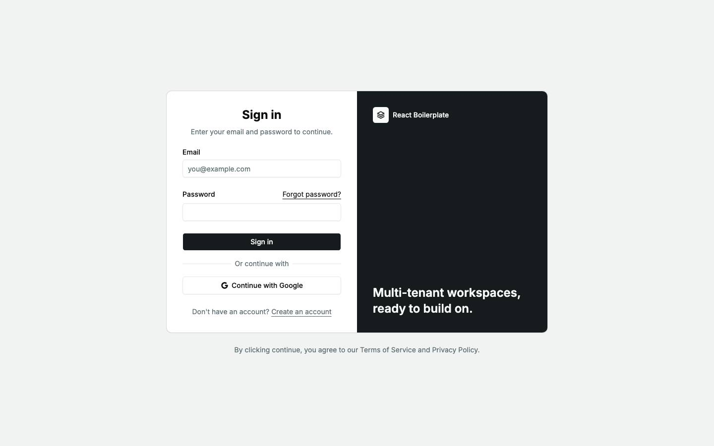 | 1035 |               | The sign-in page: form on the left, brand panel on the right.                                              |
|  | 1436 |               | As above, with the TanStack devtools button (dev only) in the corner.                                      |
| 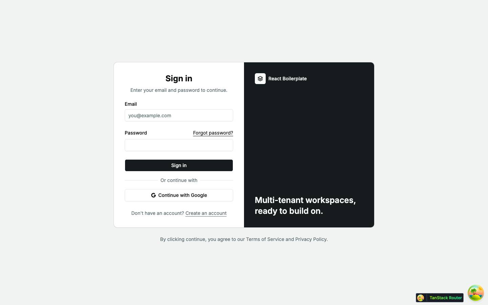 | 1492 |               | As above, with both TanStack devtools buttons (dev only) in the corner.                                    |
| 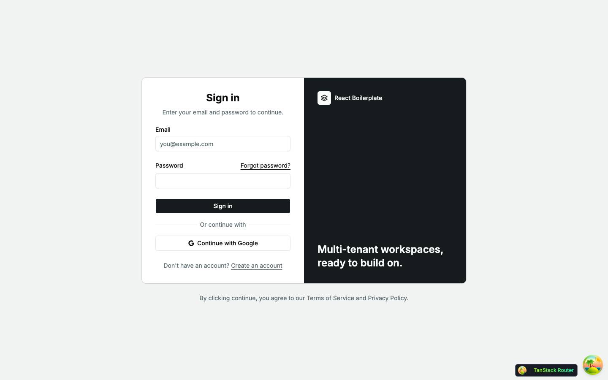 | 1616 | ready         | As above, with both TanStack devtools buttons (dev only) in the corner.                                    |

Production (`nginx-signed-out-login`):

| Frame                                        | ms  | Moment              | What it shows                                                                                 |
| -------------------------------------------- | --- | ------------------- | --------------------------------------------------------------------------------------------- |
|  | 0   | first-paint         | A blank white page: the browser's own frame before the document paints.                       |
|  | 31  | shell               | The auth shell: a card with a title bar and three field bars on the muted background, styled. |
|  | 130 | first-content+ready | The sign-in page: the same frame carries the `first-content` and `ready` marks.               |

### Signed in, `/dashboard`

Dev (`signed-in-dashboard`):

| Frame                                     | ms   | Moment        | What it shows                                                                                                                                                   |
| ----------------------------------------- | ---- | ------------- | --------------------------------------------------------------------------------------------------------------------------------------------------------------- |
|  | 0    | first-paint   | A blank white page: the browser's own frame before the document paints.                                                                                         |
|  | 388  | shell         | The app shell: sidebar bars, a header bar and a large block, styled, with the 255 px sidebar.                                                                   |
|  | 545  |               | As the frame above; only the shimmer differs.                                                                                                                   |
| 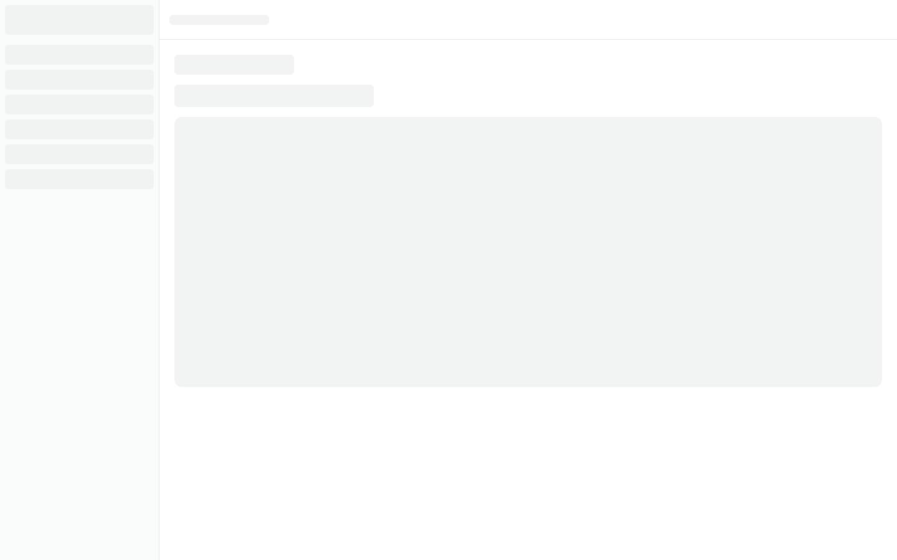 | 696  |               | As the frame above; only the shimmer differs.                                                                                                                   |
| 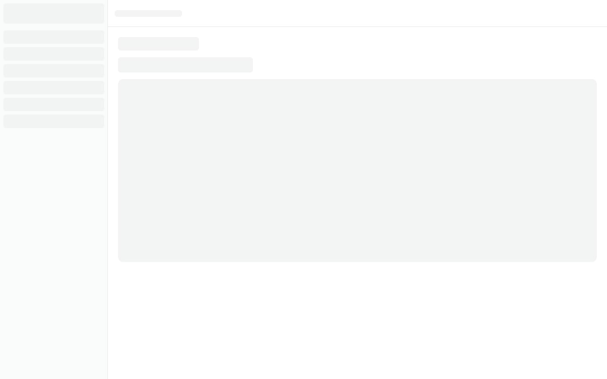 | 830  |               | As the frame above; only the shimmer differs.                                                                                                                   |
| 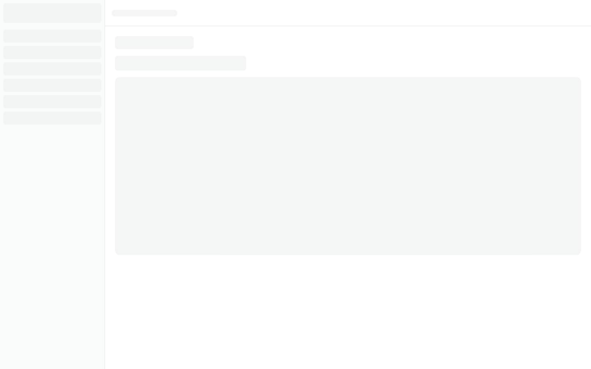 | 962  |               | As the frame above; only the shimmer differs.                                                                                                                   |
| 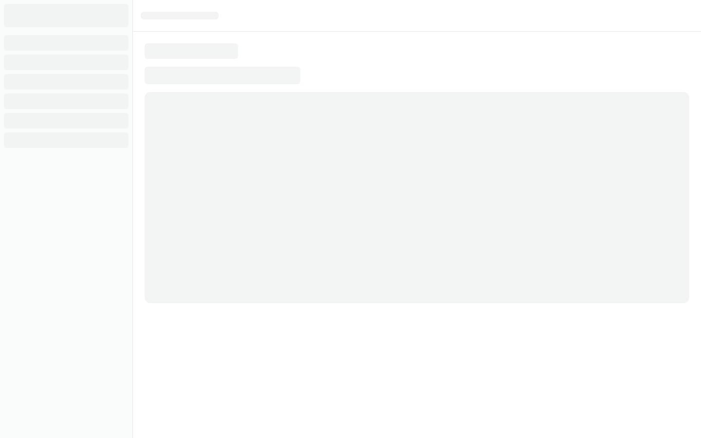 | 1113 |               | As the frame above; only the shimmer differs.                                                                                                                   |
| 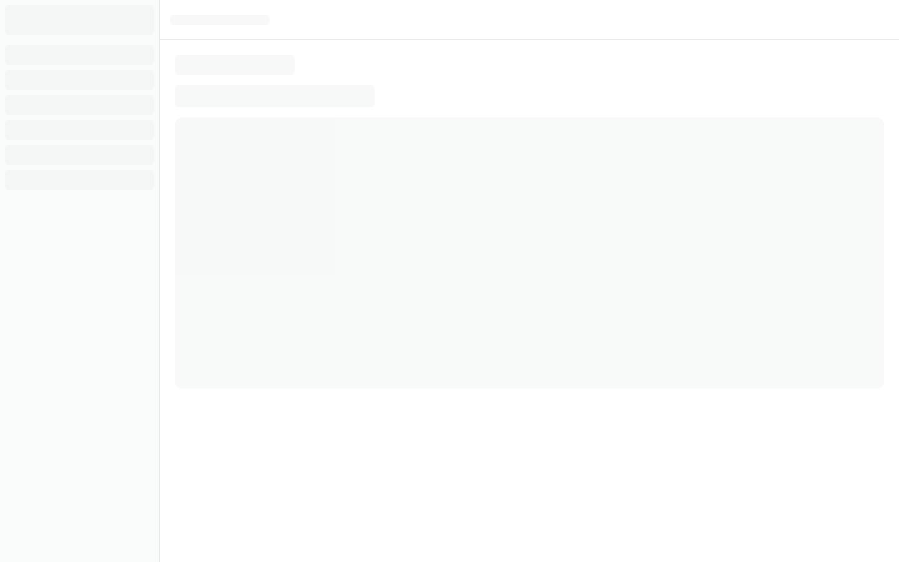 | 1227 | first-content | The shell still: the first frame at or after the DOM change, before the compositor draws the mounted page.                                                      |
|  | 1233 |               | The mounted app: the real sidebar and header, "Loading workspaces…" in the switcher, and the dashboard template (four stat cards, two panels) in the page slot. |
|  | 1261 |               | The dashboard: "Choose a workspace" in the switcher, the welcome card, the bell with a badge of 1.                                                              |
|  | 1616 |               | As above, with the TanStack devtools button (dev only) in the corner.                                                                                           |
| 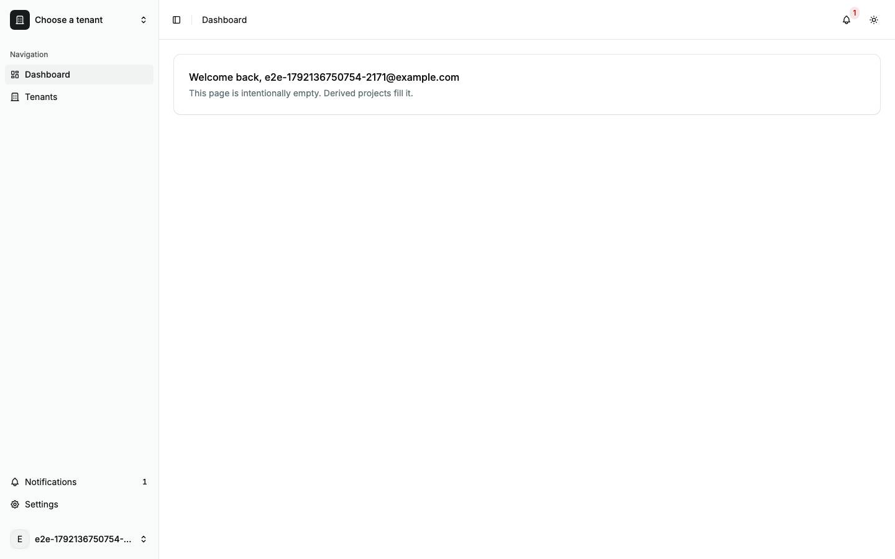 | 1674 |               | As above, with both TanStack devtools buttons (dev only) in the corner.                                                                                         |
| 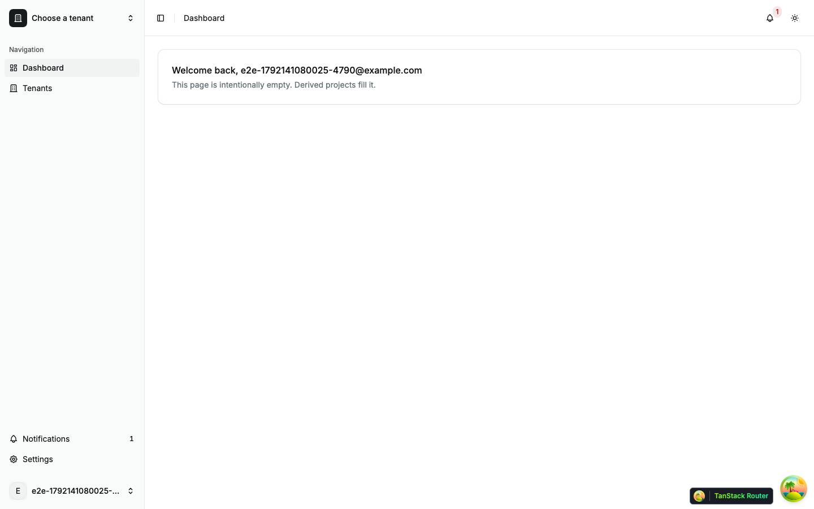 | 1795 | ready         | As above, with both TanStack devtools buttons (dev only) in the corner.                                                                                         |

Production (`nginx-signed-in-dashboard`):

| Frame                                           | ms  | Moment        | What it shows                                                                                                                                                   |
| ----------------------------------------------- | --- | ------------- | --------------------------------------------------------------------------------------------------------------------------------------------------------------- |
|  | 0   | first-paint   | A blank white page: the browser's own frame before the document paints.                                                                                         |
|  | 34  | shell         | The app shell: sidebar bars, a header bar and a large block, styled, with the 255 px sidebar.                                                                   |
|  | 123 |               | As the frame above; only the shimmer differs.                                                                                                                   |
|  | 140 |               | As the frame above; only the shimmer differs.                                                                                                                   |
|  | 174 |               | As the frame above; only the shimmer differs.                                                                                                                   |
|  | 207 |               | As the frame above; only the shimmer differs.                                                                                                                   |
|  | 222 | first-content | The shell still: the first frame at or after the DOM change, before the compositor draws the mounted page.                                                      |
| 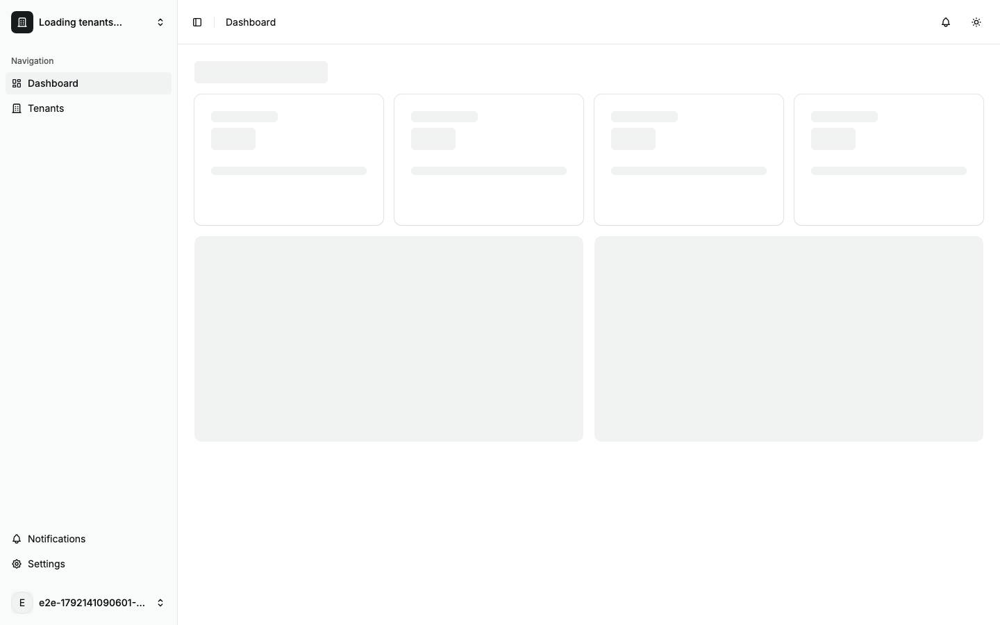 | 229 |               | The mounted app: the real sidebar and header, "Loading workspaces…" in the switcher, and the dashboard template (four stat cards, two panels) in the page slot. |
|  | 260 | ready         | The dashboard: "Choose a workspace" in the switcher, the welcome card, the bell with a badge of 1.                                                              |

### Signed in, `/tenants`

Dev only (`signed-in-tenants`):

| Frame                                   | ms   | Moment            | What it shows                                                                                                                                                               |
| --------------------------------------- | ---- | ----------------- | --------------------------------------------------------------------------------------------------------------------------------------------------------------------------- |
|  | 0    | first-paint+shell | The app shell already: the first distinct frame is the shell, with no blank frame before it. Sidebar bars, a header bar and a large block, styled, with the 255 px sidebar. |
|  | 98   |                   | The app shell: sidebar bars, a header bar and a large block, styled, with the 255 px sidebar.                                                                               |
|  | 198  |                   | As the frame above; only the shimmer differs.                                                                                                                               |
|  | 298  |                   | As the frame above; only the shimmer differs.                                                                                                                               |
|  | 416  |                   | As the frame above; only the shimmer differs.                                                                                                                               |
|  | 515  |                   | As the frame above; only the shimmer differs.                                                                                                                               |
| 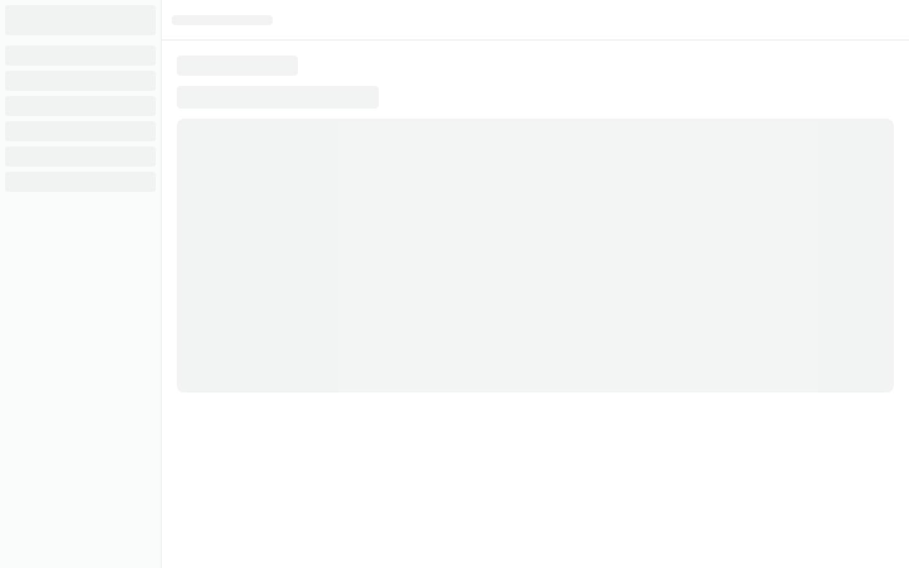 | 615  |                   | As the frame above; only the shimmer differs.                                                                                                                               |
| 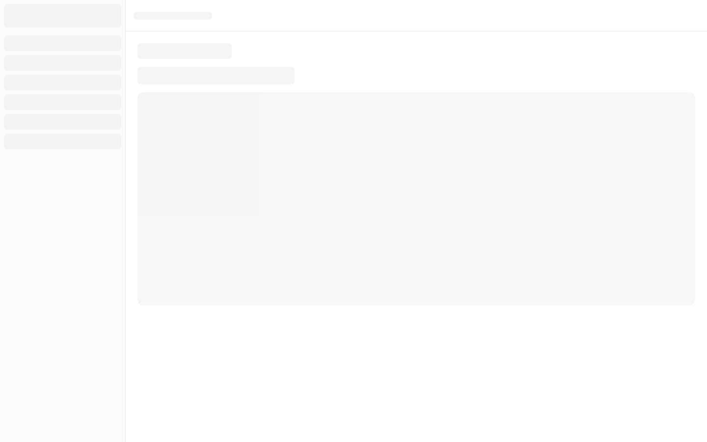 | 731  |                   | As the frame above; only the shimmer differs.                                                                                                                               |
| 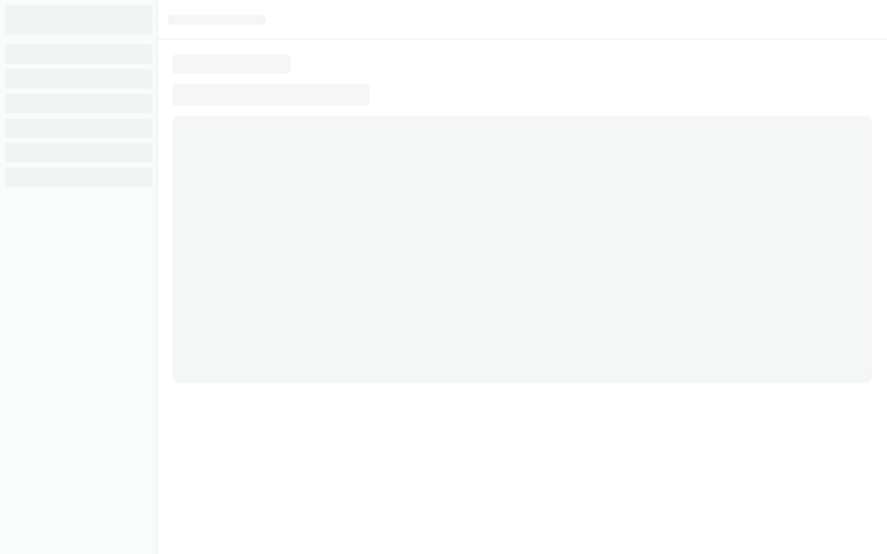 | 813  |                   | As the frame above; only the shimmer differs.                                                                                                                               |
|  | 831  | first-content     | The shell still: the first frame at or after the DOM change, before the compositor draws the mounted page.                                                                  |
|  | 919  |                   | The mounted app: the real sidebar and header, "Loading workspaces…" in the switcher, and the list template (heading, toolbar, eight table rows) in the page slot.           |
| 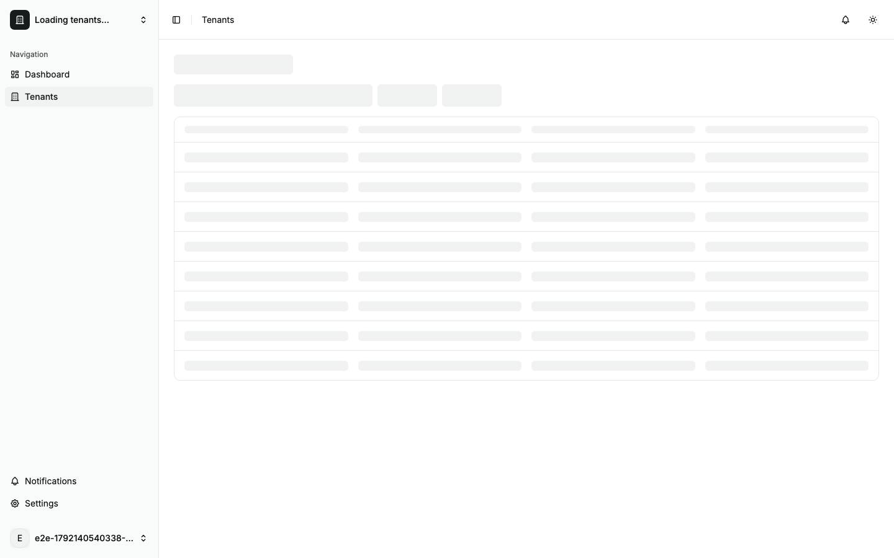 | 954  |                   | The tenants page for an account with no tenants: "This account isn’t a member of any workspace." and the create form.                                                       |
| 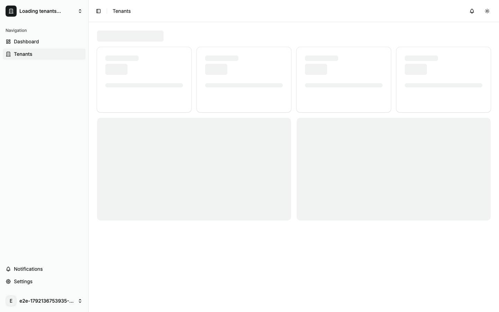 | 1191 |                   | As above, with the TanStack devtools button (dev only) in the corner.                                                                                                       |
| 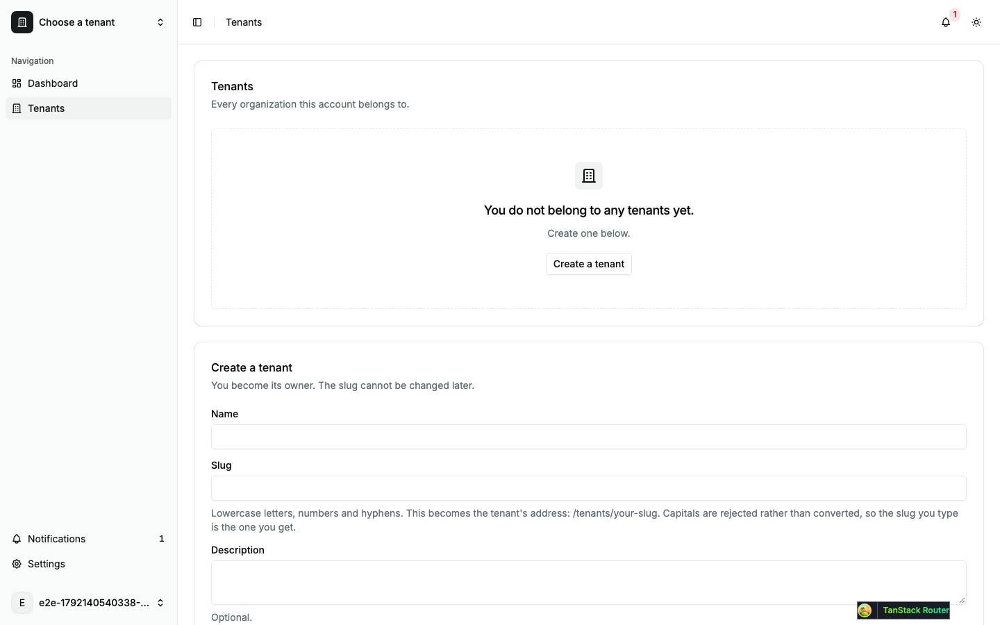 | 1249 |                   | As above, with both TanStack devtools buttons (dev only) in the corner.                                                                                                     |
| 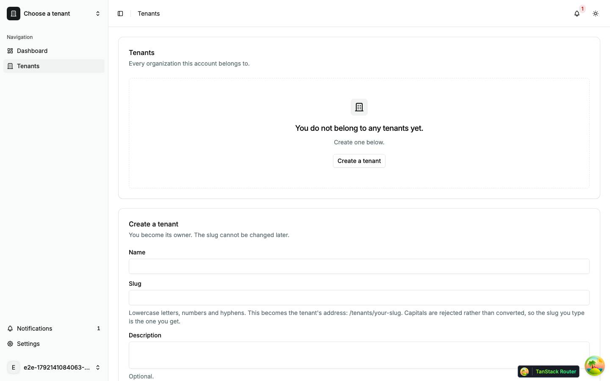 | 1331 |                   | As above, with both TanStack devtools buttons (dev only) in the corner.                                                                                                     |
| 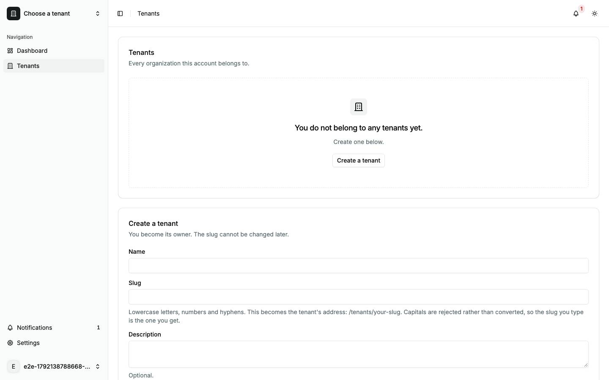 | 1431 | ready             | As above, with both TanStack devtools buttons (dev only) in the corner.                                                                                                     |

These are fast loads: every request answered at once. When a request that the boot awaits is slow, the shell stays up for as long as the request takes, up to the 10 s cap on the flags read.

## The first frame

The shell's inline Cascading Style Sheets (CSS) paint it in both builds. After the first blank frame, which is the browser's own, no frame of either build shows unstyled text or a bare browser page. The dev `/tenants` capture's first distinct frame is already the shell.

`globals.css` arrives later and only replaces the shell's own values with the same ones. The shell sets `box-sizing: border-box` on its own boxes, so under `vite dev` the sidebar is 255 px and the auth card 770 px from the first frame. Those are the sizes the app has once the stylesheet lands.

## The handoff

On `/login` the frame after the shell is the page.

On an `_app` page without `$slug`, React mounts once the first load has resolved. The first app frame has the real sidebar and header and "Loading workspaces…" in the switcher. Until the tenant list lands, the page slot holds the pending template of the route directly under `_app` (`TenantSearchGuard`): the dashboard template on `/dashboard`, the list template on `/tenants`. Then the page replaces the template.

The list template shares the shell's sizes: its table block is `calc(26.5rem + 10px)`, a header row, eight rows and their borders. The shell and the guard's hold on `/tenants` are therefore one shape. The router's own pending templates (`defaultPendingMs`, 300 ms) show only on an in-app navigation that is still pending after that time.

## In-app navigation

A cold load shows only the boot shell, so the route and section templates are shot on an in-app navigation (`e2e/capture/navigation.test.ts`). Each navigation starts from a settled page and runs twice: once with the target route's code held, once with only its section requests held.

`capture-records/navigation.json` records two values per navigation:

- `routeTemplate`: the Loading status appeared with the code held.
- `sectionSkeleton`: a busy section showed skeleton bars with its requests held.

All three recorded `true`. Each route shot's check names the template it expects (`data-variant`, `data-nested` on the skeleton's root), so `true` means the target's own template showed.

| Navigation                         | Route template (code held)                                                                                  | Section skeletons (requests held)                                                                                 |
| ---------------------------------- | ----------------------------------------------------------------------------------------------------------- | ----------------------------------------------------------------------------------------------------------------- |
| Settings, Profile to Notifications | [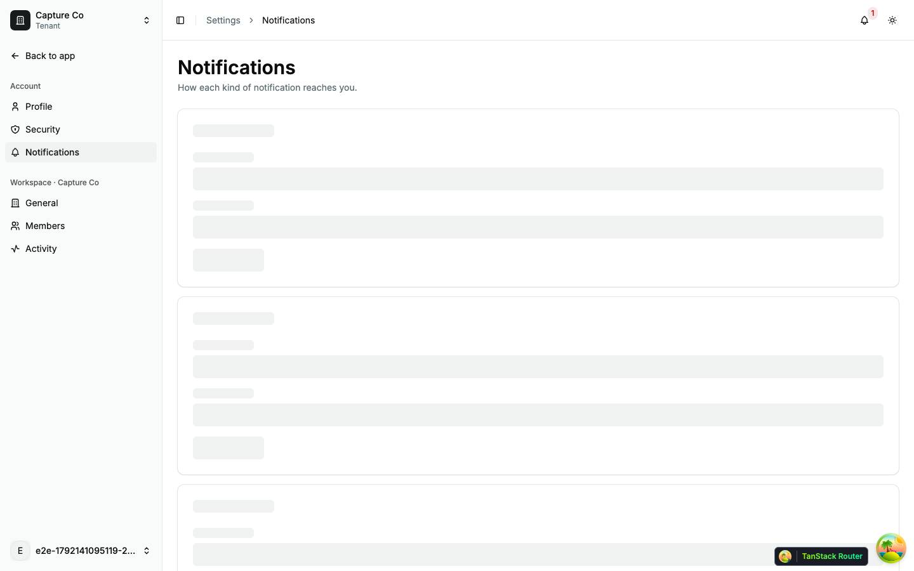](img/settings/account-notifications--nav-route.jpg) | [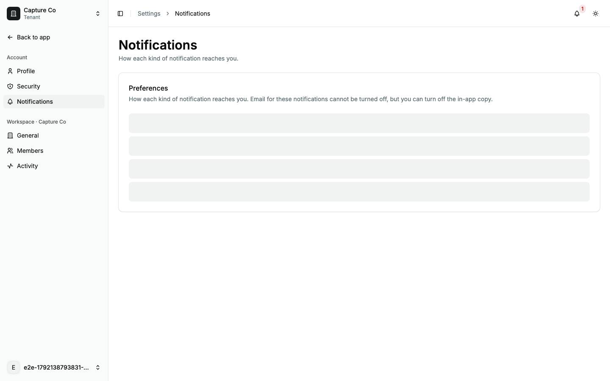](img/settings/account-notifications--nav-sections.jpg) |
| Tenants to the tenant's overview   | [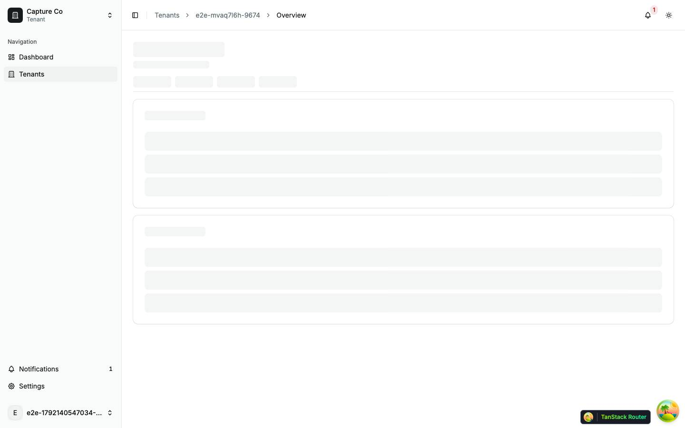](img/tenants/tenant-overview--nav-route.jpg)               | [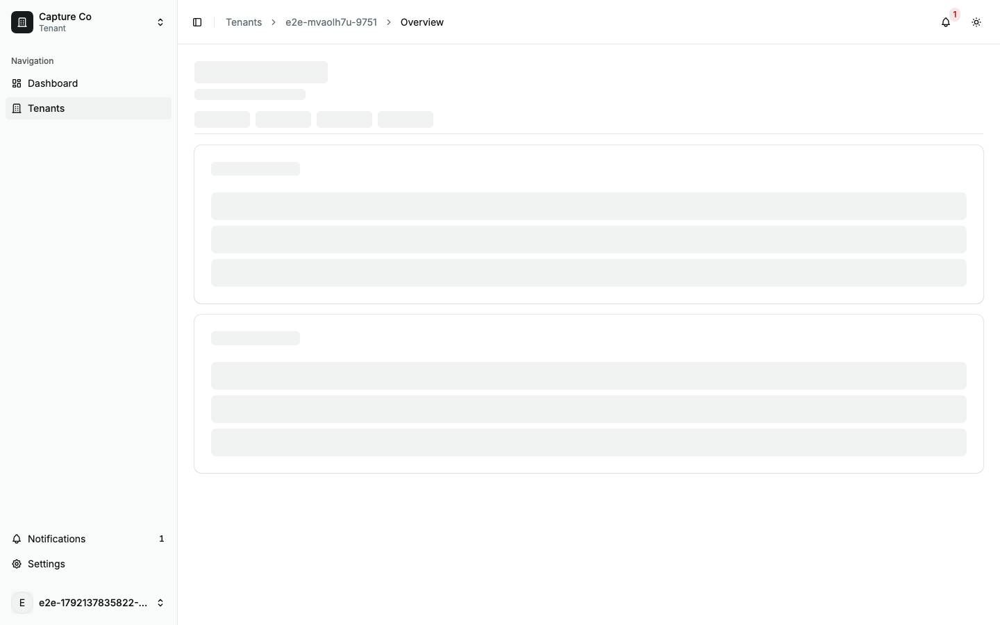](img/tenants/tenant-overview--nav-sections.jpg)               |

- **Notifications, route template:** the settings shell stays, with the page's real heading and subtitle, and the page slot shows the nested settings template (stacked cards of field bars). The shot also shows the TanStack Router devtools button, which is dev-only.
- **Notifications, sections:** the real heading and the card's own title with four preference bars.
- **Security** has no navigation shots; running `pnpm capture:pages` takes them. Its sign-in methods sit on a heading bar and two row bars above the real "Other sessions" block, which needs no request.
- **Tenant overview, route template:** the app chrome stays (sidebar, header, breadcrumb already reading Workspaces, the slug and Overview), with the detail template in the page slot: heading and subtitle bars, tab bars and two cards of rows.
- **Tenant overview, sections:** the same chrome and detail layout on two cards of rows, with the requests held.

## Dev and production

- **Dev-only:** the module-by-module fetches under `/src/…`; the TanStack devtools buttons.
- **Both:** before React mounts, the boot waits on `POST /auth/refresh`, `GET /profile`, and on `_app` pages the flags (up to 10 s, the cap in `ensureFlags`). It waits on nothing else: the tenant list and the tenant reads happen after mount, under the app's own chrome.
- **Both:** a signed-out load logs one console error, the browser's own "Failed to load resource" line for the `POST /auth/refresh` 401. The 401 is how the app learns it is signed out, so the line is expected. No page script logs an error.
