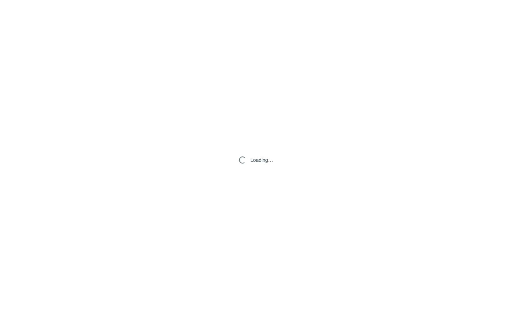
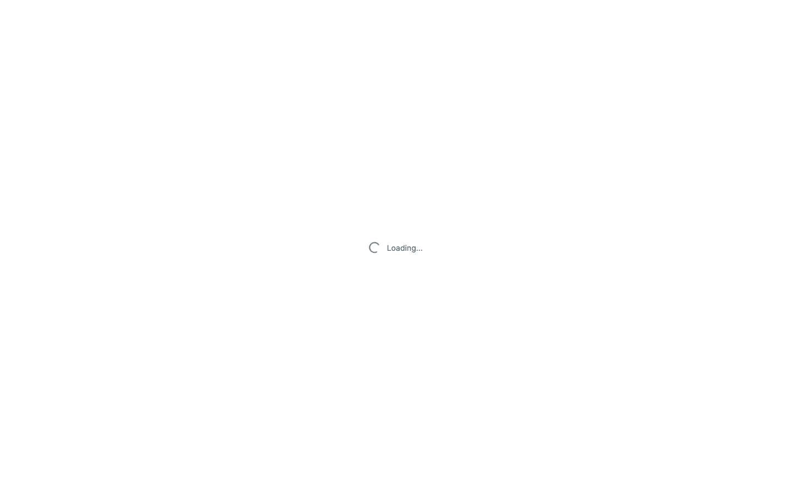
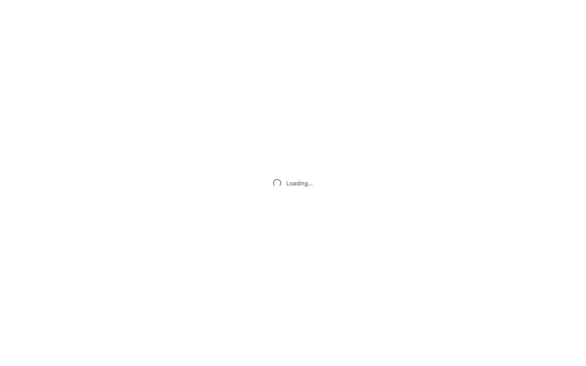
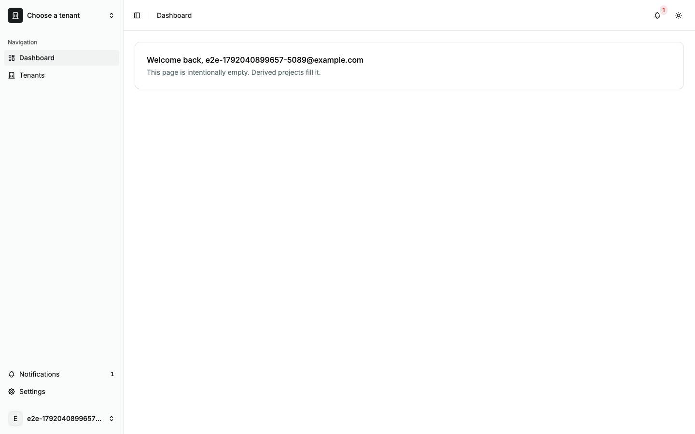
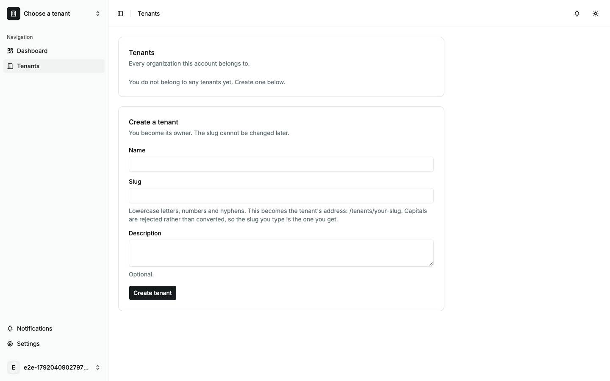

# Boot

What a cold load of the app does, from `index.html` to the first page, and what it looks like while it does it. Back to the [route map](README.md#route-map).

## What happens

1. The browser parses `index.html`. Its `<head>` runs two blocking scripts: `/theme-init.js`, which sets the `dark` class on `<html>` from the stored theme or the system preference, and `/runtime-config.js`, the run-time settings. `#root` already holds the static splash: a `.boot-splash` element with `role="status"`, a spinner and the text "Loading…".
2. `src/main.tsx` loads as a module. Its imports bring in the router (`src/router.tsx`) and `src/styles/globals.css`, and it calls `router.load()` before React mounts anything.
3. `__root`'s `beforeLoad` awaits `bootstrapSession()`: `POST /api/v1/auth/refresh` with the refresh cookie (a 401 when signed out), then, when the refresh succeeds, `GET /api/v1/profile`.
4. The matched layout's guard runs. `_auth` sends a signed-in user to `/dashboard`. `_app` sends a signed-out user to `/login?redirect=<the URL>`; for a signed-in user on a page without `$slug`, its tenant guard (`src/lib/tenant-guard.ts`) awaits `GET /api/v1/tenants` for at most 3 s (`TENANT_LIST_WAIT_MS`) and fixes `?tenant=`.
5. `_app`'s loader awaits the flags: `GET /api/v1/flags`, or `GET /api/v1/tenants/:slug/flags` on a tenant page. The tenant layouts (`/tenants/$slug`, `/settings/workspace/$slug`) also await `GET /api/v1/tenants/:slug` in their loaders, and `/tenants/$slug/beta` awaits the tenant's flags in its `beforeLoad`.
6. `router.load()` settles, whether it resolved or rejected, and React mounts (`createRoot().render()` in the `finally`). The first commit replaces the splash with the matched page. Until this point the splash is the only thing on screen, however long steps 3 to 5 take.
7. After mount: `MaintenanceGate` (in `__root`) starts `GET /api/v1/status/maintenance`; on `_app` pages the bell starts `GET /api/v1/notifications?limit=20` and opens `GET /api/v1/notifications/stream`; analytics starts (`initAnalytics()`), and posthog-js fetches its config and extensions through `/api/v1/collect/…`.

A signed-in reload of `/tenants` in Chrome showed exactly this order: `POST /auth/refresh` 200, `GET /profile` 200, `GET /tenants` 200, `GET /flags` 200, then the `/collect/…` scripts, the notifications stream, `GET /notifications?limit=20` and `GET /status/maintenance`. A signed-out load of any `_auth` page makes three requests of its own: `/runtime-config.js`, `POST /auth/refresh` 401 and `GET /status/maintenance`.

## Frame by frame

A CDP screencast of each cold load (`e2e/capture/boot.test.ts`), unthrottled, cache disabled, against `vite dev`. Times are from the first distinct frame. Consecutive identical frames are dropped, and when a scenario has more than twelve, a time-spread sample is kept, so the gaps between rows are not frame intervals.

### Signed out, `/login`

| Frame                                        | ms  | What it shows                                                                                                                       |
| -------------------------------------------- | --- | ----------------------------------------------------------------------------------------------------------------------------------- |
|    | 0   | A blank white page.                                                                                                                 |
|   | 69  | The splash without its CSS: "Loading…" in the browser's default black serif, top-left. The spinner span is empty, so nothing spins. |
|  | 557 | The styled splash: grey spinner and "Loading…", centred, on white.                                                                  |
|  | 564 | The styled splash; only the spinner's angle differs.                                                                                |
|  | 581 | The styled splash.                                                                                                                  |
|  | 596 | The styled splash.                                                                                                                  |
|  | 613 | The styled splash.                                                                                                                  |
|  | 644 | The styled splash.                                                                                                                  |
|  | 662 | The styled splash.                                                                                                                  |
|  | 681 | The sign-in page, on the muted auth background.                                                                                     |

### Signed in, `/dashboard`

| Frame                                           | ms  | What it shows                                                                                                 |
| ----------------------------------------------- | --- | ------------------------------------------------------------------------------------------------------------- |
|    | 0   | A blank white page.                                                                                           |
|   | 23  | The unstyled splash, "Loading…" top-left.                                                                     |
|  | 590 | The styled splash, centred.                                                                                   |
|  | 656 | The styled splash.                                                                                            |
|  | 723 | The styled splash.                                                                                            |
|  | 804 | The styled splash.                                                                                            |
|  | 893 | The dashboard in the app shell: sidebar with "Choose a tenant", the welcome card, the bell with a badge of 1. |

### Signed in, `/tenants`

| Frame                                         | ms  | What it shows                                                                                                                   |
| --------------------------------------------- | --- | ------------------------------------------------------------------------------------------------------------------------------- |
|    | 0   | A blank white page.                                                                                                             |
|   | 32  | The unstyled splash, "Loading…" top-left.                                                                                       |
|  | 544 | The styled splash, centred.                                                                                                     |
|  | 593 | The styled splash.                                                                                                              |
|  | 660 | The styled splash.                                                                                                              |
|  | 742 | The styled splash.                                                                                                              |
|  | 812 | The tenants page for an account with no tenants: "You do not belong to any tenants yet. Create one below." and the create form. |

In all three loads the unstyled splash is on screen for about half a second (from 23–69 ms to 544–590 ms), and the styled splash for a further 0.1–0.3 s. These are fast loads: every request answered at once. When a request that the boot awaits is slow, the styled splash stays up for as long as it takes ([F-boot-2](findings.md#f-boot-2)).

## Why the first frame is unstyled

The splash markup lives in `index.html`, but its only styles (`.boot-splash`, `.boot-splash-spinner`) are in `src/styles/globals.css`. Under `vite dev` that stylesheet is not linked from the page: `src/main.tsx` imports it, and Vite turns the import into a JavaScript module that injects a `<style>` tag when it runs. So the CSS arrives only after the browser has fetched and run the module graph up to that import, about half a second on a cold dev load, and until then the splash renders as unstyled inline text in the top-left corner. A production build (`vite build`) extracts the CSS and links it from `<head>` (`<link rel="stylesheet" href="/assets/index-….css">`), so there the splash is styled from its first paint. The comment above `.boot-splash` in `globals.css`, which says the splash is painted from the stylesheet before any script runs, holds for the production build only. Finding: [F-boot-1](findings.md#f-boot-1).

The same gap applies to the page background: `theme-init.js` sets the `dark` class before first paint, but the colours it selects are also in `globals.css`, so under `vite dev` a dark-theme user should see white until the CSS lands. That follows from the code; the boot capture runs in the light theme and did not record it.

## Dev and production

- **Dev-only:** the unstyled first frames and their half-second duration ([F-boot-1](findings.md#f-boot-1)); the module-by-module fetches under `/src/…`; the TanStack devtools buttons.
- **Both:** the boot waits on `POST /auth/refresh`, `GET /profile`, and on `_app` pages `GET /tenants` (up to 3 s) and the flags, before React mounts, so any slow answer there keeps the splash up ([F-boot-2](findings.md#f-boot-2)).
- **Both:** a signed-out load logs one console error, the browser's own "Failed to load resource" line for the `POST /auth/refresh` 401. The 401 is how the app learns it is signed out, so the line is expected; no page script logs an error.
