# Boot

What a cold load of the app does, from `index.html` to the first page, and what it looks like while it does it. Back to the [route map](README.md#route-map).

## What happens

1. The browser parses `index.html`. Its `<head>` runs three blocking scripts: `/theme-init.js`, which sets the `dark` class on `<html>` from the stored theme or the system preference, `/boot-variant.js`, which marks `<html data-boot="auth">` on an auth path, and `/runtime-config.js`, the run-time settings. `#root` already holds the static boot shell: `.boot-shell` with `role="status"`, a visually hidden "Loading…", and the app or auth variant that `/boot-variant.js` picked, styled by the inline `<style>` blocks in `<head>`.
2. `src/main.tsx` loads as a module. Its imports bring in the router (`src/router.tsx`) and `src/styles/globals.css`, and it calls `router.load()` before React mounts anything.
3. `__root`'s `beforeLoad` awaits `bootstrapSession()`: `POST /api/v1/auth/refresh` with the refresh cookie (a 401 when signed out), then, when the refresh succeeds, `GET /api/v1/profile`.
4. The matched layout's guard runs. `_auth` sends a signed-in user to `/dashboard`. `_app` sends a signed-out user to `/login?redirect=<the URL>`.
5. `_app`'s loader awaits the flags, at most 10 s (`FLAGS_BOOT_WAIT_MS`): `GET /api/v1/flags`, or `GET /api/v1/tenants/:slug/flags` on a tenant page. The tenant layouts (`/tenants/$slug`, `/settings/workspace/$slug`) start `GET /api/v1/tenants/:slug` without waiting on it, and `/tenants/$slug/beta` awaits the tenant's flags in its `beforeLoad`, under the same cap.
6. `router.load()` settles, whether it resolved or rejected, and React mounts (`createRoot().render()` in the `finally`) once those reads settle. The first commit replaces the shell with the matched page, whose sections show their own skeletons. Until this point the shell is the only thing on screen, however long steps 3 to 5 take.
7. After mount, on a page without `$slug`, `TenantSearchGuard` reads `GET /api/v1/tenants`, shows the dashboard template in the page slot until it lands, and fixes `?tenant=` with a replace.
8. After mount: `MaintenanceGate` (in `__root`) starts `GET /api/v1/status/maintenance`; on `_app` pages the bell starts `GET /api/v1/notifications?limit=20` and opens `GET /api/v1/notifications/stream`; analytics starts (`initAnalytics()`), and posthog-js fetches its config and extensions through `/api/v1/collect/…`.

A signed-in reload of `/tenants` in Chrome showed exactly this order: `POST /auth/refresh` 200, `GET /profile` 200, `GET /tenants` 200, `GET /flags` 200, then the `/collect/…` scripts, the notifications stream, `GET /notifications?limit=20` and `GET /status/maintenance`. A signed-out load of any `_auth` page makes three requests of its own: `/runtime-config.js`, `POST /auth/refresh` 401 and `GET /status/maintenance`.

## Frame by frame

A CDP screencast of each cold load (`e2e/capture/boot.test.ts`), unthrottled, cache disabled. Times are from the first distinct frame. Consecutive identical frames are dropped. Each scenario keeps a time-spread sample of its distinct frames, at most 16, and always the first distinct frame (`first-paint`), the first frame at or after the shell's first appearance in `#root` (`shell`), the first frame at or after the shell's replacement (`first-content`) and the last (`ready`), so the gaps between rows are not frame intervals. The first-content frame can precede the page's first drawn frame by one: the mark is the DOM change, and the screencast stamps the compositor's frame. Frame files are named `<scenario>--<nn>.jpg`, so a rerun rewrites the same files, and `capture-records/boot.json` records each frame's `ms` and label; a frame that marks two moments carries both, joined by `+`.

The dev frames come from `vite dev` (`signed-…`). The production frames (`nginx-signed-…`) come from `vite preview` of the production build on this machine: the same `dist/` the image serves, without nginx. The image's CSP and first paint are pinned by `e2e/nginx/boot-shell.test.ts`. The capture runs in the light theme, so these frames do not show the dark theme.

### Signed out, `/login`

Dev (`signed-out-login`):

| Frame                                  | ms  | Moment        | What it shows                                                                                                                                                                                |
| -------------------------------------- | --- | ------------- | -------------------------------------------------------------------------------------------------------------------------------------------------------------------------------------------- |
|  | 0   | first-paint   | A blank white page: the browser's own frame before the document paints.                                                                                                                      |
|  | 58  | shell         | The auth shell: a card with a title bar and three field bars on the muted background, styled.                                                                                                |
|  | 200 |               | The auth shell: a card with a title bar and three field bars on the muted background, styled. Only the shimmer differs.                                                                      |
|  | 217 |               | The auth shell: a card with a title bar and three field bars on the muted background, styled. Only the shimmer differs.                                                                      |
|  | 283 |               | The auth shell: a card with a title bar and three field bars on the muted background, styled. Only the shimmer differs.                                                                      |
|  | 350 |               | The auth shell: a card with a title bar and three field bars on the muted background, styled. Only the shimmer differs.                                                                      |
|  | 433 |               | The auth shell: a card with a title bar and three field bars on the muted background, styled. Only the shimmer differs.                                                                      |
|  | 499 |               | The auth shell: a card with a title bar and three field bars on the muted background, styled. Only the shimmer differs.                                                                      |
|  | 566 |               | The auth shell: a card with a title bar and three field bars on the muted background, styled. Only the shimmer differs.                                                                      |
|  | 633 |               | The auth shell: a card with a title bar and three field bars on the muted background, styled. Only the shimmer differs.                                                                      |
| 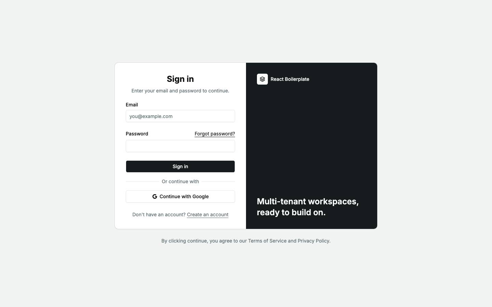 | 717 |               | The auth shell: a card with a title bar and three field bars on the muted background, styled. Only the shimmer differs.                                                                      |
| 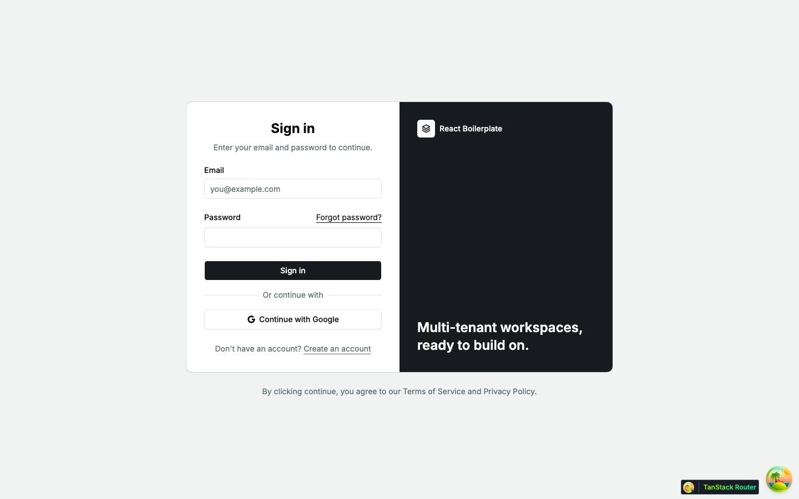 | 783 |               | The auth shell: a card with a title bar and three field bars on the muted background, styled. Only the shimmer differs.                                                                      |
| 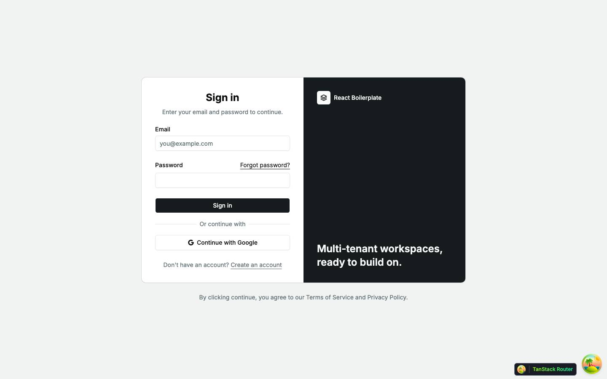 | 850 |               | The auth shell: a card with a title bar and three field bars on the muted background, styled. Only the shimmer differs.                                                                      |
|  | 915 | first-content | The auth shell: a card with a title bar and three field bars on the muted background, styled. The first frame at or after the DOM change; the compositor has not yet drawn the mounted page. |
|  | 925 | ready         | The sign-in page: form on the left, brand panel on the right.                                                                                                                                |

Production (`nginx-signed-out-login`):

| Frame                                        | ms  | Moment              | What it shows                                                                                 |
| -------------------------------------------- | --- | ------------------- | --------------------------------------------------------------------------------------------- |
|  | 0   | first-paint         | A blank white page: the browser's own frame before the document paints.                       |
|  | 36  | shell               | The auth shell: a card with a title bar and three field bars on the muted background, styled. |
|  | 186 | first-content+ready | The sign-in page: the same frame carries the `first-content` and `ready` marks.               |

### Signed in, `/dashboard`

Dev (`signed-in-dashboard`):

| Frame                                     | ms   | Moment              | What it shows                                                                                                                                                                                                                                                     |
| ----------------------------------------- | ---- | ------------------- | ----------------------------------------------------------------------------------------------------------------------------------------------------------------------------------------------------------------------------------------------------------------- |
|  | 0    | first-paint         | A blank white page: the browser's own frame before the document paints.                                                                                                                                                                                           |
|  | 520  | shell               | The app shell: sidebar bars, a header bar and a large block, styled, with the 255 px sidebar.                                                                                                                                                                     |
|  | 679  |                     | The app shell: sidebar bars, a header bar and a large block, styled, with the 255 px sidebar. Only the shimmer differs.                                                                                                                                           |
|  | 795  |                     | The app shell: sidebar bars, a header bar and a large block, styled, with the 255 px sidebar. Only the shimmer differs.                                                                                                                                           |
| 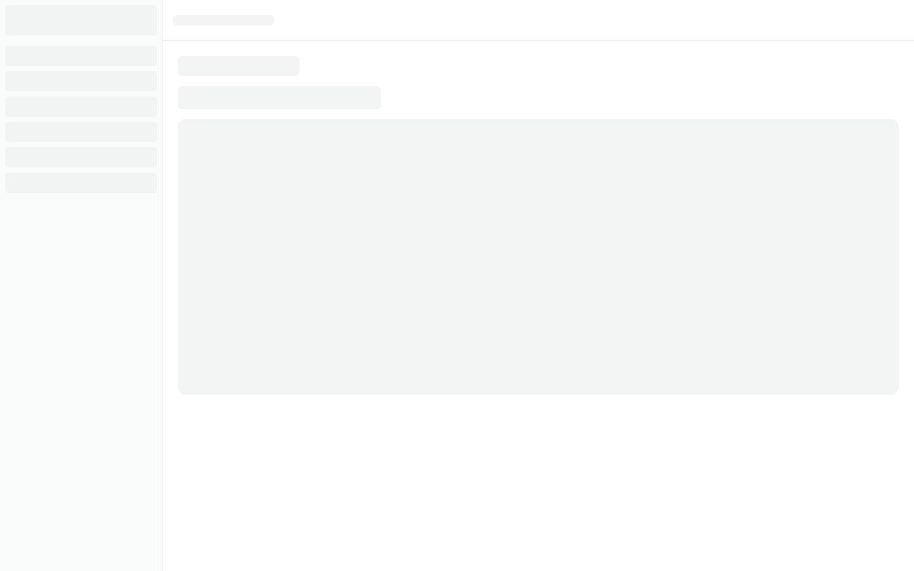 | 896  |                     | The app shell: sidebar bars, a header bar and a large block, styled, with the 255 px sidebar. Only the shimmer differs.                                                                                                                                           |
| 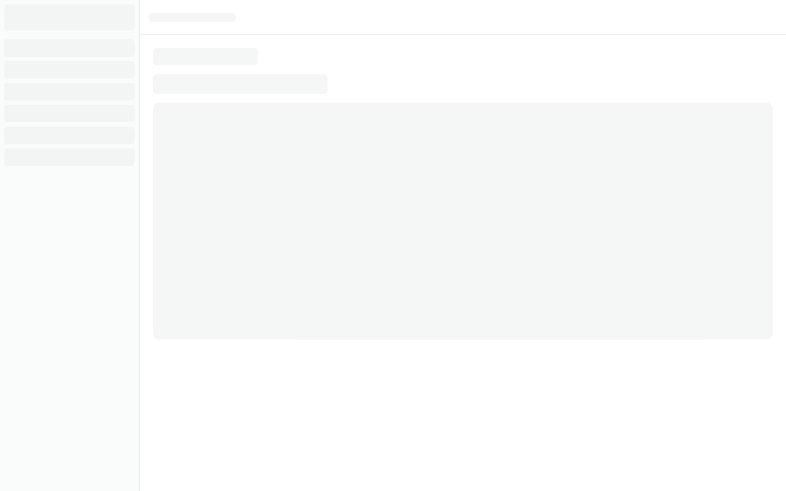 | 1012 |                     | The app shell: sidebar bars, a header bar and a large block, styled, with the 255 px sidebar. Only the shimmer differs.                                                                                                                                           |
| 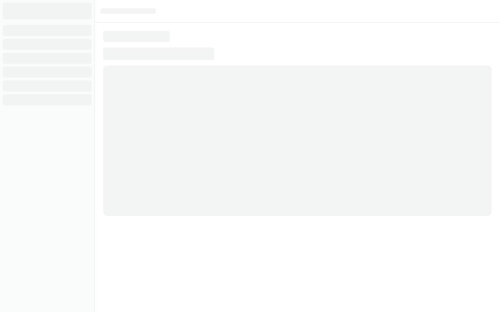 | 1128 |                     | The app shell: sidebar bars, a header bar and a large block, styled, with the 255 px sidebar. Only the shimmer differs.                                                                                                                                           |
|  | 1245 |                     | The app shell: sidebar bars, a header bar and a large block, styled, with the 255 px sidebar. Only the shimmer differs.                                                                                                                                           |
|  | 1346 |                     | The app shell: sidebar bars, a header bar and a large block, styled, with the 255 px sidebar. Only the shimmer differs.                                                                                                                                           |
|  | 1478 |                     | The app shell: sidebar bars, a header bar and a large block, styled, with the 255 px sidebar. Only the shimmer differs.                                                                                                                                           |
| 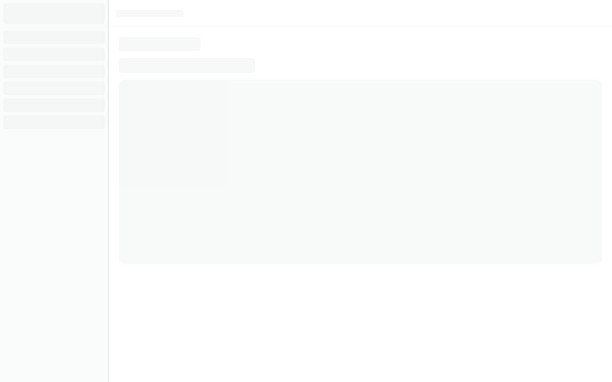 | 1577 | first-content+ready | The app shell: sidebar bars, a header bar and a large block, styled, with the 255 px sidebar. The capture ends here: the screencast stopped before the compositor drew the dashboard, so the page itself is not in the dev frames; the production frames show it. |

Production (`nginx-signed-in-dashboard`):

| Frame                                           | ms  | Moment            | What it shows                                                                                                                                                                                |
| ----------------------------------------------- | --- | ----------------- | -------------------------------------------------------------------------------------------------------------------------------------------------------------------------------------------- |
|  | 0   | first-paint+shell | The app shell already: the first distinct frame is the shell, with no blank frame before it. Sidebar bars, a header bar and a large block, styled, with the 255 px sidebar.                  |
|  | 88  |                   | The app shell: sidebar bars, a header bar and a large block, styled, with the 255 px sidebar.                                                                                                |
|  | 105 |                   | The app shell: sidebar bars, a header bar and a large block, styled, with the 255 px sidebar. Only the shimmer differs.                                                                      |
| 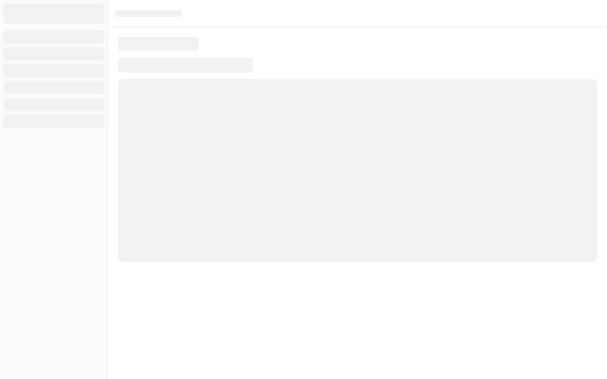 | 154 | first-content     | The app shell: sidebar bars, a header bar and a large block, styled, with the 255 px sidebar. The first frame at or after the DOM change; the compositor has not yet drawn the mounted page. |
|  | 162 |                   | The mounted app: the real sidebar and header, "Loading tenants…" in the switcher, and the dashboard template (four stat cards, two panels) in the page slot.                                 |
|  | 209 | ready             | The dashboard: "Choose a tenant" in the switcher, the welcome card, the bell with a badge of 1.                                                                                              |

### Signed in, `/tenants`

Dev only (`signed-in-tenants`):

| Frame                                   | ms   | Moment        | What it shows                                                                                                                                                                                |
| --------------------------------------- | ---- | ------------- | -------------------------------------------------------------------------------------------------------------------------------------------------------------------------------------------- |
|  | 0    | first-paint   | A blank white page: the browser's own frame before the document paints.                                                                                                                      |
|  | 28   | shell         | The app shell: sidebar bars, a header bar and a large block, styled, with the 255 px sidebar.                                                                                                |
|  | 112  |               | The app shell: sidebar bars, a header bar and a large block, styled, with the 255 px sidebar. Only the shimmer differs.                                                                      |
|  | 212  |               | The app shell: sidebar bars, a header bar and a large block, styled, with the 255 px sidebar. Only the shimmer differs.                                                                      |
|  | 327  |               | The app shell: sidebar bars, a header bar and a large block, styled, with the 255 px sidebar. Only the shimmer differs.                                                                      |
|  | 428  |               | The app shell: sidebar bars, a header bar and a large block, styled, with the 255 px sidebar. Only the shimmer differs.                                                                      |
| 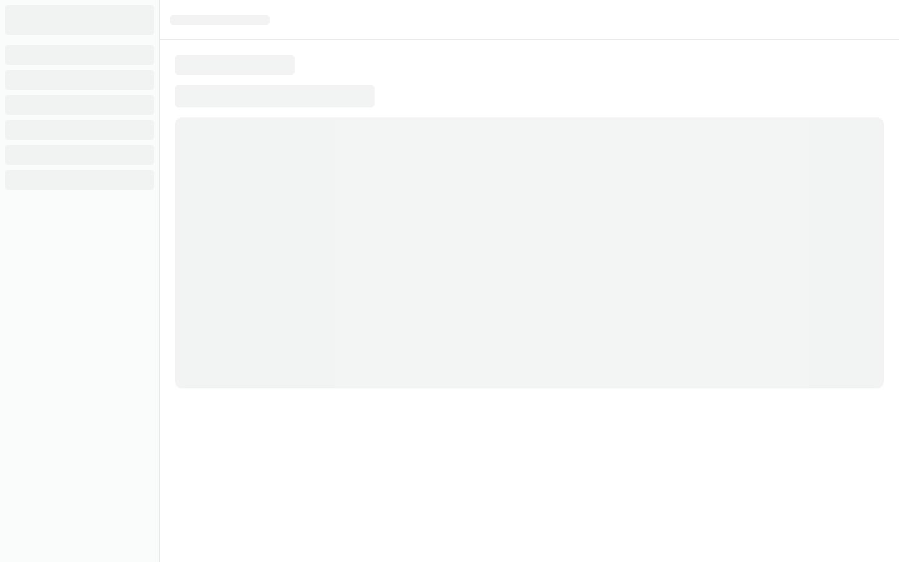 | 545  |               | The app shell: sidebar bars, a header bar and a large block, styled, with the 255 px sidebar. Only the shimmer differs.                                                                      |
| 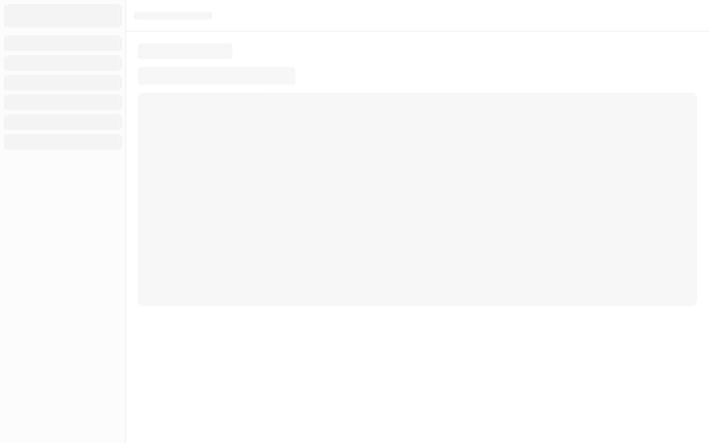 | 646  |               | The app shell: sidebar bars, a header bar and a large block, styled, with the 255 px sidebar. Only the shimmer differs.                                                                      |
| 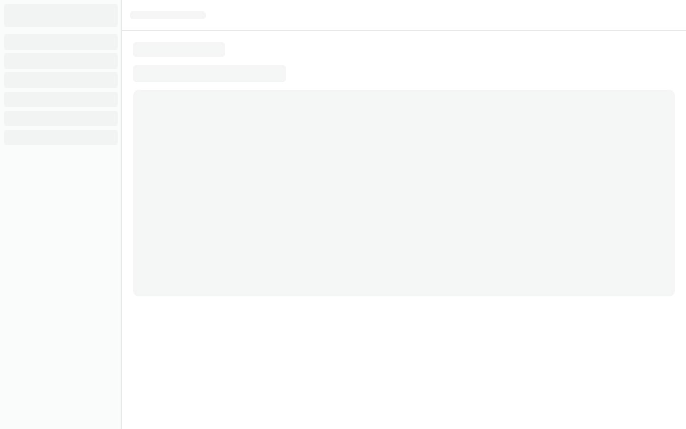 | 771  |               | The app shell: sidebar bars, a header bar and a large block, styled, with the 255 px sidebar. Only the shimmer differs.                                                                      |
|  | 818  | first-content | The app shell: sidebar bars, a header bar and a large block, styled, with the 255 px sidebar. The first frame at or after the DOM change; the compositor has not yet drawn the mounted page. |
|  | 847  |               | The mounted app: the real sidebar and header, "Loading tenants…" in the switcher, and the list template (heading, toolbar, eight table rows) in the page slot.                               |
| 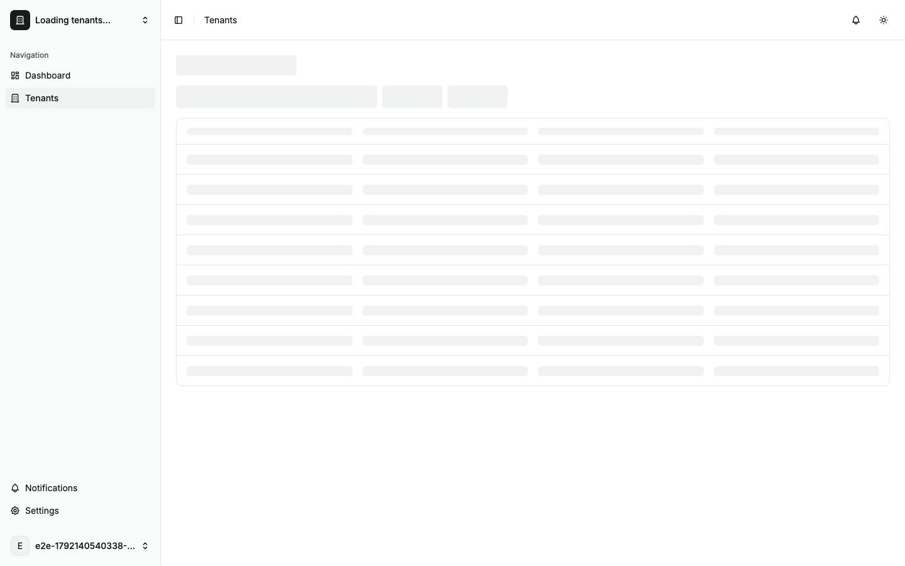 | 979  |               | The mounted app: the real sidebar and header, "Loading tenants…" in the switcher, and the list template (heading, toolbar, eight table rows) in the page slot.                               |
| 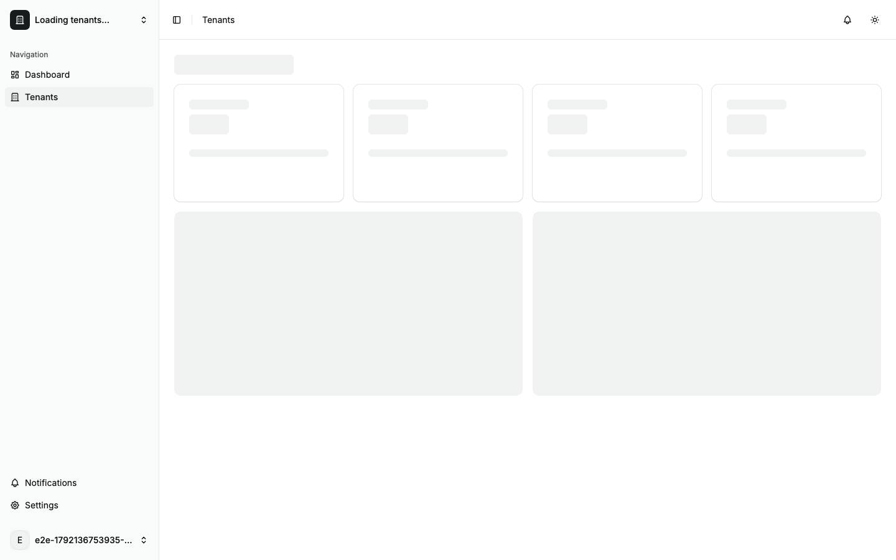 | 1013 |               | The tenants page for an account with no tenants: "You do not belong to any tenants yet." and the create form.                                                                                |
| 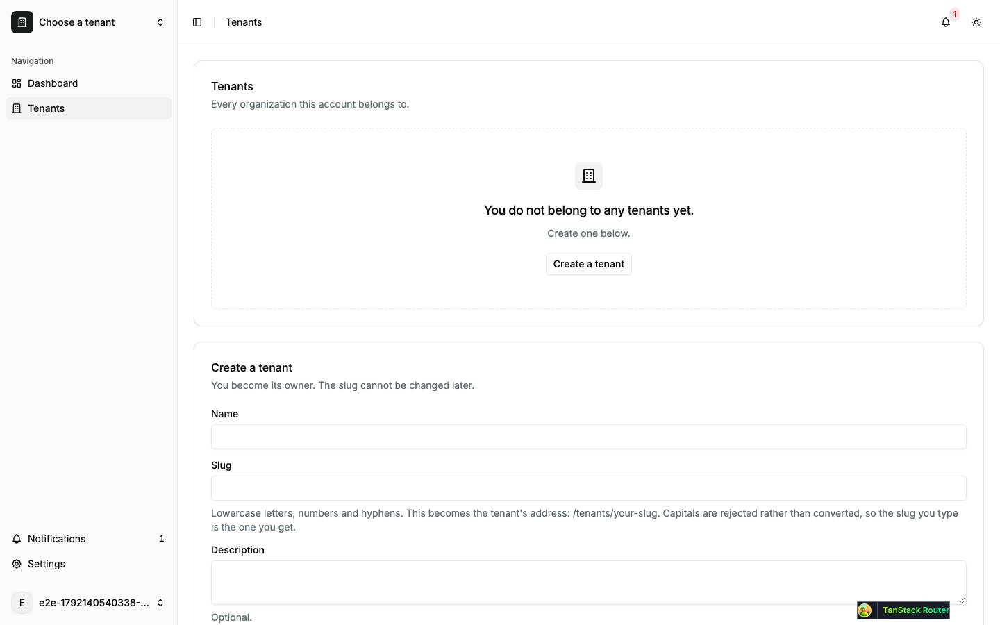 | 1203 |               | The tenants page for an account with no tenants: "You do not belong to any tenants yet." and the create form. The TanStack devtools buttons (dev only) are in the corner.                    |
| 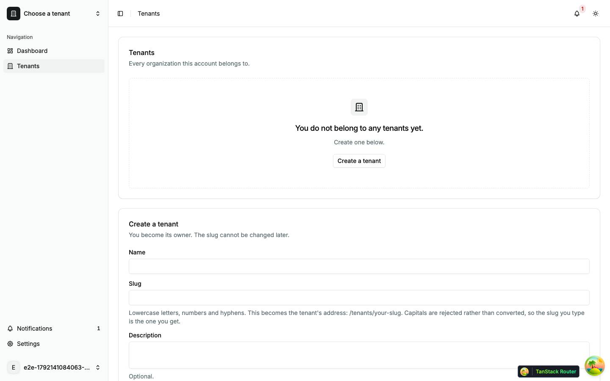 | 1296 |               | The tenants page for an account with no tenants: "You do not belong to any tenants yet." and the create form. The TanStack devtools buttons (dev only) are in the corner.                    |
| 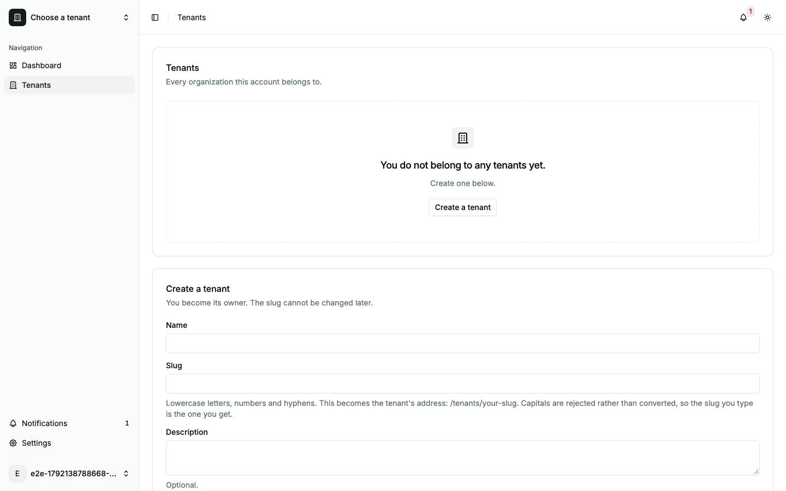 | 1411 | ready         | The tenants page for an account with no tenants: "You do not belong to any tenants yet." and the create form. The TanStack devtools buttons (dev only) are in the corner.                    |

These are fast loads: every request answered at once. When a request that the boot awaits is slow, the shell stays up for as long as it takes, to the 10 s cap on the flags read.

## The first frame

The shell's inline CSS paints it in both builds, so no frame of either build shows unstyled text or a bare browser page after the first blank frame, which is the browser's own (the production `/dashboard` capture's first distinct frame is already the shell). `globals.css` arrives later and only replaces the shell's own values with the same ones: the shell sets `box-sizing: border-box` on its own boxes, so under `vite dev` the sidebar is 255 px and the auth card 770 px from the first frame, the same sizes the app has once the stylesheet lands.

## The handoff

On `/login` the frame after the shell is the page. On an `_app` page without `$slug`, React mounts once the first load has resolved, and the first app frame is the real sidebar and header, "Loading tenants…" in the switcher, and in the page slot the pending template of the route directly under `_app` (`TenantSearchGuard`), until the tenant list lands: the dashboard template on `/dashboard`, the list template on `/tenants`, then the page replaces it. The list template shares the shell's sizes (its table block is `calc(26.5rem + 10px)`: a header row, eight rows and their borders), so the shell and the guard's hold on `/tenants` are one shape. The router's own pending templates (`defaultPendingMs`, 300 ms) show only on an in-app navigation still pending after that.

## In-app navigation

A cold load only shows the boot shell, so the route and section templates are shot on an in-app navigation (`e2e/capture/navigation.test.ts`), from a settled page, once with the target route's code held and once with only its section requests held. `capture-records/navigation.json` records, per navigation, `routeTemplate` (the Loading status appeared with the code held) and `sectionSkeleton` (a busy section showed skeleton bars with its requests held). All three recorded `true`, and each route shot's check names the template it expects (`data-variant`, `data-nested` on the skeleton's root), so `true` means the target's own template showed.

| Navigation                         | Route template (code held)                                                                                  | Section skeletons (requests held)                                                                                 |
| ---------------------------------- | ----------------------------------------------------------------------------------------------------------- | ----------------------------------------------------------------------------------------------------------------- |
| Settings, Profile to Notifications | [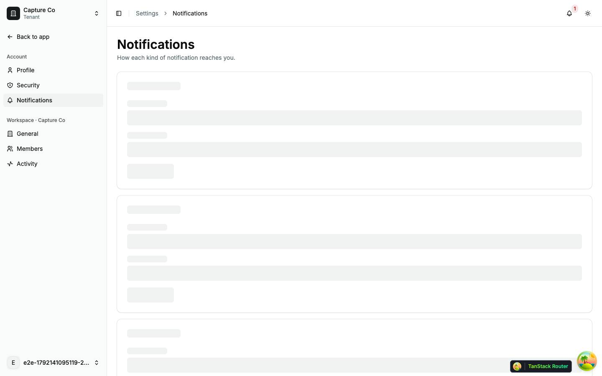](img/settings/account-notifications--nav-route.jpg) | [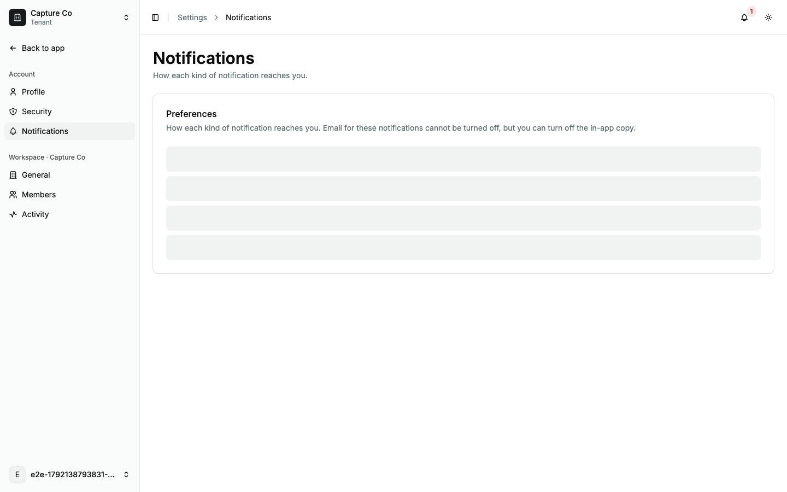](img/settings/account-notifications--nav-sections.jpg) |
| Tenants to the tenant's overview   | [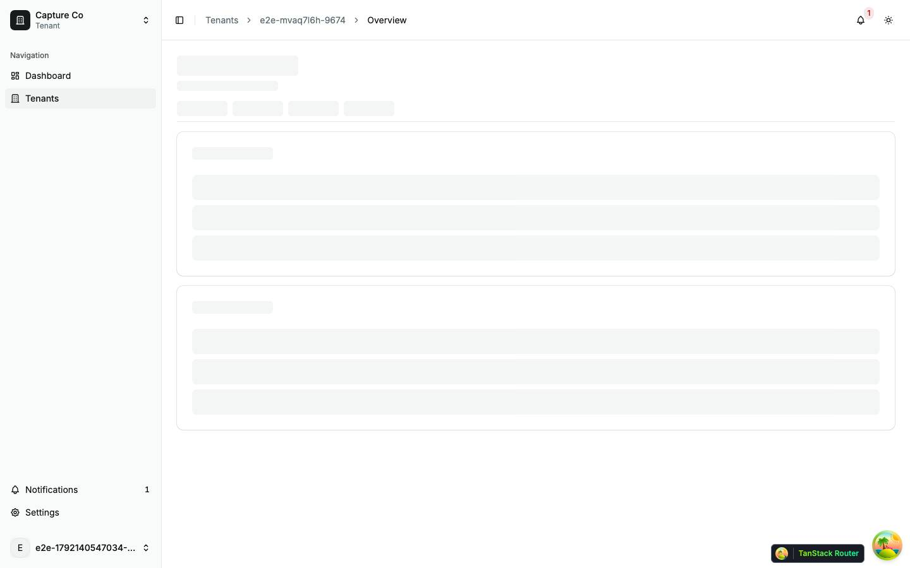](img/tenants/tenant-overview--nav-route.jpg)               | [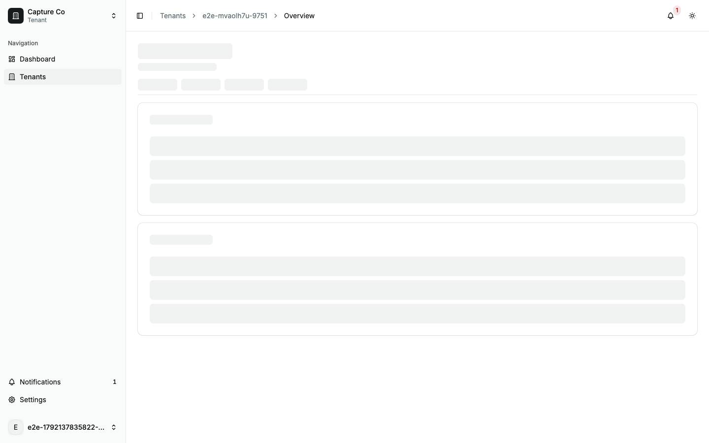](img/tenants/tenant-overview--nav-sections.jpg)               |
| Settings, Profile to Security      | [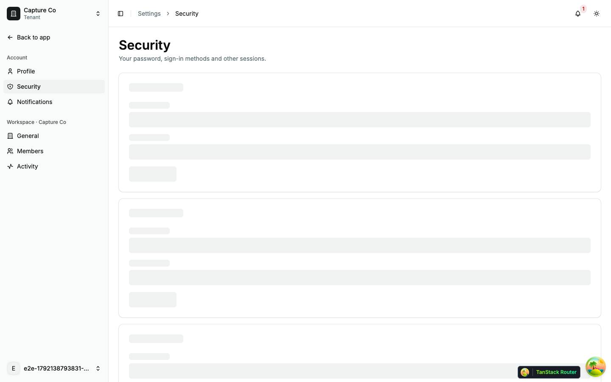](img/settings/account-security--nav-route.jpg)           | [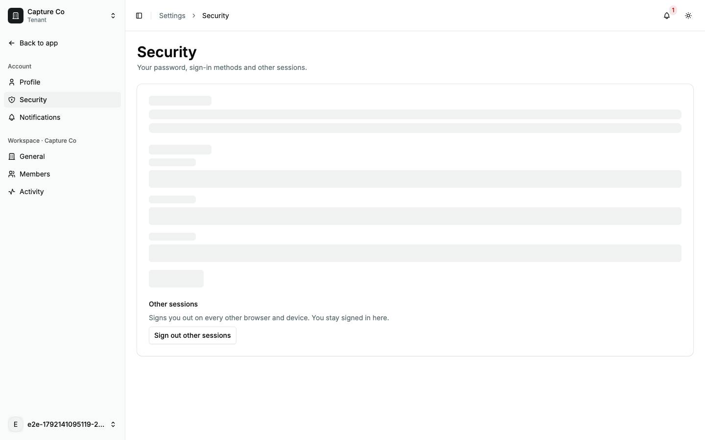](img/settings/account-security--nav-sections.jpg)           |

- **Notifications and Security, route template:** the settings shell stays, with the page's real heading and subtitle, and the page slot shows the nested settings template (stacked cards of field bars). Both shots also show the TanStack Router devtools button, which is dev-only.
- **Notifications and Security, sections:** the real heading and the card's own title with four preference bars (Notifications), or, on Security, one card whose password and sign-in-method sections are on bars above the real "Other sessions" block, which needs no request.
- **Tenant overview, route template:** the app chrome stays (sidebar, header, breadcrumb already reading Tenants, the slug and Overview), with the detail template in the page slot: heading and subtitle bars, tab bars and two cards of rows.
- **Tenant overview, sections:** the same chrome and detail layout on two cards of rows, with the requests held.

## Dev and production

- **Dev-only:** the module-by-module fetches under `/src/…`; the TanStack devtools buttons.
- **Both:** the boot waits on `POST /auth/refresh`, `GET /profile`, and on `_app` pages the flags (up to 10 s, the cap in `ensureFlags`), before React mounts, and nothing else: the tenant list and the tenant reads happen after mount, under the app's own chrome.
- **Both:** a signed-out load logs one console error, the browser's own "Failed to load resource" line for the `POST /auth/refresh` 401. The 401 is how the app learns it is signed out, so the line is expected; no page script logs an error.
