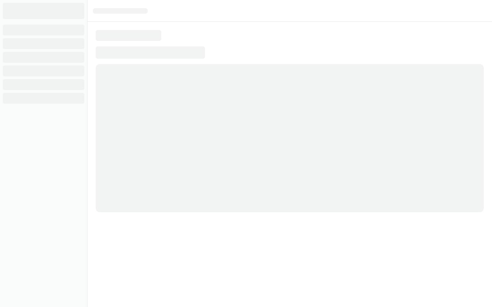
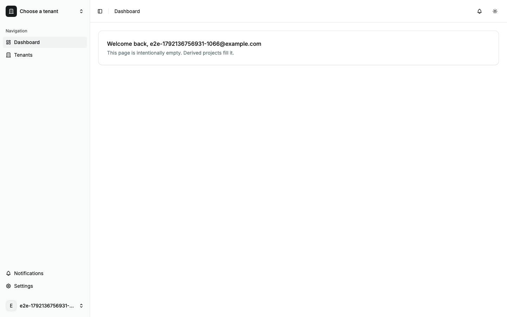
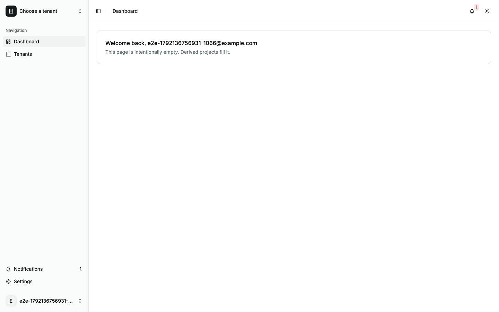

# Boot

What a cold load of the app does, from `index.html` to the first page, and what it looks like while it does it. Back to the [route map](README.md#route-map).

## What happens

1. The browser parses `index.html`. Its `<head>` runs three blocking scripts: `/theme-init.js`, which sets the `dark` class on `<html>` from the stored theme or the system preference, `/boot-variant.js`, which marks `<html data-boot="auth">` on an auth path, and `/runtime-config.js`, the run-time settings. `#root` already holds the static boot shell: `.boot-shell` with `role="status"`, a visually hidden "Loading…", and the app or auth variant that `/boot-variant.js` picked, styled by the inline `<style>` blocks in `<head>`.
2. `src/main.tsx` loads as a module. Its imports bring in the router (`src/router.tsx`) and `src/styles/globals.css`, and it calls `router.load()` before React mounts anything.
3. `__root`'s `beforeLoad` awaits `bootstrapSession()`: `POST /api/v1/auth/refresh` with the refresh cookie (a 401 when signed out), then, when the refresh succeeds, `GET /api/v1/profile`.
4. The matched layout's guard runs. `_auth` sends a signed-in user to `/dashboard`. `_app` sends a signed-out user to `/login?redirect=<the URL>`.
5. `_app`'s loader awaits the flags, at most 10 s (`FLAGS_BOOT_WAIT_MS`): `GET /api/v1/flags`, or `GET /api/v1/tenants/:slug/flags` on a tenant page. The tenant layouts (`/tenants/$slug`, `/settings/workspace/$slug`) start `GET /api/v1/tenants/:slug` without waiting on it, and `/tenants/$slug/beta` awaits the tenant's flags in its `beforeLoad`, under the same cap.
6. `router.load()` settles, whether it resolved or rejected, and React mounts (`createRoot().render()` in the `finally`) once those reads settle. The first commit replaces the shell with the matched page, whose sections show their own skeletons. Until this point the shell is the only thing on screen, however long steps 3 to 5 take.
7. After mount, on a page without `$slug`, `TenantSearchGuard` reads `GET /api/v1/tenants`, shows the dashboard template in the page slot until it lands, and fixes `?tenant=` with a replace.
8. After mount: `MaintenanceGate` (in `__root`) starts `GET /api/v1/status/maintenance`; on `_app` pages the bell starts `GET /api/v1/notifications?limit=20` and opens `GET /api/v1/notifications/stream`; analytics starts (`initAnalytics()`), and posthog-js fetches its config and extensions through `/api/v1/collect/…`.

A signed-in reload of `/tenants` in Chrome showed exactly this order: `POST /auth/refresh` 200, `GET /profile` 200, `GET /tenants` 200, `GET /flags` 200, then the `/collect/…` scripts, the notifications stream, `GET /notifications?limit=20` and `GET /status/maintenance`. A signed-out load of any `_auth` page makes three requests of its own: `/runtime-config.js`, `POST /auth/refresh` 401 and `GET /status/maintenance`.

## Frame by frame

A CDP screencast of each cold load (`e2e/capture/boot.test.ts`), unthrottled, cache disabled. Times are from the first distinct frame. Consecutive identical frames are dropped. Each scenario keeps a time-spread sample of its distinct frames, at most 16, and always the first distinct frame (`first-paint`), the first frame at or after the shell's first appearance in `#root` (`shell`), the first frame at or after the shell's replacement (`first-content`) and the last (`ready`), so the gaps between rows are not frame intervals. The first-content frame can precede the page's first drawn frame by one: the mark is the DOM change, and the screencast stamps the compositor's frame. Frame files are named `<scenario>--<nn>.jpg`, so a rerun rewrites the same files, and `test-results/capture/boot.json` records each frame's `ms` and label.

The dev frames come from `vite dev` (`signed-…`). The production frames (`nginx-signed-…`) come from `vite preview` of the production build on this machine: the same `dist/` the image serves, without nginx. The image's CSP and first paint are pinned by `e2e/nginx/boot-shell.test.ts`. The capture runs in the light theme, so these frames do not show the dark theme.

### Signed out, `/login`

Dev (`signed-out-login`):

| Frame                                  | ms   | Moment      | What it shows                                                                                                                                                                      |
| -------------------------------------- | ---- | ----------- | ---------------------------------------------------------------------------------------------------------------------------------------------------------------------------------- |
|  | 0    | first-paint | A blank white page: the browser's own frame before the document paints.                                                                                                            |
|  | 557  | shell       | The auth shell: a card with a title bar and three field bars on the muted background, styled. In dev the card is 816 px wide (the final card is 770 px) until `globals.css` lands. |
|  | 681  |             | The auth shell; only the shimmer differs.                                                                                                                                          |
|  | 798  |             | The auth shell; only the shimmer differs.                                                                                                                                          |
|  | 914  |             | The auth shell; only the shimmer differs.                                                                                                                                          |
|  | 1030 |             | The auth shell; only the shimmer differs.                                                                                                                                          |
|  | 1151 |             | The auth shell; only the shimmer differs.                                                                                                                                          |
|  | 1264 |             | The auth shell; only the shimmer differs.                                                                                                                                          |
|  | 1380 |             | The auth shell; only the shimmer differs.                                                                                                                                          |
|  | 1480 |             | The auth shell; only the shimmer differs.                                                                                                                                          |
|  | 1609 | ready       | The sign-in page: form on the left, brand panel on the right.                                                                                                                      |

Production (`nginx-signed-out-login`):

| Frame                                        | ms  | Moment      | What it shows                                                                                         |
| -------------------------------------------- | --- | ----------- | ----------------------------------------------------------------------------------------------------- |
|  | 0   | first-paint | A blank white page: the browser's own frame before the document paints.                               |
|  | 96  | ready       | The sign-in page. The screencast holds no shell frame: the second distinct frame is already the page. |

### Signed in, `/dashboard`

Dev (`signed-in-dashboard`):

| Frame                                     | ms   | Moment        | What it shows                                                                                                                                               |
| ----------------------------------------- | ---- | ------------- | ----------------------------------------------------------------------------------------------------------------------------------------------------------- |
|  | 0    | first-paint   | A blank white page.                                                                                                                                         |
|  | 332  | shell         | The app shell: sidebar bars and a header bar and a large block, styled. In dev the sidebar is 272 px wide, the final one 255 px, until `globals.css` lands. |
|  | 442  |               | The app shell; only the shimmer differs.                                                                                                                    |
|  | 476  |               | The app shell; only the shimmer differs.                                                                                                                    |
|  | 559  |               | The app shell; only the shimmer differs.                                                                                                                    |
|  | 643  |               | The app shell; only the shimmer differs.                                                                                                                    |
|  | 726  |               | The app shell; only the shimmer differs.                                                                                                                    |
|  | 809  |               | The app shell; only the shimmer differs.                                                                                                                    |
|  | 893  |               | The app shell with the sidebar at its final 255 px: `globals.css` has landed.                                                                               |
|  | 959  |               | The app shell, 255 px sidebar.                                                                                                                              |
|  | 992  | first-content | The app shell, 255 px sidebar: this is the first frame at or after the DOM change, and the compositor had not yet drawn the mounted page.                   |
|  | 1046 | ready         | The dashboard: "Choose a tenant" in the switcher, the welcome card, the bell with a badge of 1.                                                             |

Production (`nginx-signed-in-dashboard`):

| Frame                                           | ms  | Moment        | What it shows                                                                                                                                                |
| ----------------------------------------------- | --- | ------------- | ------------------------------------------------------------------------------------------------------------------------------------------------------------ |
|  | 0   | first-paint   | A blank white page.                                                                                                                                          |
|  | 63  | shell         | The app shell, styled, with the 255 px sidebar from the first frame.                                                                                         |
|  | 153 |               | The app shell; only the shimmer differs.                                                                                                                     |
|  | 164 |               | The app shell; only the shimmer differs.                                                                                                                     |
|  | 197 |               | The app shell; only the shimmer differs.                                                                                                                     |
|  | 247 |               | The app shell; only the shimmer differs.                                                                                                                     |
|  | 280 |               | The app shell; only the shimmer differs.                                                                                                                     |
|  | 331 |               | The app shell; only the shimmer differs.                                                                                                                     |
|  | 364 |               | The app shell; only the shimmer differs.                                                                                                                     |
|  | 415 | first-content | The app shell; the compositor had not yet drawn the mounted page.                                                                                            |
|  | 427 |               | The mounted app: the real sidebar and header, "Loading tenants…" in the switcher, and the dashboard template (four stat cards, two panels) in the page slot. |
|  | 516 |               | The dashboard page; "Choose a tenant" in the switcher, the bell without its badge.                                                                           |
|  | 532 | ready         | The dashboard with the bell's badge of 1.                                                                                                                    |

### Signed in, `/tenants`

Dev only (`signed-in-tenants`):

| Frame                                   | ms  | Moment        | What it shows                                                                                                              |
| --------------------------------------- | --- | ------------- | -------------------------------------------------------------------------------------------------------------------------- |
|  | 0   | first-paint   | A blank white page.                                                                                                        |
|  | 31  | shell         | The app shell, with the 272 px dev sidebar.                                                                                |
|  | 144 |               | The app shell; only the shimmer differs.                                                                                   |
|  | 193 |               | The app shell; only the shimmer differs.                                                                                   |
|  | 243 |               | The app shell; only the shimmer differs.                                                                                   |
|  | 299 |               | The app shell; only the shimmer differs.                                                                                   |
|  | 343 |               | The app shell; only the shimmer differs.                                                                                   |
|  | 411 |               | The app shell; only the shimmer differs.                                                                                   |
|  | 460 |               | The app shell; only the shimmer differs.                                                                                   |
|  | 510 |               | The app shell; only the shimmer differs.                                                                                   |
|  | 559 |               | The app shell; only the shimmer differs.                                                                                   |
|  | 593 | first-content | The app shell, 255 px sidebar.                                                                                             |
|  | 600 |               | The mounted app: "Loading tenants…" in the switcher, and the dashboard template in the page slot, under the Tenants title. |
|  | 653 | ready         | The tenants page for an account with no tenants: "You do not belong to any tenants yet." and the create form.              |

These are fast loads: every request answered at once. When a request that the boot awaits is slow, the shell stays up for as long as it takes, to the 10 s cap on the flags read.

## The first frame

The shell's inline CSS paints it in both builds, so no frame of either build shows unstyled text or a bare browser page after the first blank frame, which is the browser's own. `globals.css` arrives later and only replaces the shell's own values with the same ones. The one visible difference is under `vite dev`: until `globals.css` lands, the shell's boxes are measured without the stylesheet's `box-sizing: border-box`, so the dev shell's sidebar is 272 px instead of 255 px and the auth card 816 px instead of 770 px, and both snap to size when the CSS arrives (about 0.9 s into the dashboard load). A production build links `globals.css` from `<head>` and the shell paints at its final size.

## The handoff

On a cold load the first app frame is the page React mounts, not a route template: React mounts once the first load has resolved, and the router's `defaultPendingMs` (300 ms) only counts after mount, so the frame after the shell is the page, its sections on their own skeletons. The list template shares the shell's sizes (its table block is `calc(26.5rem + 10px)`: a header row, eight rows and their borders), so the two are one shape; the template itself shows only on an in-app navigation still pending after 300 ms.

The frames show a different first app frame on `/dashboard` and `/tenants`: the mounted app has its real sidebar and header and "Loading tenants…" in the switcher, and the page slot holds the dashboard template (four stat cards, two panels), on both pages, until the tenant list lands. Then the page replaces it: on `/dashboard` the welcome card, on `/tenants` the tenants page, which is not a dashboard-shaped page. On `/login` there is no such step: the shell is followed by the page.

## In-app navigation

A cold load only shows the boot shell, so the route and section templates are shot on an in-app navigation (`e2e/capture/navigation.test.ts`), from a settled page, once with the target route's code held and once with only its section requests held. `test-results/capture/navigation.json` records, per navigation, `routeTemplate` (the Loading status appeared with the code held) and `sectionSkeleton` (a busy section showed skeleton bars with its requests held). All three recorded `true`.

| Navigation                         | Route template (code held)                                                                                  | Section skeletons (requests held)                                                                                 |
| ---------------------------------- | ----------------------------------------------------------------------------------------------------------- | ----------------------------------------------------------------------------------------------------------------- |
| Settings, Profile to Notifications |  |  |
| Tenants to the tenant's overview   |                |                |
| Settings, Profile to Security      |            |            |

- **Notifications and Security, route template:** the settings shell stays and the page slot shows the settings template (a heading bar and stacked cards of field bars). Both shots also show the TanStack Router devtools button, which is dev-only.
- **Notifications and Security, sections:** the real page heading, then the card with its own title and four preference bars (Notifications), or, on Security, one card whose password and sign-in-method sections are on bars above the real "Other sessions" block, which needs no request.
- **Tenant overview, route template:** the whole screen, sidebar and header included, is replaced by a list-shaped table skeleton at the page's top-left corner, not the detail template. The shot shows the router's default pending, not the tenant layout's `DetailPending`.
- **Tenant overview, sections:** the app shell with the breadcrumb already reading Tenants, the tenant's slug and Overview, the heading and tab bars, and two cards of rows on skeletons.

## Dev and production

- **Dev-only:** the shell's 17 px (sidebar) and 46 px (auth card) of extra width until `globals.css` lands (see above); the module-by-module fetches under `/src/…`; the TanStack devtools buttons.
- **Both:** the boot waits on `POST /auth/refresh`, `GET /profile`, and on `_app` pages the flags (up to 10 s, the cap in `ensureFlags`), before React mounts, and nothing else: the tenant list and the tenant reads happen after mount, under the app's own chrome.
- **Both:** a signed-out load logs one console error, the browser's own "Failed to load resource" line for the `POST /auth/refresh` 401. The 401 is how the app learns it is signed out, so the line is expected; no page script logs an error.
