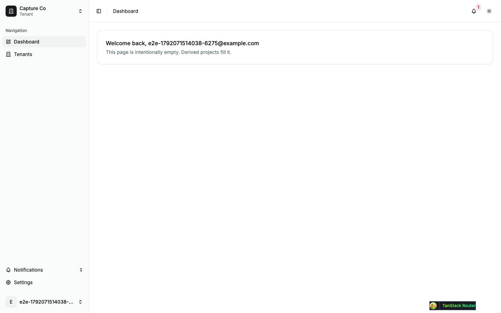
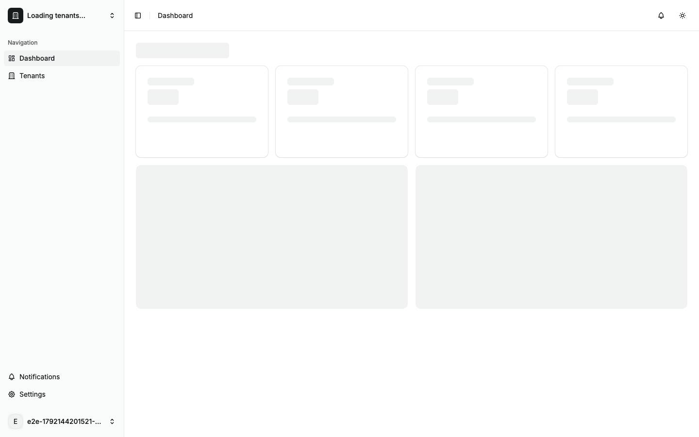
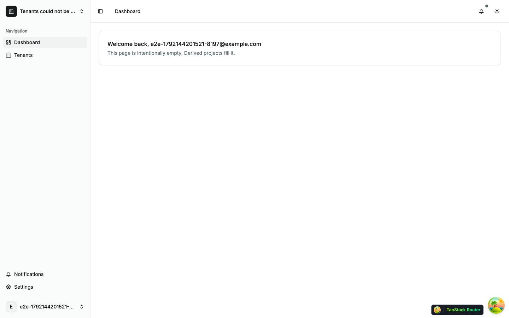
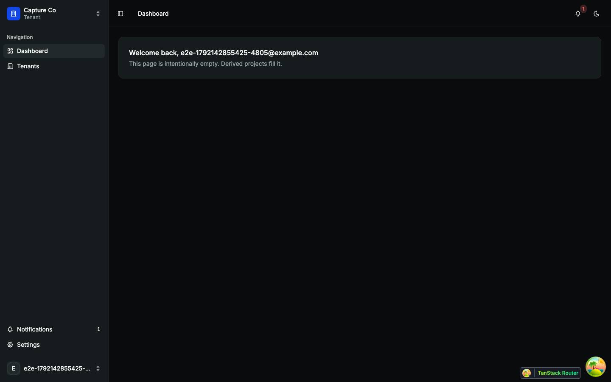
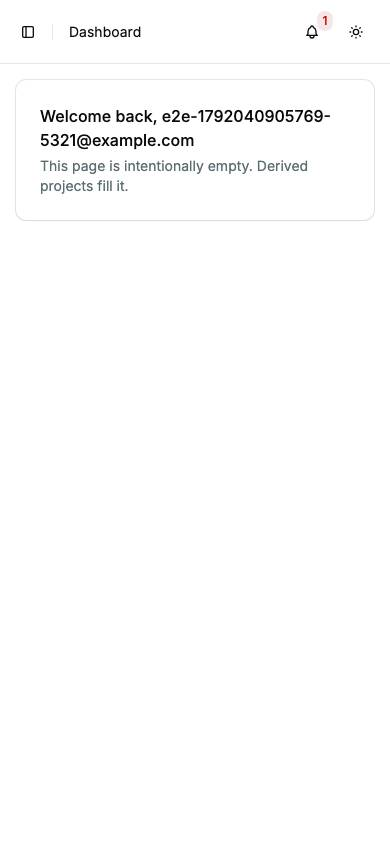

# Dashboard

This file covers the signed-in landing page (`/dashboard`), the first page after sign-in. Back to the [route map](README.md#route-map).

Every signed-in page renders inside `AppLayout` (`src/components/layouts/app-layout.tsx`). This page shows the shell with nothing else in the way, so the shell is described here.

"The walk" below is the Playwright walk of the app made for pull request (PR) #108 on 15 October 2026.

## The app shell

`AppLayout` is shadcn's sidebar-07 block (shadcn is the component collection the app's user interface is built from). It has a sidebar that collapses to icons (with a rail), a header, and the page in a padded column. Below the `md` breakpoint (768 px) the sidebar becomes a `Sheet`, opened from the header's Toggle sidebar button.

| Part             | What it shows                                                                                                                                                                                                                                                                                                                                                                                                                         | Data                                                                      |
| ---------------- | ------------------------------------------------------------------------------------------------------------------------------------------------------------------------------------------------------------------------------------------------------------------------------------------------------------------------------------------------------------------------------------------------------------------------------------- | ------------------------------------------------------------------------- |
| Tenant switcher  | `TenantSwitcher` (`src/components/features/tenant-switcher.tsx`): the current tenant's name over "Workspace". With no current tenant, the trigger reads "Loading workspaces…" until the list is in, "Workspaces didn’t load" after a failure (with Try again in the popup), else "Choose a workspace". It opens a searchable `Combobox` of "Your workspaces" (suspended ones disabled) and a "Create a workspace" link to `/tenants`. | `GET /tenants` (the list `TenantSearchGuard` reads), `GET /tenants/:slug` |
| Navigation       | `NavMain`: Dashboard, Workspaces. `NavSecondary` at the bottom: Notifications (with the unread count) and Settings. On `/settings/*`, `NavSettings` replaces both ([settings.md](settings.md#settings--settings-shell)).                                                                                                                                                                                                              | `GET /notifications?limit=20` for the count                               |
| Account menu     | `UserMenu`: avatar initial and address; Profile → `/settings/account/profile`, Notifications → `/settings/account/notifications`, Platform (staff only) → the platform tenant, Sign out.                                                                                                                                                                                                                                              | the session's user                                                        |
| Header           | Toggle sidebar; breadcrumbs from each route's `staticData.crumb` (a `Workspaces` crumb is inserted above any `/tenants/…` page); the Search… button, which opens the command palette ([palette.md](palette.md)); the notification bell ([notifications.md](notifications.md#the-bell)); and `ThemeToggle` (Light, Dark, System).                                                                                                      | none                                                                      |
| Maintenance      | `MaintenanceBanner` under the header while maintenance is `read_only`.                                                                                                                                                                                                                                                                                                                                                                | `GET /status/maintenance` (from `__root`)                                 |
| Started by shell | The notification stream (`GET /notifications/stream`) and the `$feature/*` property sync. They live in the shell, not the sidebar, because the mobile sidebar unmounts while closed.                                                                                                                                                                                                                                                  |                                                                           |

How the `_app` route guards and fills each signed-in page:

1. Its `beforeLoad` sends a signed-out visitor to `/login?redirect=…`.
2. Its loader awaits `GET /flags`, or `GET /tenants/:slug/flags` on a tenant page, for at most 10 s, before React mounts.
3. After mount, on a page without `$slug`, `TenantSearchGuard` in the layout's page slot reads `GET /tenants` and shows the dashboard template there until the list lands.
4. The guard then fills or corrects `?tenant=` with a replace: the requested tenant, else the remembered one, else the first eligible one (`src/lib/tenant-guard.ts`). A failed list renders the page with the URL (Uniform Resource Locator) as it is ([boot.md](boot.md#what-happens)).

What the walk saw in the shell:

- The switcher listed both of the account's tenants. (For a query that matches none, the switcher says "No workspaces match your search".)
- Choosing a tenant on `/dashboard` changed only `?tenant=`. The change is a push, so Back returns.
- On a workspace settings page, choosing a tenant opened the same section for the chosen tenant.
- The theme toggle switched the document to dark at once. Its menu marks no current choice.
- No signed-in page logged a console error.

Findings: [F-dashboard-2](findings.md#f-dashboard-2), [F-dashboard-4](findings.md#f-dashboard-4), [F-dashboard-5](findings.md#f-dashboard-5)

## Pages

### `/dashboard` — Dashboard

|                     |                                                                                                                                                                                                                                                                                                                                                                                                                           |
| ------------------- | ------------------------------------------------------------------------------------------------------------------------------------------------------------------------------------------------------------------------------------------------------------------------------------------------------------------------------------------------------------------------------------------------------------------------- |
| Purpose             | Greet the signed-in user. The page is a placeholder that derived projects fill.                                                                                                                                                                                                                                                                                                                                           |
| File                | `src/pages/_app/dashboard.tsx`                                                                                                                                                                                                                                                                                                                                                                                            |
| Guard and redirects | `_app`: signed out → `/login?redirect=/dashboard`; `?tenant=` filled by `TenantSearchGuard` after mount, with the dashboard template in the page slot until the list lands. `/`, `/login` (signed in), `/auth/callback` and Back to app (settings) land here.                                                                                                                                                             |
| Layout              | `AppLayout`                                                                                                                                                                                                                                                                                                                                                                                                               |
| Data                | The name comes from the session's user. The page reads the cached tenant list (`useTenants`, `['tenants']`) for the workspace prompt. Awaited by `_app`: `GET /flags` (`['flags', 'none']`, `staleTime` 5 min, 10 s cap). Read after mount by `TenantSearchGuard`: `GET /tenants` (`['tenants']`). Started by the shell: `GET /notifications?limit=20` (`['notifications', 'list']`), the stream.                         |
| Sections            | One `Card`: "Welcome back, {first name or email}" (`h1` inside `CardTitle`), always. Under it, "This page is intentionally empty. Derived projects fill it."; or, when `GET /tenants` answers an empty list, an `EmptyState` titled "Create your workspace" (not a heading) with "You don’t belong to a workspace yet." and a "Create your workspace" link to `/welcome`. A pending or failed read keeps the placeholder. |
| Components          | `Card`, `CardHeader`, `CardTitle`, `CardDescription`, `CardContent`, `EmptyState`, `Pii`                                                                                                                                                                                                                                                                                                                                  |
| Transitions         | the sidebar, the switcher, the bell and the account menu; nothing on the page itself                                                                                                                                                                                                                                                                                                                                      |

The page has no request of its own; the shell's reads carry their own states:

- While the guard's `GET /tenants` is held, the page slot holds the dashboard template and the switcher trigger reads "Loading workspaces…".
- Once that read fails, the page renders and the trigger reads "Workspaces didn’t load", with a Try again button in the popup.
- A failed `GET /notifications` leaves the bell's accessible name at "Notifications, count unavailable", marks the bell with a muted dot, and offers Try again in its menu. While the read is held, the bell has no dot.

`tenant-switcher.test.tsx`, `notification-bell.test.tsx` and `a11y.test.tsx` cover these states.

| Loading                                                                                                          | Error                                                                                    |
| ---------------------------------------------------------------------------------------------------------------- | ---------------------------------------------------------------------------------------- |
|                                                                         |                                                   |
| The real sidebar and header, "Loading workspaces…" in the switcher, and the dashboard template in the page slot. | The page as usual; the switcher reads "Workspaces didn’t load" and the bell shows a dot. |

| Dark                                   | Mobile                                                     |
| -------------------------------------- | ---------------------------------------------------------- |
|  |                    |
| Sidebar and card on the dark surfaces. | Sidebar in a sheet; the greeting wraps inside the address. |

Findings: [F-dashboard-1](findings.md#f-dashboard-1), [F-dashboard-2](findings.md#f-dashboard-2), [F-dashboard-3](findings.md#f-dashboard-3), [F-dashboard-4](findings.md#f-dashboard-4)
