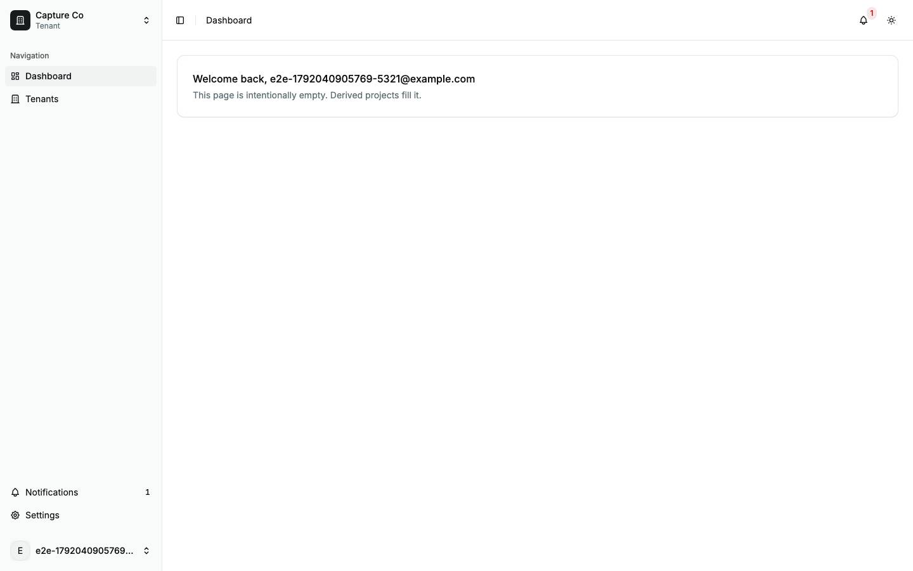
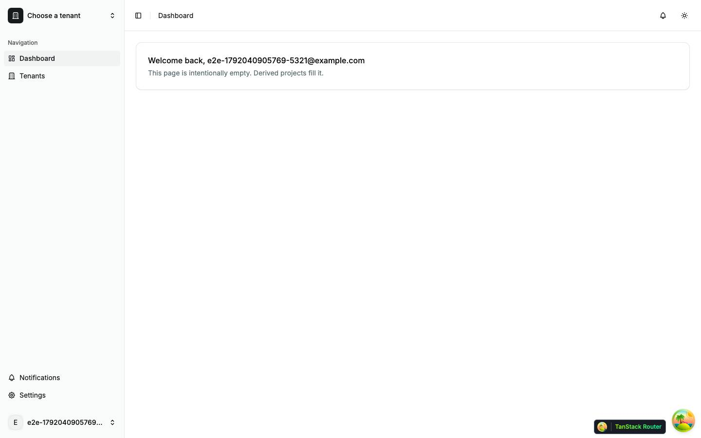
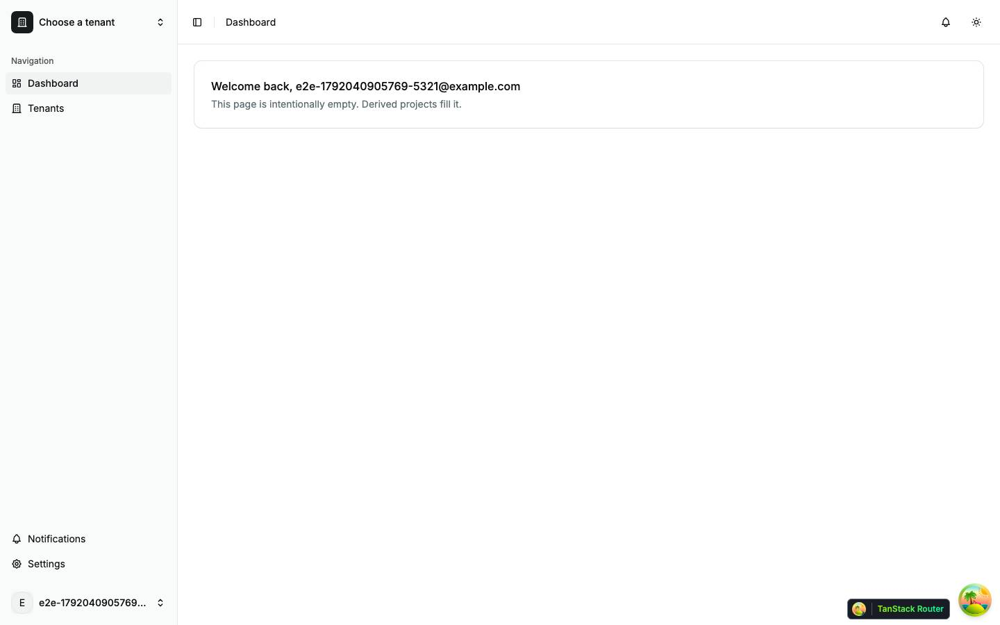
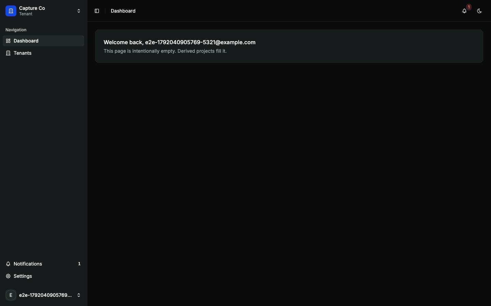
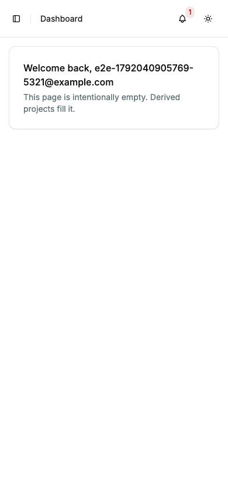

# Dashboard

The signed-in landing page (`/dashboard`): the first page after sign-in. Back to the [route map](README.md#route-map).

Every signed-in page renders inside `AppLayout` (`src/components/layouts/app-layout.tsx`), which this page shows with nothing else in the way, so the shell is described here.

## The app shell

`AppLayout` is shadcn's sidebar-07 block: a sidebar that collapses to icons (with a rail), a header, and the page in a padded column. Below `md` the sidebar becomes a `Sheet` opened from the header's Toggle sidebar button.

| Part             | What it shows                                                                                                                                                                                                                                          | Data                                                           |
| ---------------- | ------------------------------------------------------------------------------------------------------------------------------------------------------------------------------------------------------------------------------------------------------ | -------------------------------------------------------------- |
| Tenant switcher  | `TenantSwitcher` (`src/components/features/tenant-switcher.tsx`): the current tenant's name over "Tenant", or "Choose a tenant". Opens a searchable `Combobox` of "Your tenants" (suspended ones disabled) and a "Create a tenant" link to `/tenants`. | `GET /tenants` (the guard's cached list), `GET /tenants/:slug` |
| Navigation       | `NavMain`: Dashboard, Tenants. `NavSecondary` at the bottom: Notifications (with the unread count) and Settings. On `/settings/*` both are replaced by `NavSettings` ([settings.md](settings.md#settings--settings-shell)).                            | `GET /notifications?limit=20` for the count                    |
| Account menu     | `UserMenu`: avatar initial and address; Profile → `/settings/account/profile`, Notifications → `/settings/account/notifications`, Platform (staff only) → the platform tenant, Sign out.                                                               | the session's user                                             |
| Header           | Toggle sidebar, breadcrumbs from each route's `staticData.crumb` (a `Tenants` crumb is inserted above any `/tenants/…` page), the notification bell ([notifications.md](notifications.md#the-bell)) and `ThemeToggle` (Light, Dark, System).           | none                                                           |
| Maintenance      | `MaintenanceBanner` under the header while maintenance is `read_only`.                                                                                                                                                                                 | `GET /status/maintenance` (from `__root`)                      |
| Started by shell | The notification stream (`GET /notifications/stream`) and the `$feature/*` property sync. These live in the shell, not the sidebar, because the mobile sidebar unmounts while closed.                                                                  |                                                                |

The `_app` route's `beforeLoad` sends a signed-out visitor to `/login?redirect=…`, then runs the tenant guard (`src/lib/tenant-guard.ts`): on a page without `$slug` it awaits `GET /tenants` (no retry, capped at 3 s) and fills or corrects `?tenant=` (the requested tenant, else the remembered one, else the first eligible). Its loader awaits `GET /flags`, or `GET /tenants/:slug/flags` on a tenant page. On a cold load all of it is awaited before React mounts, so the boot splash covers it ([boot.md](boot.md#what-happens)).

In the walk: the switcher listed both of the account's tenants and said "No tenants match your search" for a query that matched none; choosing a tenant on `/dashboard` changed only `?tenant=` (a push, so Back returns); on a workspace settings page it opened the same section for the chosen tenant. The theme toggle switched the document to dark at once, and its menu marks no current choice. No console errors on any signed-in page.

Findings: [F-dashboard-2](findings.md#f-dashboard-2), [F-dashboard-4](findings.md#f-dashboard-4), [F-dashboard-5](findings.md#f-dashboard-5)

## Pages

### `/dashboard` — Dashboard

|                     |                                                                                                                                                                                      |
| ------------------- | ------------------------------------------------------------------------------------------------------------------------------------------------------------------------------------ |
| Purpose             | Greet the signed-in user. The page is a placeholder that derived projects fill.                                                                                                      |
| File                | `src/pages/_app/dashboard.tsx`                                                                                                                                                       |
| Guard and redirects | `_app`: signed out → `/login?redirect=/dashboard`; `?tenant=` filled by the tenant guard. `/`, `/login` (signed in), `/auth/callback` and Back to app (settings) land here.          |
| Layout              | `AppLayout`                                                                                                                                                                          |
| Data                | none of its own; the name comes from the session's user. Awaited by `_app`: `GET /tenants` (3 s cap), `GET /flags`. Started by the shell: `GET /notifications?limit=20`, the stream. |
| Sections            | One `Card`: "Welcome back, {first name or email}" (`h1` inside `CardTitle`) and "This page is intentionally empty. Derived projects fill it."                                        |
| Components          | `Card`, `CardHeader`, `CardTitle`, `CardDescription`, `Pii`                                                                                                                          |
| Transitions         | the sidebar, the switcher, the bell and the account menu; nothing on the page itself                                                                                                 |

The page has no request of its own, so its loading and error shots show what the shell does when the guard's `GET /tenants` and the bell's `GET /notifications` are held or fail. Held, the boot splash stays until the guard's 3 s cap, then the page renders with "Choose a tenant" in the switcher and no badge on the bell: no sign that tenants are still on their way. Failed, the page renders the same way, with nothing on screen saying that the tenant list or the notifications could not be loaded; only the bell's accessible name changes, to "Notifications, count unavailable".

| Loading                                       | Error                                             |
| --------------------------------------------- | ------------------------------------------------- |
|      |            |
| none · splash for 3 s, then "Choose a tenant" | none · page as usual, "Choose a tenant", no badge |

| Dark                                   | Mobile                                                     |
| -------------------------------------- | ---------------------------------------------------------- |
|  |                    |
| Sidebar and card on the dark surfaces. | Sidebar in a sheet; the greeting wraps inside the address. |

Findings: [F-dashboard-1](findings.md#f-dashboard-1), [F-dashboard-2](findings.md#f-dashboard-2), [F-dashboard-3](findings.md#f-dashboard-3), [F-dashboard-4](findings.md#f-dashboard-4)
