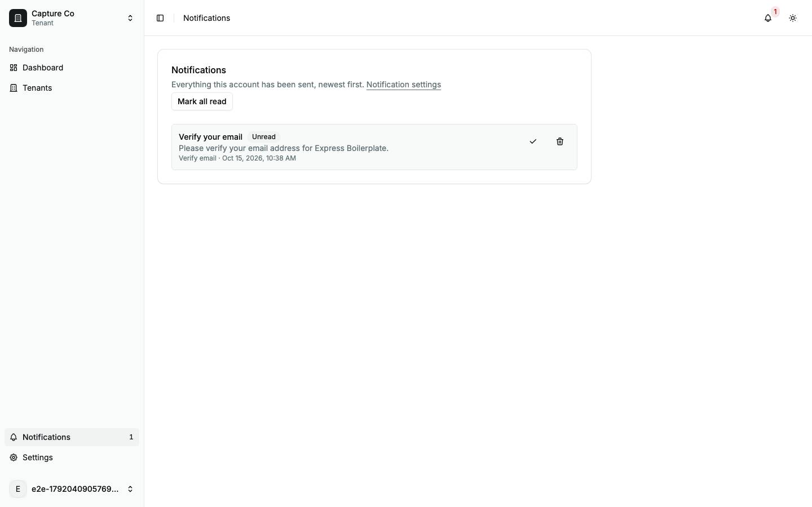
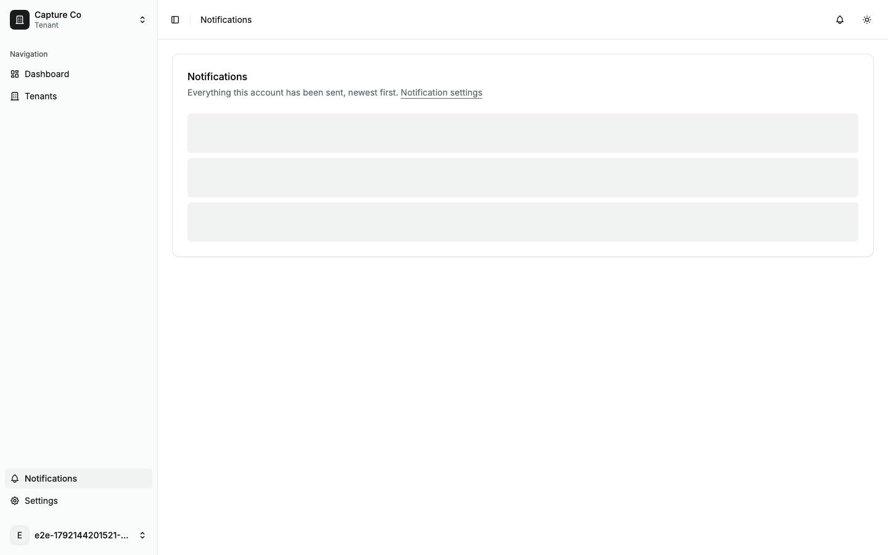
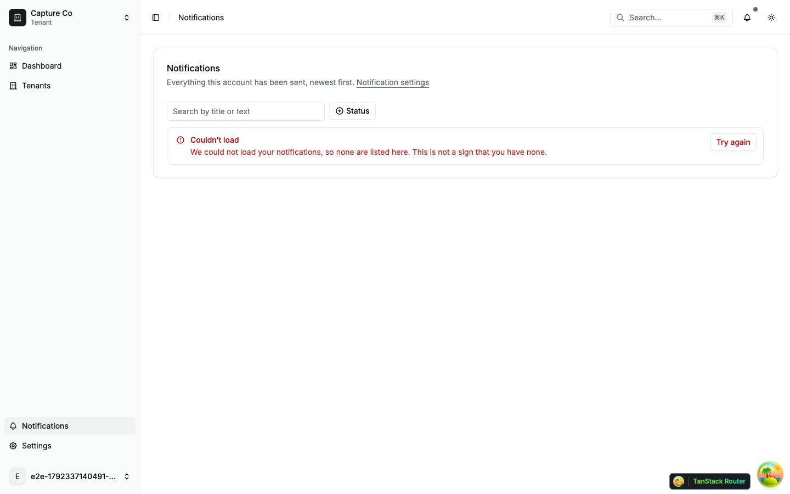
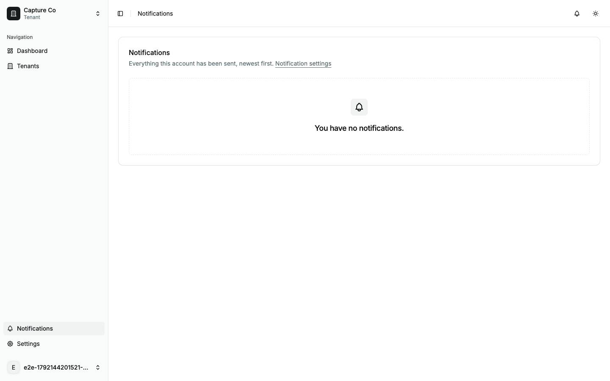

# Notifications

This file covers the notifications page (`/notifications`) and the bell in the app header. Back to the [route map](README.md#route-map).

Both read the paged list, `GET /notifications` (`notificationsListOptions`, `src/queries/notification.queries.ts`), from the application programming interface (API). A URL below is a Uniform Resource Locator.

- The page asks for its own view.
- The bell asks for its first five rows (`limit=5`).
- The bell, the sidebar badge and the page's Mark all read share one unread count (`useUnreadCount`: `unread=true&limit=1&total=1`, the API's capped total).

The shell starts these reads on every signed-in page, and the notification stream (`GET /notifications/stream`) keeps every page fresh. Delivery preferences live in Settings ([settings.md](settings.md#settingsaccountnotifications--notifications)).

"The walk" below is the Playwright walk of the app made for pull request (PR) #108 on 15 October 2026.

## Pages

### `/notifications` — Notifications

|                     |                                                                                                                                                                                                                                                                                                                                                                                  |
| ------------------- | -------------------------------------------------------------------------------------------------------------------------------------------------------------------------------------------------------------------------------------------------------------------------------------------------------------------------------------------------------------------------------- |
| Purpose             | Every notification this account has been sent, newest first, with mark-read and delete.                                                                                                                                                                                                                                                                                          |
| File                | `src/pages/_app/notifications.tsx`                                                                                                                                                                                                                                                                                                                                               |
| Guard and redirects | `_app`                                                                                                                                                                                                                                                                                                                                                                           |
| Layout              | `AppLayout`                                                                                                                                                                                                                                                                                                                                                                      |
| Data                | started: `GET /notifications` for the URL's view (`?search=`, `?unread=`, `?cursor=`, `?limit=`), under `['notifications', 'list']`. On click: `PATCH /notifications/:id/read`, `PATCH /notifications/read-all`, `DELETE /notifications/:id`.                                                                                                                                    |
| Sections            | One `Card`: the `h1` "Notifications", "Everything this account has been sent, newest first." with a Notification settings link, Mark all read (always shown; disabled until the unread total lands and while it is zero, and `aria-disabled` while its request runs, so focus stays), then the list: a toolbar (search by title or text, a Status filter), the cards and paging. |
| Components          | `Card`, `DataTable` with `layout="cards"` (with `QueryState`), `Badge` ("Unread"), `Button` (icon buttons named "Mark "{title}" as read" and "Delete "{title}""), `EmptyState`, `Pii`; `Item` (the cards), `ItemContent`, `ItemTitle`, `ItemDescription`, `ItemActions`                                                                                                          |
| Transitions         | Notification settings → `/settings/account/notifications`; the sidebar's Notifications item and the bell's View all notifications land here                                                                                                                                                                                                                                      |

`DataTable` reports a failed load before an empty inbox, because both give no rows. Mark all read keeps its place whatever the unread total, so the toolbar and the list never move when the total changes.

The stream connects once per page load. Under React's StrictMode in dev, the effect's cleanup aborts the first connect and the second one stays. A browser extension can list the aborted request as a failed 503; it is not one. A signed-out stream request answers 401.

| Loading                                           | Error                                           | Empty                                           |
| ------------------------------------------------- | ----------------------------------------------- | ----------------------------------------------- |
|  |  |  |
| table-shaped skeleton (`DataTable`)               | alert · `QueryState`, with Try again            | "You have no notifications."                    |

The bell loses its badge in the loading and error shots too, since it reads the same request.

Findings: [F-notifications-1](findings.md#f-notifications-1), [F-notifications-2](findings.md#f-notifications-2), [F-notifications-3](findings.md#f-notifications-3), [F-notifications-6](findings.md#f-notifications-6)

## The bell

`NotificationBell` (`src/components/features/notification-bell.tsx`) sits in the header of every signed-in page, beside the theme toggle. It is not a route, so it has no shot of its own; it shows in every `AppLayout` shot.

|             |                                                                                                                                                                                                                                                                                                                     |
| ----------- | ------------------------------------------------------------------------------------------------------------------------------------------------------------------------------------------------------------------------------------------------------------------------------------------------------------------- |
| Trigger     | A ghost icon button with a red count badge (`aria-hidden`). Its name carries the count: "Notifications, 1 unread", "Notifications, 1,000+ unread" at the API's cap, or "Notifications, count unavailable" until the count has loaded. The count is the API's total for the unread view, not a count of loaded rows. |
| Menu        | `DropdownMenu`: "Notifications", up to five recent titles (an unread one starts with a "●" character), then View all notifications. With no rows the menu shows "Notifications didn’t load." with Try again, "Loading notifications…", or a compact `EmptyState`, "You have no notifications."                      |
| Transitions | Every preview row and View all notifications open `/notifications`.                                                                                                                                                                                                                                                 |

Loaded rows win over an error here, unlike on the page: a menu with cached rows stays usable while the page reports the failure. In the walk, the menu of a newly verified account read "Notifications / ● Verify your email / View all notifications". The account menu also has a "Notifications" item; it opens the preferences, not this page.

Findings: [F-notifications-4](findings.md#f-notifications-4), [F-notifications-5](findings.md#f-notifications-5)
