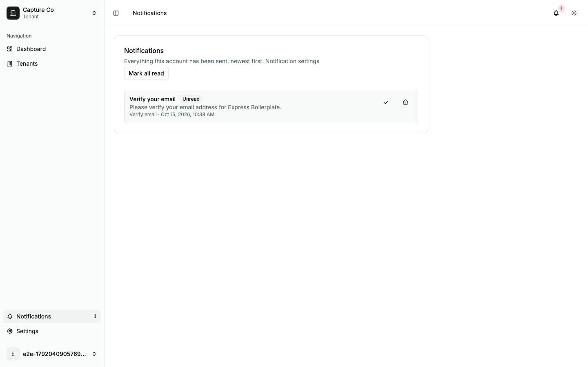
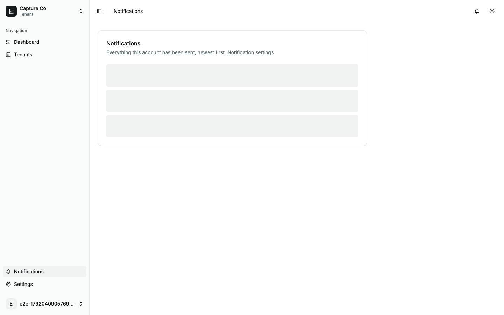
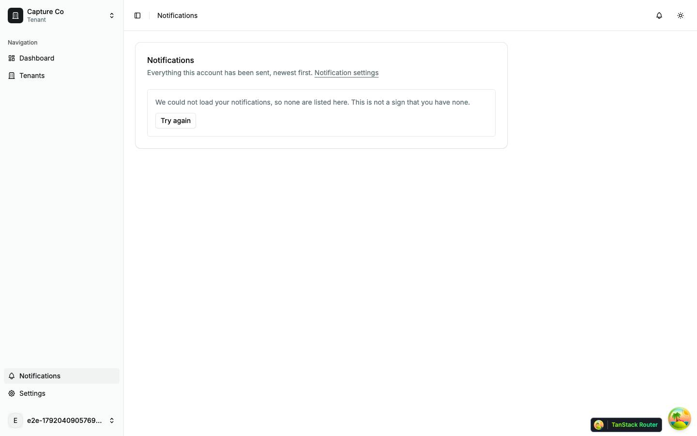
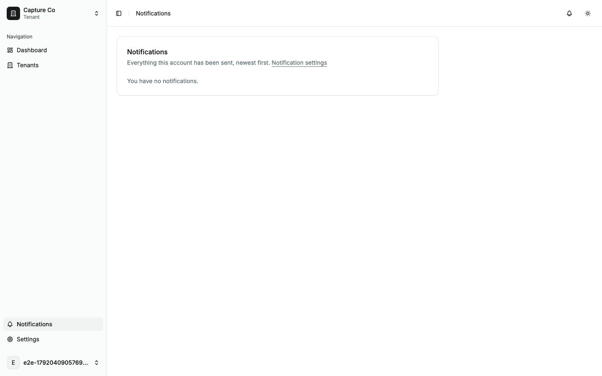

# Notifications

The notifications page (`/notifications`) and the bell in the app header. Back to the [route map](README.md#route-map).

Both read the same infinite query, `GET /notifications?limit=20` (`useNotifications`, `src/queries/notification.queries.ts`), which the shell starts on every signed-in page, and the notification stream (`GET /notifications/stream`) keeps it fresh. Delivery preferences live in Settings ([settings.md](settings.md#settingsaccountnotifications--notifications)).

## Pages

### `/notifications` — Notifications

|                     |                                                                                                                                                                                                                                                    |
| ------------------- | -------------------------------------------------------------------------------------------------------------------------------------------------------------------------------------------------------------------------------------------------- |
| Purpose             | Every notification this account has been sent, newest first, with mark-read and delete.                                                                                                                                                            |
| File                | `src/pages/_app/notifications.tsx`                                                                                                                                                                                                                 |
| Guard and redirects | `_app`                                                                                                                                                                                                                                             |
| Layout              | `AppLayout`                                                                                                                                                                                                                                        |
| Data                | started: `GET /notifications?limit=20` (then `&cursor=` for Load more). On click: `PATCH /notifications/:id/read`, `PATCH /notifications/read-all`, `DELETE /notifications/:id`.                                                                   |
| Sections            | One `Card`: the `h1` "Notifications", "Everything this account has been sent, newest first." with a Notification settings link, Mark all read (only once something unread has loaded), then the list and Load more.                                |
| Components          | `Card`, `Badge` ("Unread"), `Button` (icon buttons named "Mark "{title}" as read" and "Delete "{title}""), `Skeleton`, `LoadError`, `Pii`; hand-rolled: the list (`ul` of bordered rows), the empty `p`, the Load more button with "Loading…" text |
| Transitions         | Notification settings → `/settings/account/notifications`; the sidebar's Notifications item and the bell's View all notifications land here                                                                                                        |

The error branch comes before the empty one, because a failed load and an empty inbox both give `[]`. In the walk, the three skeleton bars gave way to one row and Mark all read appeared above the list at the same moment, moving the row down 36 px.

| Loading                                           | Error                                           | Empty                                           |
| ------------------------------------------------- | ----------------------------------------------- | ----------------------------------------------- |
|  |  |  |
| skeleton · 3× `h-16`                              | alert · `LoadError`                             | "You have no notifications."                    |

The bell loses its badge in the loading and error shots too, since it reads the same request.

Findings: [F-notifications-1](findings.md#f-notifications-1), [F-notifications-2](findings.md#f-notifications-2), [F-notifications-3](findings.md#f-notifications-3), [F-notifications-6](findings.md#f-notifications-6)

## The bell

`NotificationBell` (`src/components/features/notification-bell.tsx`) sits in the header of every signed-in page, beside the theme toggle. It is not a route, so it has no shot of its own; it shows in every `AppLayout` shot.

|             |                                                                                                                                                                                                                                                                        |
| ----------- | ---------------------------------------------------------------------------------------------------------------------------------------------------------------------------------------------------------------------------------------------------------------------- |
| Trigger     | A ghost icon button with a red count badge (`aria-hidden`); its name carries the count: "Notifications, 1 unread", or "Notifications, count unavailable" before any data. The count comes from the loaded pages, since the API has no unread-count endpoint.           |
| Menu        | `DropdownMenu`: "Notifications", up to five recent titles (an unread one starts with a "●" character), then View all notifications. With no rows it says "Notifications could not be loaded.", "Loading notifications…" or "You have no notifications." as plain text. |
| Transitions | Every preview row and View all notifications open `/notifications`.                                                                                                                                                                                                    |

Loaded rows win over an error here, unlike the page: a menu with cached rows stays usable while the page reports the failure. In the walk the menu read "Notifications / ● Verify your email / View all notifications" for a newly verified account. The account menu also has a "Notifications" item, and it opens the preferences, not this page.

Findings: [F-notifications-4](findings.md#f-notifications-4), [F-notifications-5](findings.md#f-notifications-5)
