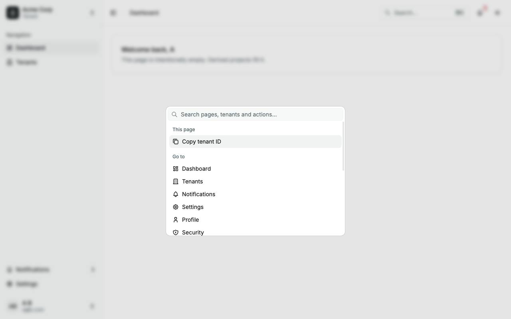
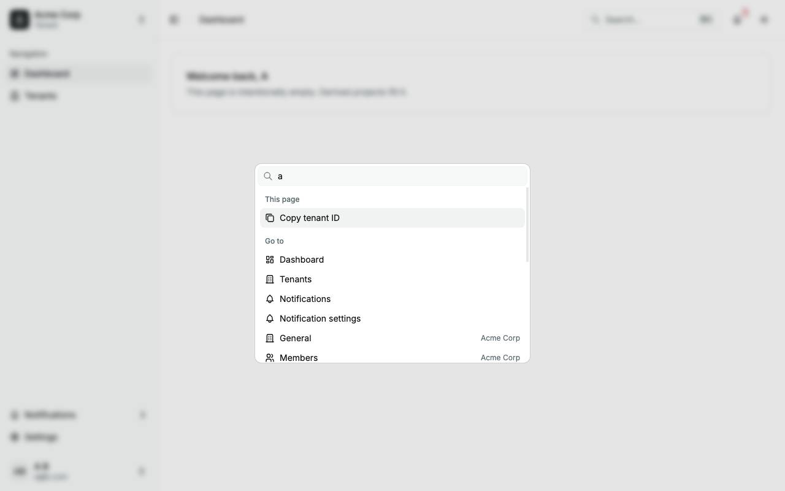
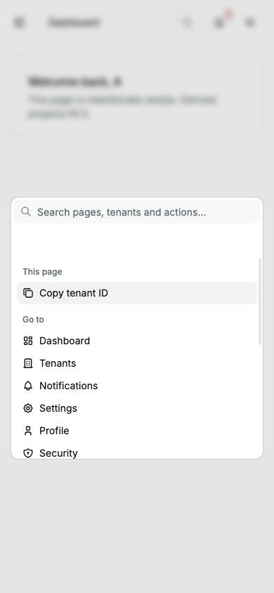
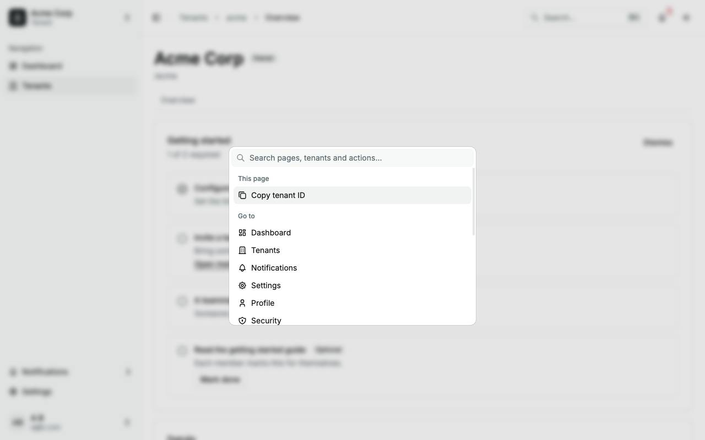

# Command palette

The command palette (⌘K on Apple platforms, Ctrl+K elsewhere) in the signed-in shell; it has no route of its own. Back to the [route map](README.md#route-map).

|               |                                                                                                                                                                                                                                                                                                                                                                                                                                                                                                                                                                                                                                                                                                                                                                                                                                                                                                             |
| ------------- | ----------------------------------------------------------------------------------------------------------------------------------------------------------------------------------------------------------------------------------------------------------------------------------------------------------------------------------------------------------------------------------------------------------------------------------------------------------------------------------------------------------------------------------------------------------------------------------------------------------------------------------------------------------------------------------------------------------------------------------------------------------------------------------------------------------------------------------------------------------------------------------------------------------- |
| Purpose       | Go to any page, switch tenant, change the theme, create a tenant, sign out or copy the current tenant's ID, from the keyboard.                                                                                                                                                                                                                                                                                                                                                                                                                                                                                                                                                                                                                                                                                                                                                                              |
| Files         | `src/components/features/command-palette.tsx` (the commands); the shared `src/components/shared/command-palette/*` (shell, host, loader, registry, recents); `src/states/command-palette.store.ts`; `src/components/ui/command.tsx` (Base UI `Autocomplete`, not `cmdk`); `src/lib/shortcut.ts`; `src/hooks/use-switch-tenant.ts`; `src/hooks/use-record-recent-tenant.ts` (records Recent)                                                                                                                                                                                                                                                                                                                                                                                                                                                                                                                 |
| Mounted by    | `AppLayout`, through `CommandPaletteHost`; the code loads on idle, on hover or focus of the Search… button, or at the first open                                                                                                                                                                                                                                                                                                                                                                                                                                                                                                                                                                                                                                                                                                                                                                            |
| Opens         | ⌘K on Apple platforms, Ctrl+K elsewhere; the K is matched by its character when the key types a Latin letter (so Dvorak and Colemak follow what their keys type) and by its physical position only when it does not (a Cyrillic or Greek layout). It ignores repeats, IME composition, Shift and Alt; the header's Search… button. Escape, a click outside or a choice closes it; every close clears the term.                                                                                                                                                                                                                                                                                                                                                                                                                                                                                              |
| Groups        | Recent, This page, Go to, Switch tenant, Theme, Account, in that order. Go to: Dashboard, Tenants, Notifications, Settings, Profile, Security, Notification settings, then General, Members and Activity for the current tenant. Switch tenant: the caller's tenants. Theme: Light, Dark, System. Account: Create a tenant, Sign out. This page: Copy tenant ID, with a current tenant.                                                                                                                                                                                                                                                                                                                                                                                                                                                                                                                     |
| Search        | Every group is matched here, on the label, the detail and the keywords. Switch tenant lists the first 8 matches and nothing with no term; a tenant already listed under Recent is not repeated there while a term is typed. The palette sends no request.                                                                                                                                                                                                                                                                                                                                                                                                                                                                                                                                                                                                                                                   |
| States        | "No results." when nothing matches. A suspended tenant is listed but disabled, with "Suspended".                                                                                                                                                                                                                                                                                                                                                                                                                                                                                                                                                                                                                                                                                                                                                                                                            |
| Loading       | The palette's code is fetched once, on idle, on hover or focus of the Search… button, or at the first open. Once the fetch has resolved, the first open shows the palette directly; only an open that beats the fetch shows a "Loading search…" overlay (a polite status line) over a field named "Search" that holds the typed text in the store's `query`, so keys pressed right after the shortcut carry into the palette. The overlay is a modal dialog named "Search": Tab stays on the field, and Escape or a click on the backdrop closes it. When the palette takes over, focus goes back to the opener first, so closing the palette returns it to the Search… button. A failed fetch closes the palette and shows the toast "Search didn’t load. Reload the page to use it." with a Reload action; there is no in-page retry, because Chromium keeps a failed `import()` for the page's lifetime. |
| Analytics     | `command_palette_opened` on each open; `command_palette_action_run` with `action` `open_page`, `open_recent`, `switch_tenant`, `set_theme`, `create_tenant`, `copy_id` or `sign_out`.                                                                                                                                                                                                                                                                                                                                                                                                                                                                                                                                                                                                                                                                                                                       |
| Accessibility | A dialog named "Command palette", described "Go to a page, switch tenant or run an action."; the input "Search pages, tenants and actions", described by the arrow-keys line; disabled rows `aria-disabled`; icons hidden.                                                                                                                                                                                                                                                                                                                                                                                                                                                                                                                                                                                                                                                                                  |
| Storage       | `palette.recent.v1:<userId>` in `localStorage` (Recent): at most 5 tenants, newest first, each with its kind, id, the name the pages show and a time. Recents are cleared on every session end, expiry included: `logout()` removes every `palette.recent.v1:` key, and it runs on sign-out, on a dead or expired session cookie at the cold-load restore or a refresh, and on another tab's logout, whether or not the palette ever loaded.                                                                                                                                                                                                                                                                                                                                                                                                                                                                |
| Bundle        | The entry chunk holds none of the palette's code. `pnpm check:bundle` fails when a chunk with the palette's code is statically reachable from the entry or the host, and holds the entry to 589,500 B.                                                                                                                                                                                                                                                                                                                                                                                                                                                                                                                                                                                                                                                                                                      |

## After

Opened on the dashboard, with no term:

With the term `a`:

At 390 px, opened from the header's search icon:

On a tenant's page (`/tenants/acme`), with no term and This page showing:

