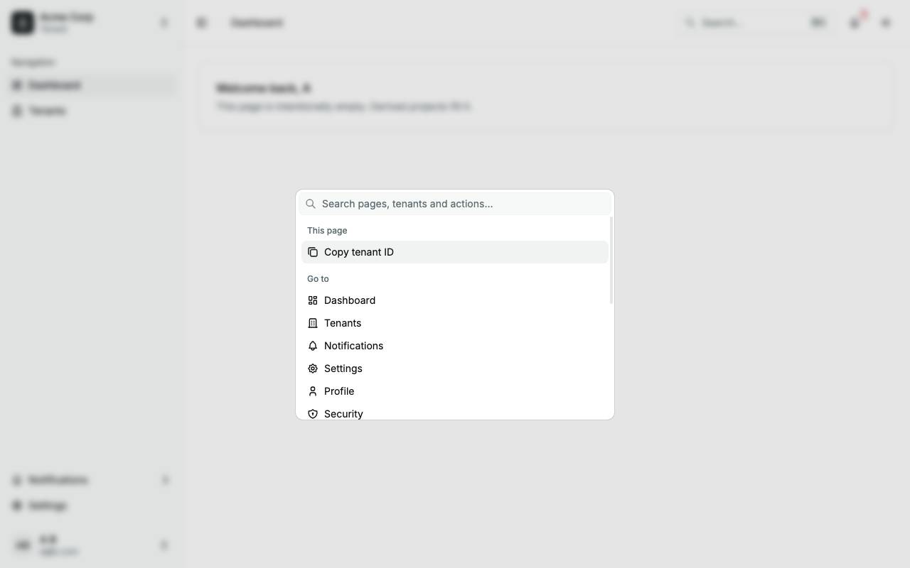
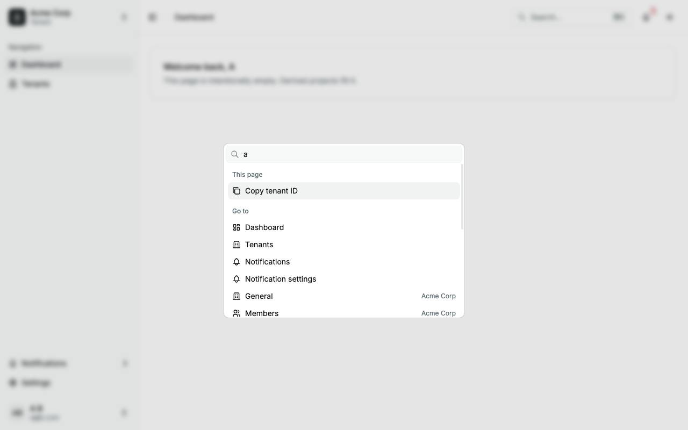
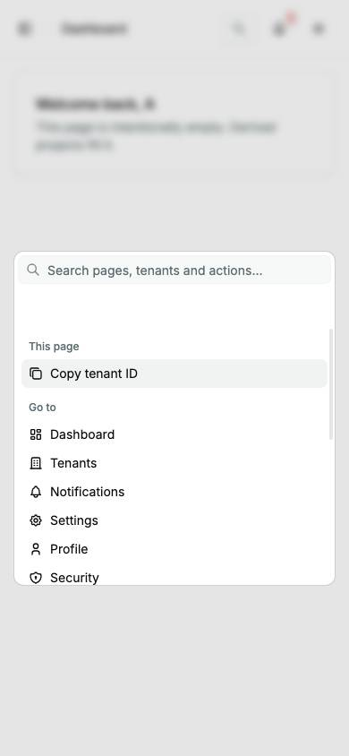
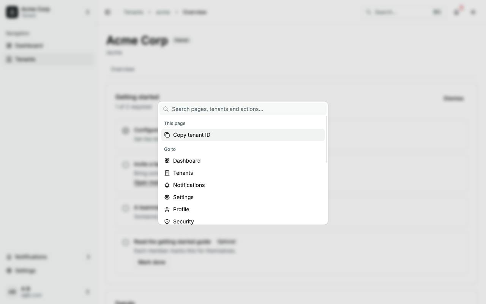

# Command palette

This file covers the command palette of the signed-in shell, opened with ⌘K on Apple platforms and Ctrl+K elsewhere. It has no route of its own. Back to the [route map](README.md#route-map).

|               |                                                                                                                                                                                                                                                                                                                                                                                             |
| ------------- | ------------------------------------------------------------------------------------------------------------------------------------------------------------------------------------------------------------------------------------------------------------------------------------------------------------------------------------------------------------------------------------------- |
| Purpose       | Go to any page, switch tenant, change the theme, create a tenant, sign out or copy the current tenant's identifier (ID), from the keyboard.                                                                                                                                                                                                                                                 |
| Files         | `src/components/features/command-palette.tsx` (the commands); the shared `src/components/shared/command-palette/*` (shell, host, loader, registry, recents); `src/states/command-palette.store.ts`; `src/components/ui/command.tsx` (Base UI `Autocomplete`, not `cmdk`); `src/lib/shortcut.ts`; `src/hooks/use-switch-tenant.ts`; `src/hooks/use-record-recent-tenant.ts` (records Recent) |
| Mounted by    | `AppLayout`, through `CommandPaletteHost`. The code loads on idle, on hover or focus of the Search… button, or at the first open.                                                                                                                                                                                                                                                           |
| Opens         | ⌘K on Apple platforms, Ctrl+K elsewhere, or the header's Search… button. See [Opening the palette](#opening-the-palette).                                                                                                                                                                                                                                                                   |
| Groups        | Recent, This page, Go to, Switch workspace, Theme, Account, in that order. See [Groups](#groups).                                                                                                                                                                                                                                                                                           |
| Search        | Every group is matched, on the label, the detail and the keywords. Switch workspace lists the first 8 matches, and nothing with no term. While a term is typed, a tenant already listed under Recent is not repeated there. The palette sends no request.                                                                                                                                   |
| States        | "No results." when nothing matches. A suspended tenant is listed but disabled, with "Suspended".                                                                                                                                                                                                                                                                                            |
| Loading       | See [Loading the palette's code](#loading-the-palettes-code).                                                                                                                                                                                                                                                                                                                               |
| Analytics     | `command_palette_opened` on each open; `command_palette_action_run` with `action` `open_page`, `open_recent`, `switch_tenant`, `set_theme`, `create_tenant`, `copy_id` or `sign_out`.                                                                                                                                                                                                       |
| Accessibility | A dialog named "Command palette", described "Go to a page, switch workspace or run an action."; the input "Search pages, workspaces and actions", described by the arrow-keys line; disabled rows `aria-disabled`; icons hidden.                                                                                                                                                            |
| Storage       | `palette.recent.v1:<userId>` in `localStorage` (Recent). See [Recent tenants](#recent-tenants).                                                                                                                                                                                                                                                                                             |
| Bundle        | The entry chunk holds none of the palette's code. `pnpm check:bundle` fails when a chunk with the palette's code is statically reachable from the entry or the host, and holds the entry to 593,750 B (bytes).                                                                                                                                                                              |

## Opening the palette

- ⌘K on Apple platforms and Ctrl+K elsewhere open it, as does the header's Search… button.
- The shortcut matches the K by its character when the key types a Latin letter, so Dvorak and Colemak follow what their keys type. It matches the K by its physical position only when the key does not type a Latin letter (a Cyrillic or Greek layout).
- The shortcut ignores key repeats, input method editor (IME) composition, Shift and Alt.
- Escape, a click outside or a choice closes the palette. Every close clears the term.

## Groups

| Group            | Commands                                                                                                                                                     |
| ---------------- | ------------------------------------------------------------------------------------------------------------------------------------------------------------ |
| Recent           | The tenants recorded in [Recent tenants](#recent-tenants)                                                                                                    |
| This page        | Copy workspace ID (for support), when there is a current tenant                                                                                              |
| Go to            | Dashboard, Workspaces, Notifications, Settings, Profile, Security, Notification settings, then General, Members, Billing and Activity for the current tenant |
| Switch workspace | The caller's tenants                                                                                                                                         |
| Theme            | Light, Dark, System                                                                                                                                          |
| Account          | Create a workspace, Sign out                                                                                                                                 |

## Loading the palette's code

1. The palette's code is fetched once: on idle, on hover or focus of the Search… button, or at the first open.
2. Once the fetch has resolved, the first open shows the palette directly.
3. Only an open that beats the fetch shows a "Loading search…" overlay. The overlay has a polite status line over a field named "Search". The field holds the typed text in the store's `query`, so keys pressed right after the shortcut carry into the palette.
4. The overlay is a modal dialog named "Search": Tab stays on the field, and Escape or a click on the backdrop closes it.
5. When the palette takes over, focus goes back to the opener first, so closing the palette returns focus to the Search… button.
6. A failed fetch closes the palette and shows the toast "Search didn’t load. Reload the page to use it." with a Reload action. There is no in-page retry, because Chromium keeps a failed `import()` for the page's lifetime.

## Recent tenants

`palette.recent.v1:<userId>` in `localStorage` holds at most 5 tenants, newest first. Each entry has its kind, its ID, the name the pages show and a time.

Recents are cleared on every session end, expiry included. `logout()` removes every `palette.recent.v1:` key. It runs on sign-out, on a dead or expired session cookie at the cold-load restore or a refresh, and on another tab's logout, whether or not the palette ever loaded.

## After

Four screenshots of the palette.

Opened on the dashboard, with no term:

With the term `a`:

At 390 px, opened from the header's search icon:

On a tenant's page (`/tenants/acme`), with no term and This page showing:

