# Settings

The settings shell (`/settings`), account settings (profile, security, notifications) and workspace settings (general, members, activity). Back to the [route map](README.md#route-map).

The groups and pages are declared once, in `src/constants/settings.ts` (`SETTINGS_GROUPS`, `SETTINGS_SECTIONS`); the sidebar nav, the landing page and the layout's title all read them. Every settings page sets `errorComponent: SettingsRouteError`, the router's "Something went wrong" card titled `h2` under the layout's `h1`, kept in the page's own chunk so a failed fetch can still show it.

## Layout

### `/settings` — Settings shell

|             |                                                                                                                                                                                                                                                                                              |
| ----------- | -------------------------------------------------------------------------------------------------------------------------------------------------------------------------------------------------------------------------------------------------------------------------------------------- |
| File        | `src/pages/_app/settings.tsx`                                                                                                                                                                                                                                                                |
| Fetches     | nothing of its own; it sits under `_app`, whose `TenantSearchGuard` reads `GET /tenants` after mount and keeps `?tenant=` on account pages                                                                                                                                                   |
| Renders     | a `header` with the active section's label as a large `h1` and its description (on the landing page, "Settings" and "Manage your account and the current tenant."), then the page                                                                                                            |
| Nav         | `AppLayout` swaps the sidebar's content for `NavSettings`: Back to app (→ `/dashboard`), then "Account": Profile, Security, Notifications; "Workspace · {tenant name}": General, Members, Activity. With no current tenant the workspace items are disabled and say "Choose a tenant first." |
| Breadcrumbs | Settings › {page}; on workspace pages Settings › {slug} (plain text) › {page}                                                                                                                                                                                                                |

### `/settings/workspace/$slug` — Workspace gate

|                |                                                                                                                                                                                                                                                                                            |
| -------------- | ------------------------------------------------------------------------------------------------------------------------------------------------------------------------------------------------------------------------------------------------------------------------------------------ |
| File           | `src/pages/_app/settings/workspace.$slug.tsx`                                                                                                                                                                                                                                              |
| Fetches        | the same loader as the tenant layout ([tenants.md](tenants.md#layout)): starts `GET /tenants/:slug` (`['tenants', slug]`) and awaits `GET /tenants/:slug/flags` (`['flags', 'tenant', slug]`, `staleTime` 5 min, 10 s cap), `preloadStaleTime: 0`, blocking stale reload; strips `?tenant` |
| While it loads | the flags read holds the route (`pendingComponent: SettingsPagePending`); then the gate shows the settings template (`PageSkeleton variant="settings" nested`) under the layout's `h1` until the tenant lands                                                                              |
| Gate panels    | `TenantGate` titled `h2`: **Tenant not available** for a 404, **Tenant suspended** for a suspended tenant of yours, a `LoadError` when the list also failed                                                                                                                                |
| Load failed    | the gate's `QueryState`: one `LoadError`, "We could not load this tenant. The request failed, which is not the same as the tenant being gone.", under the layout's `h1`, in place of every card of the page                                                                                |
| Renders        | a `PlatformAccessBanner` for staff on platform access, a line "{name} · /{slug}", then the page. Choosing another tenant in the switcher opens the same section for it.                                                                                                                    |

Findings: [F-settings-1](findings.md#f-settings-1), [F-settings-2](findings.md#f-settings-2), [F-settings-14](findings.md#f-settings-14)

## Pages

### `/settings/` — Settings home

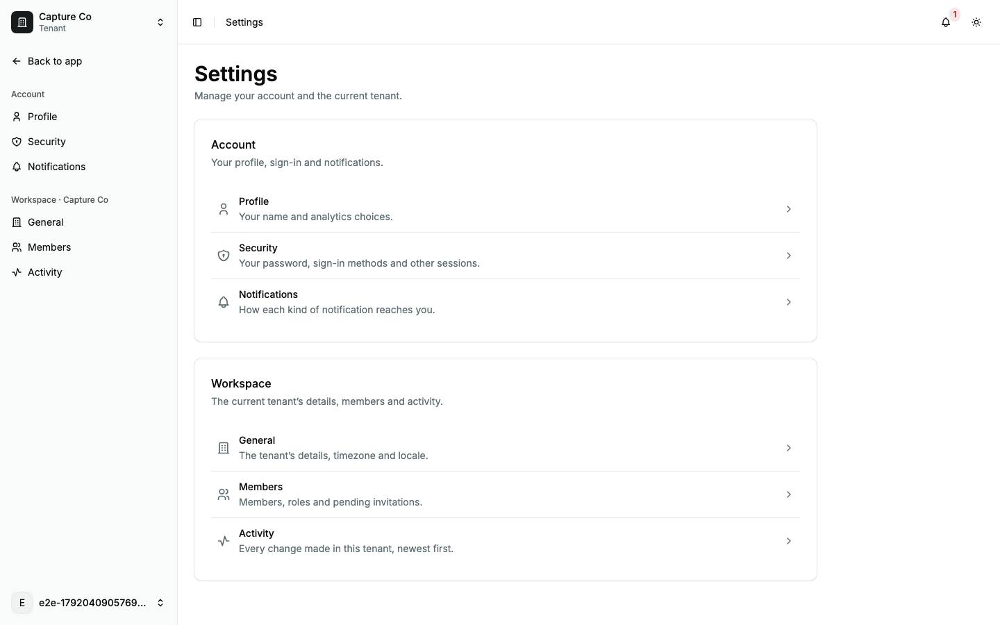

|                     |                                                                                                                                                                                                                                                          |
| ------------------- | -------------------------------------------------------------------------------------------------------------------------------------------------------------------------------------------------------------------------------------------------------- |
| Purpose             | One card per settings group, each page a row that links to it.                                                                                                                                                                                           |
| File                | `src/pages/_app/settings/index.tsx`                                                                                                                                                                                                                      |
| Guard and redirects | `_app`                                                                                                                                                                                                                                                   |
| Layout              | `AppLayout` › settings shell                                                                                                                                                                                                                             |
| Data                | none of its own; the workspace links use `useCurrentTenantSlug()` (the shell's `?tenant`)                                                                                                                                                                |
| Sections            | `SettingsLinkList` per group: Account (Profile, Security, Notifications) and Workspace (General, Members, Activity), each row an icon, label, description and chevron. Without a tenant the Workspace rows are plain text under "Choose a tenant first." |
| Components          | `Card`, `ItemGroup`, `Item` (link rows), `ItemMedia`, `ItemContent`, `ItemTitle`, `ItemDescription`                                                                                                                                                      |
| Transitions         | each row → its page; Back to app → `/dashboard`                                                                                                                                                                                                          |

### `/settings/account/profile` — Profile

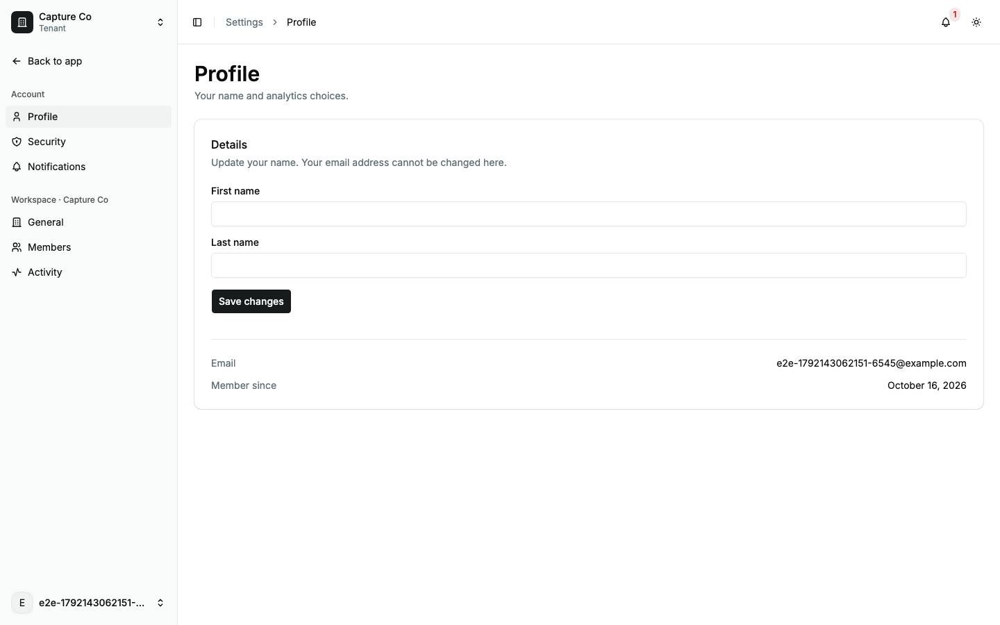

|                     |                                                                                                                                                                                                                    |
| ------------------- | ------------------------------------------------------------------------------------------------------------------------------------------------------------------------------------------------------------------ |
| Purpose             | Change your name, see your address and join date, and choose whether to share usage analytics.                                                                                                                     |
| File                | `src/pages/_app/settings/account.profile.tsx`                                                                                                                                                                      |
| Guard and redirects | `_app`; `/profile` and `/settings/account/` redirect here                                                                                                                                                          |
| Layout              | `AppLayout` › settings shell                                                                                                                                                                                       |
| Data                | `useProfile` (`GET /profile`, `['profile']`) with the session's user as `initialData`, so the page makes no request of its own. `PATCH /profile` on Save changes (changed names only) and on the analytics switch. |
| Sections            | Details card: first and last name, Save changes, then Email and Member since; Privacy: the Share usage analytics switch (`AnalyticsSection`)                                                                       |
| Components          | `Card`, `Form` fields, `Input`, `BusyButton`, `Switch`, `Pii`, `QueryState`, `FormFieldsSkeleton` (4 fields; shown only when the session holds no user)                                                            |
| Transitions         | none beyond the nav; Save changes toasts "Profile updated."                                                                                                                                                        |

The capture has no loading or error shot for this page: the session's user is always there to paint. Without it, the read decides: four label-and-input pairs and a button bar until it answers, then `LoadError` "Profile could not be loaded." with Try again on a failure.

### `/settings/account/security` — Security

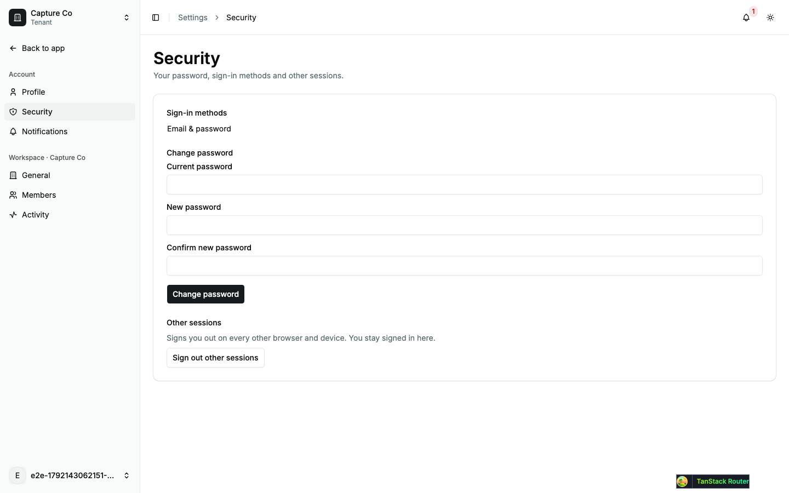

|                     |                                                                                                                                                                                                                                                        |
| ------------------- | ------------------------------------------------------------------------------------------------------------------------------------------------------------------------------------------------------------------------------------------------------ |
| Purpose             | See how you sign in, change your password, and sign out other sessions.                                                                                                                                                                                |
| File                | `src/pages/_app/settings/account.security.tsx`, rendering `SecuritySection` (`src/components/features/profile/security-section.tsx`)                                                                                                                   |
| Guard and redirects | `_app`                                                                                                                                                                                                                                                 |
| Layout              | `AppLayout` › settings shell                                                                                                                                                                                                                           |
| Data                | started: `GET /auth/providers` (`['auth', 'providers']`). `POST /auth/change-password` and `POST /auth/sessions/revoke-others` on their buttons.                                                                                                       |
| Sections            | One untitled `Card`: Sign-in methods ← providers ("Email & password"); Change password (current, new, confirm), shown only when the account has a password, else "This account signs in with Google only…"; Other sessions (no request until clicked). |
| Components          | `Card`, `Form` fields, `Input`, `BusyButton`, `QueryState`, `CardRowsSkeleton`, `FormFieldsSkeleton`, `ItemGroup`, `Item` (sign-in methods)                                                                                                            |
| Transitions         | Change password toasts "Password changed. Other sessions were signed out."                                                                                                                                                                             |

The password form waits on the providers request, because only that answer says whether the account has a password; so a failed providers request hides the form as well (the error shot). The loading skeleton holds the sign-in methods line and the password form's three fields and button, so Other sessions does not move when the form lands.

| Loading                                                                    | Error                                                         |
| -------------------------------------------------------------------------- | ------------------------------------------------------------- |
| 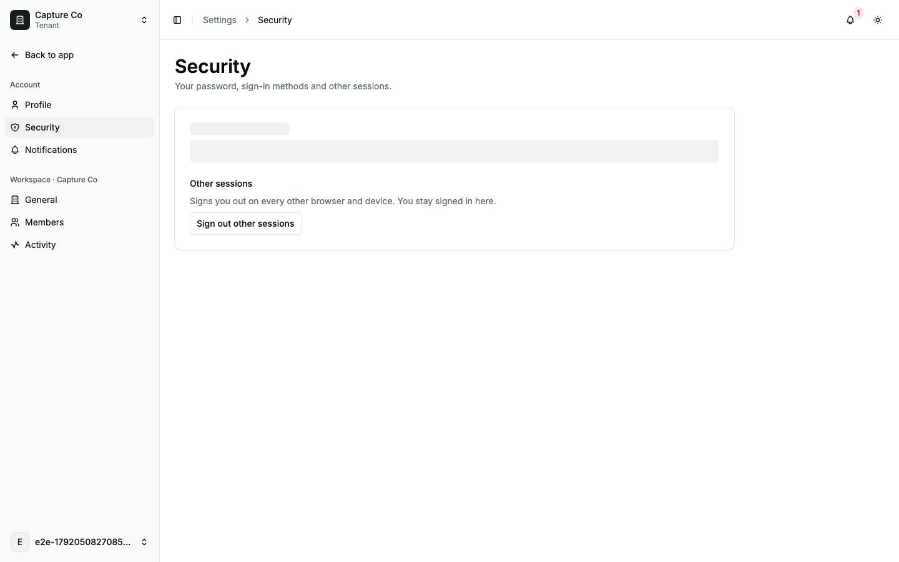                            | 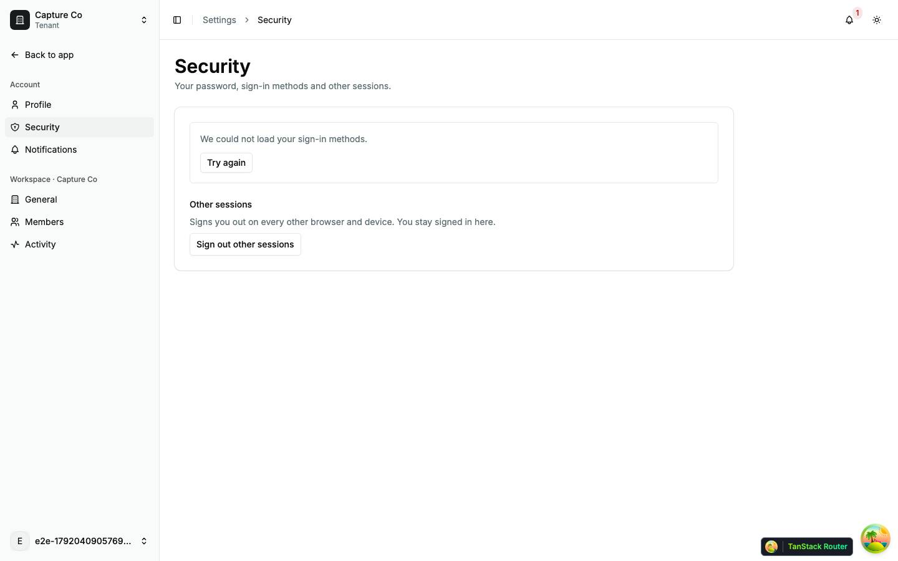                 |
| skeleton · 2 headings, 2 method rows, 3 label-and-input pairs + button bar | alert · `LoadError` "We could not load your sign-in methods." |

Findings: [F-settings-3](findings.md#f-settings-3), [F-settings-12](findings.md#f-settings-12)

### `/settings/account/notifications` — Notifications

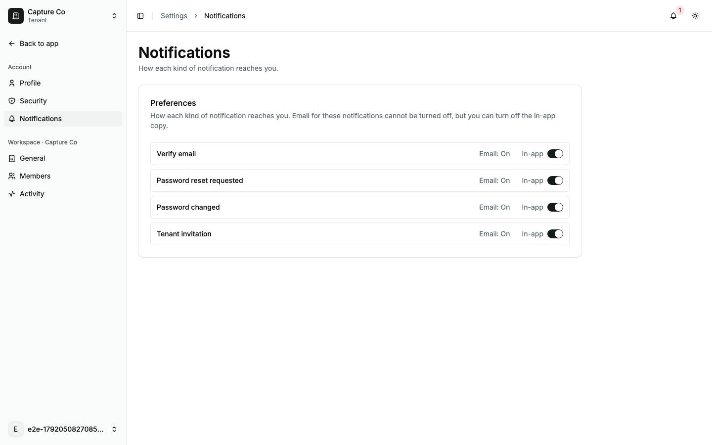

|                     |                                                                                                                                                                           |
| ------------------- | ------------------------------------------------------------------------------------------------------------------------------------------------------------------------- |
| Purpose             | Choose, per kind of notification, whether the in-app copy is kept. Email for these kinds cannot be turned off.                                                            |
| File                | `src/pages/_app/settings/account.notifications.tsx`, rendering `PreferencesCard` (`src/components/features/notifications/preferences-card.tsx`)                           |
| Guard and redirects | `_app`; the account menu's Notifications item opens this page                                                                                                             |
| Layout              | `AppLayout` › settings shell                                                                                                                                              |
| Data                | started: `GET /notifications/preferences` (`['notifications', 'preferences']`); `PUT /notifications/preferences` on each switch (optimistic)                              |
| Sections            | Preferences card: one bordered row per kind (Verify email, Password reset requested, Password changed, Tenant invitation) with "Email: On" as text and an In-app `Switch` |
| Components          | `Card`, `Switch`, `QueryState`, `CardRowsSkeleton`, `EmptyState` (compact), `ItemGroup`, `Item`, `ItemContent`, `ItemTitle`, `ItemActions`                                |
| Transitions         | none                                                                                                                                                                      |

| Loading                                              | Error                                              | Empty                                              |
| ---------------------------------------------------- | -------------------------------------------------- | -------------------------------------------------- |
| 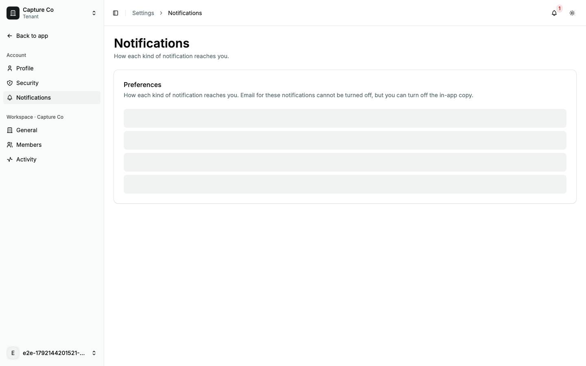 | 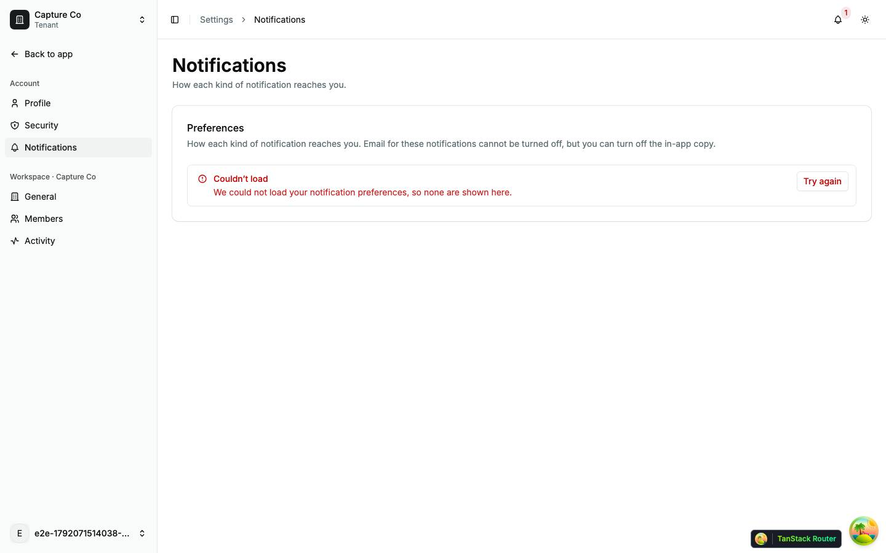 | 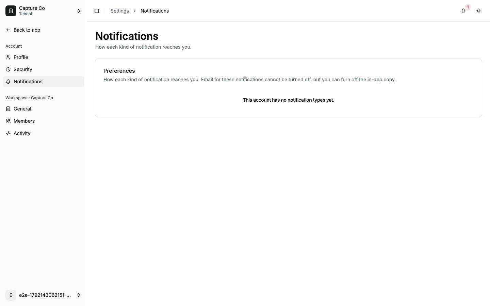 |
| skeleton · 4 rows of `2.875rem`                      | alert · `LoadError`                                | "This account has no notification types yet."      |

Findings: [F-settings-4](findings.md#f-settings-4), [F-settings-8](findings.md#f-settings-8), [F-settings-10](findings.md#f-settings-10), [F-notifications-5](findings.md#f-notifications-5)

### `/settings/workspace/$slug/general` — General

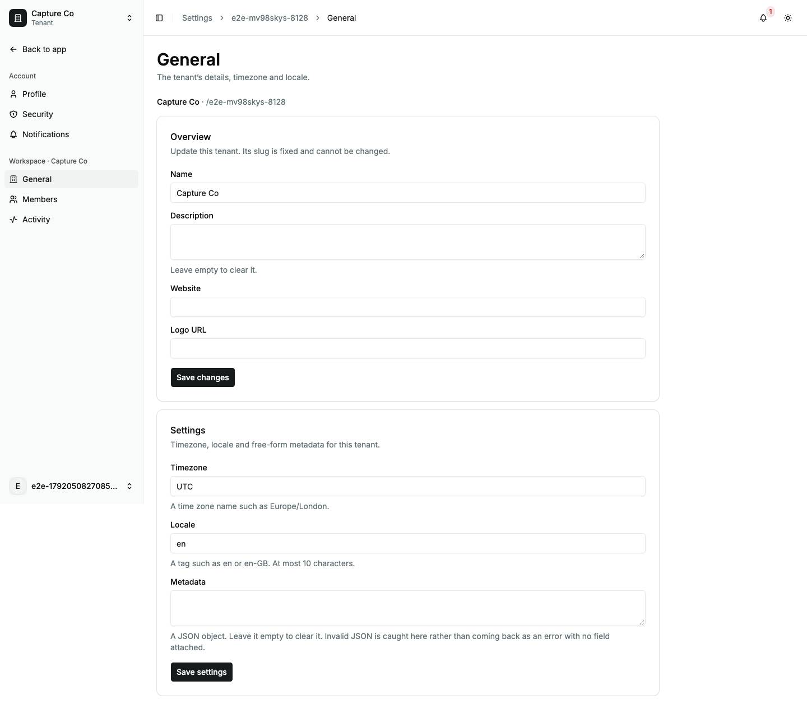

|                     |                                                                                                                                                                                                                                                                                                                                                                                                                  |
| ------------------- | ---------------------------------------------------------------------------------------------------------------------------------------------------------------------------------------------------------------------------------------------------------------------------------------------------------------------------------------------------------------------------------------------------------------- |
| Purpose             | Edit the tenant's name, description, website and logo, and its timezone, locale and metadata.                                                                                                                                                                                                                                                                                                                    |
| File                | `src/pages/_app/settings/workspace.$slug.general.tsx`                                                                                                                                                                                                                                                                                                                                                            |
| Guard and redirects | `_app`, the [workspace gate](#settingsworkspaceslug--workspace-gate); `/settings/workspace/$slug/`, `/tenants/$slug/settings`, the overview's Workspace settings link and the Configure step land here                                                                                                                                                                                                           |
| Layout              | `AppLayout` › settings shell › workspace gate                                                                                                                                                                                                                                                                                                                                                                    |
| Data                | awaited by the layout's loader: the tenant's flags (`['flags', 'tenant', slug]`, `staleTime` 5 min, 10 s cap). Started, and waited for by the gate: `GET /tenants/:slug` (`['tenants', slug]`). Started: `GET /tenants/:slug/settings` (`['tenants', slug, 'settings']`). `PATCH /tenants/:slug` and `PATCH /tenants/:slug/settings` on their Save buttons. The role comes from the tenant detail (`useMyRole`). |
| Sections            | `ReadOnlyBanner` for viewers and editors ("You can view these settings. Owners and admins can change them."); Overview card ← the detail (name, description, website, logo URL); Settings card ← settings (timezone as free text, locale, metadata as a JSON textarea). Read-only roles see `dl` lists instead of forms.                                                                                         |
| Components          | `Card`, `Form` fields, `Input`, `Textarea`, `BusyButton`, `QueryState`, `FormFieldsSkeleton` (Overview 4 fields; Settings 3 fields, each with a button bar), `LoadError` per card, `Note` (info, `ReadOnlyBanner`)                                                                                                                                                                                               |
| Transitions         | none beyond the nav; each Save toasts                                                                                                                                                                                                                                                                                                                                                                            |

Each card has its own loading state: the Settings card keeps its form skeleton until both its settings and the role have landed. Each card has its own error: in the walk, with only `GET /tenants/:slug/settings` answering 500, the Settings card showed its `LoadError` and the Overview form stayed usable. The capture's loading and error shots hold or fail the tenant read the gate waits for, so they show the settings template under the real heading and the tenant `LoadError`.

| Loading                                                 | Error                                          |
| ------------------------------------------------------- | ---------------------------------------------- |
| 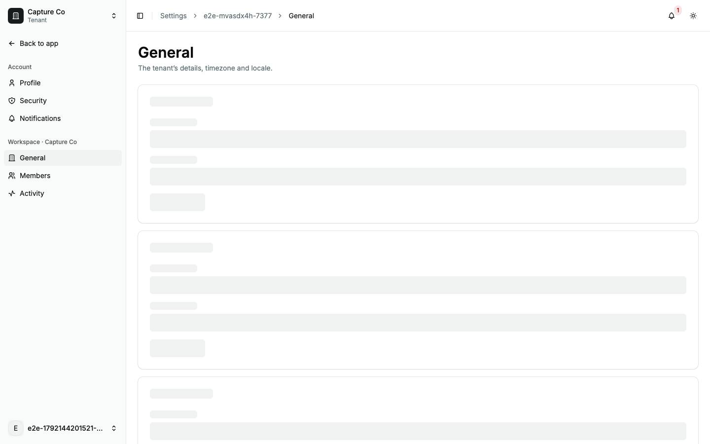        | 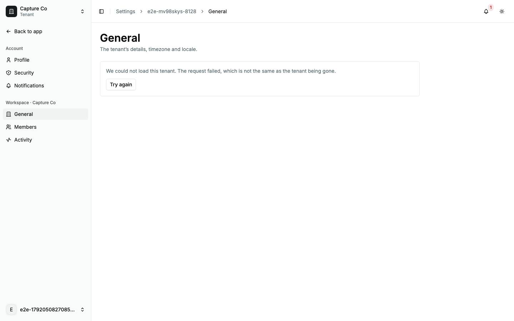 |
| skeleton · the settings template under the real heading | alert · the tenant `LoadError` under the `h1`  |

| Role-denied                                                                                                                                                                                                                                                                                                                                             |
| ------------------------------------------------------------------------------------------------------------------------------------------------------------------------------------------------------------------------------------------------------------------------------------------------------------------------------------------------------- |
| 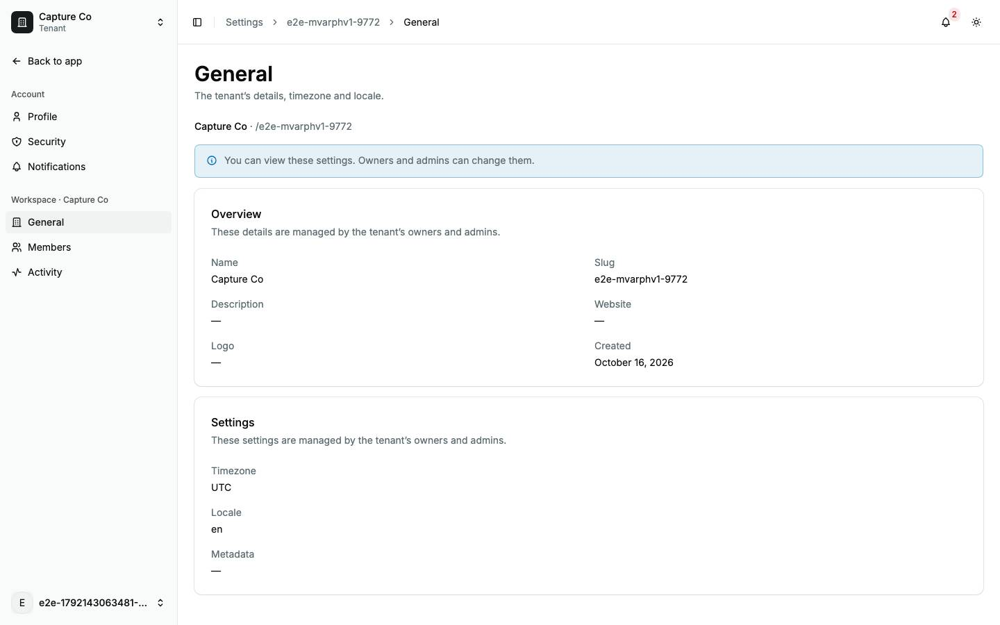                                                                                                                                                                                                                                                                                                    |
| An editor (`canManageTenant` is false): `ReadOnlyBanner` above the cards; the Overview card says "These details are managed by the tenant's owners and admins." over the read-only `TenantDetails` list, and the Settings card says "These settings are managed by the tenant's owners and admins." over `SettingsDetails`. No form and no Save button. |

Findings: [F-settings-1](findings.md#f-settings-1), [F-settings-2](findings.md#f-settings-2), [F-settings-5](findings.md#f-settings-5), [F-settings-11](findings.md#f-settings-11)

### `/settings/workspace/$slug/members` — Members

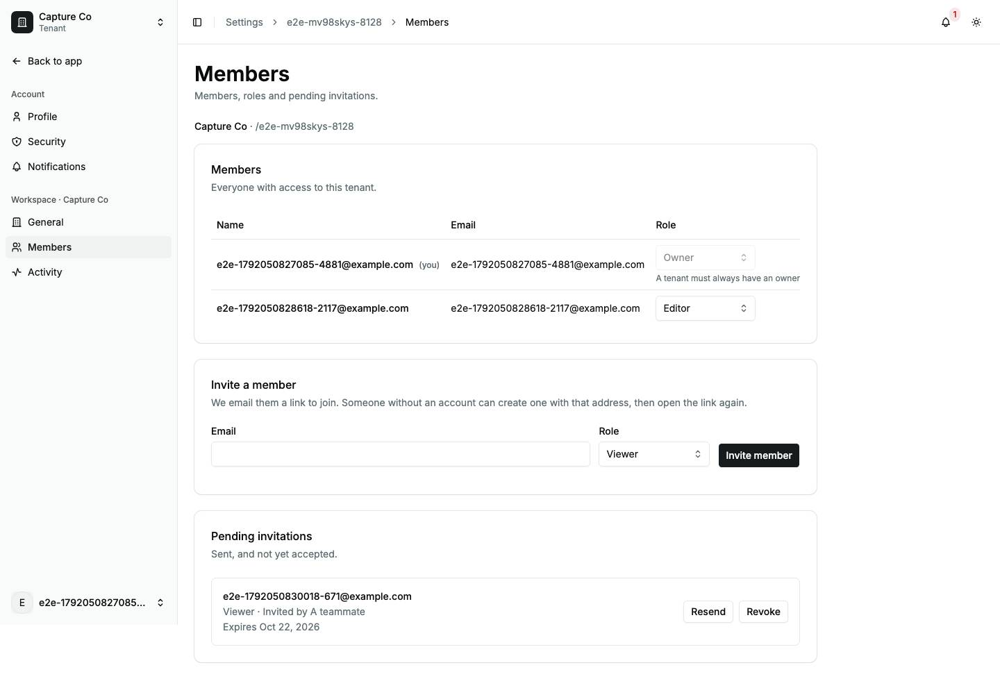

|                     |                                                                                                                                                                                                                                                                                                                                                                                                                                                                                                                                                                                                                                                                                                                                                                                                                  |
| ------------------- | ---------------------------------------------------------------------------------------------------------------------------------------------------------------------------------------------------------------------------------------------------------------------------------------------------------------------------------------------------------------------------------------------------------------------------------------------------------------------------------------------------------------------------------------------------------------------------------------------------------------------------------------------------------------------------------------------------------------------------------------------------------------------------------------------------------------- |
| Purpose             | See who has access, change roles, remove members or leave, invite people, and manage pending invitations.                                                                                                                                                                                                                                                                                                                                                                                                                                                                                                                                                                                                                                                                                                        |
| File                | `src/pages/_app/settings/workspace.$slug.members.tsx`, rendering `TenantMembersPanel` and `PendingInvitations` (`src/components/features/tenant/`)                                                                                                                                                                                                                                                                                                                                                                                                                                                                                                                                                                                                                                                               |
| Guard and redirects | `_app`, the [workspace gate](#settingsworkspaceslug--workspace-gate); `/tenants/$slug/members` lands here                                                                                                                                                                                                                                                                                                                                                                                                                                                                                                                                                                                                                                                                                                        |
| Layout              | `AppLayout` › settings shell › workspace gate                                                                                                                                                                                                                                                                                                                                                                                                                                                                                                                                                                                                                                                                                                                                                                    |
| Data                | started: `GET /tenants/:slug/members` (`['tenants', slug, 'members', 'list', …]`) with `search`, `sort` (`name`, `email`, `role`, `-joined`), `role`, `cursor`, `limit`; `GET /tenants/:slug/members?role=owner&limit=100` (`['tenants', slug, 'members', 'owners']`), the last-owner rule's owner count; `GET /tenants/:slug/invitations` (`['tenants', slug, 'invitations', 'list', …]`; owners and admins only, once the card mounts) with `search`, `sort` (`-created`, `email`), `role`, `cursor`, `limit`, its URL keys prefixed (`invitationsSearch`, `invitationsSort`). On actions: `PATCH /tenants/:slug/members/:userId` (role), `DELETE /tenants/:slug/members/:userId` (remove), `DELETE /tenants/:slug/membership` (leave), `POST /tenants/:slug/invitations`, resend, `DELETE …/invitations/:id`. |
| Sections            | Members ← members + role: a table (Name, Email, Role, Actions) with search by name or email, a Role filter and paging, bordered cards below `md`; the role `Select` per row (owner-only changes; the last owner's select and Leave are disabled with "A tenant must always have an owner"; a failed owners read says "Owners could not be loaded." and keeps them disabled). Invite a member (no request until submit): email, role, Invite member. Pending invitations ← invitations: a table (Email, Role, Invited, Expires, Actions) with search by email, a Role filter and paging, bordered cards below `md`, Resend and Revoke per row. Platform access shows all of it read-only.                                                                                                                         |
| Components          | `Card`, `DataTable` (members, pending invitations), `Select`, `Button`, `BusyButton` (invite), `AlertDialog` (remove, leave, revoke), `TableRowsSkeleton`, `LoadError`, `EmptyState` (members full, invitations compact), `Pii`, `Note` (info, `ReadOnlyBanner`), `Item` (member and invitation cards), `ItemContent`, `ItemTitle`, `ItemDescription`, `ItemFooter`, `ItemActions`                                                                                                                                                                                                                                                                                                                                                                                                                               |
| Transitions         | Leave → `/tenants` with a toast; a role change toasts "{member} is now {role}." with no confirm step                                                                                                                                                                                                                                                                                                                                                                                                                                                                                                                                                                                                                                                                                                             |

Each list has its own error: in the walk, with only `GET /tenants/:slug/invitations` answering 500, Pending invitations showed its `LoadError` while the table and the invite form stayed usable. In the walk as the owner, the member's role changed from Editor to Viewer in one click (`PATCH` 200, then members, tenant and list refetched); the owner's own select and Leave were disabled. At 1440 px the table's scroll box was 848 px wide for 1075 px of table: the Actions column (Remove, Leave) sat past the card's right edge, reachable only by scrolling the table sideways. Skeletons gave way to the table and pushed Invite a member from y 438 to y 515.

| Loading                                                 | Error                                          | Empty                                                                                    |
| ------------------------------------------------------- | ---------------------------------------------- | ---------------------------------------------------------------------------------------- |
| 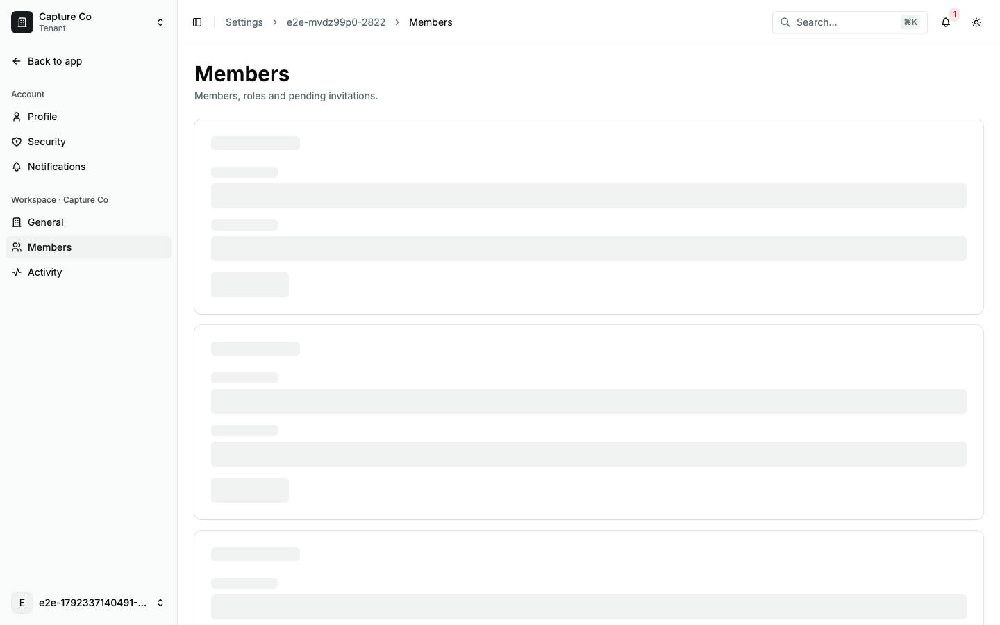        | 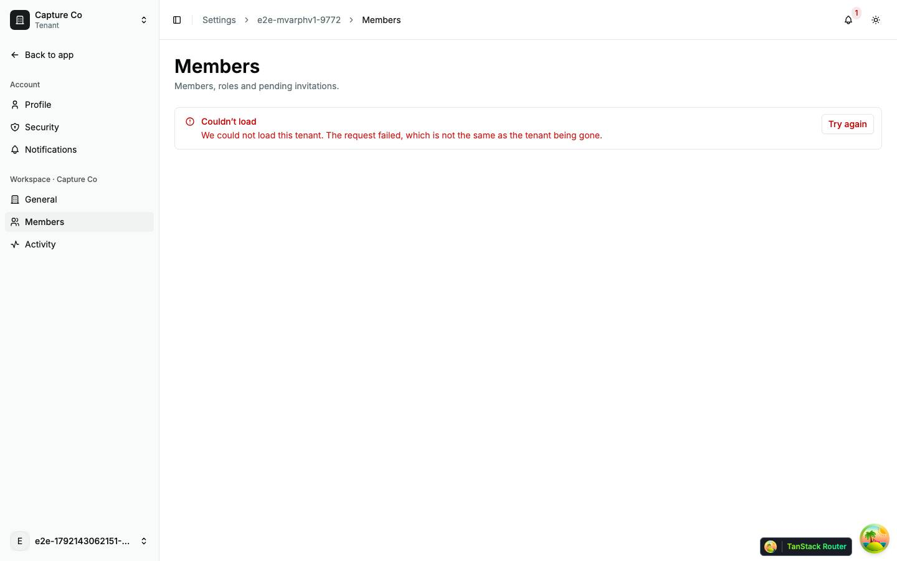 | 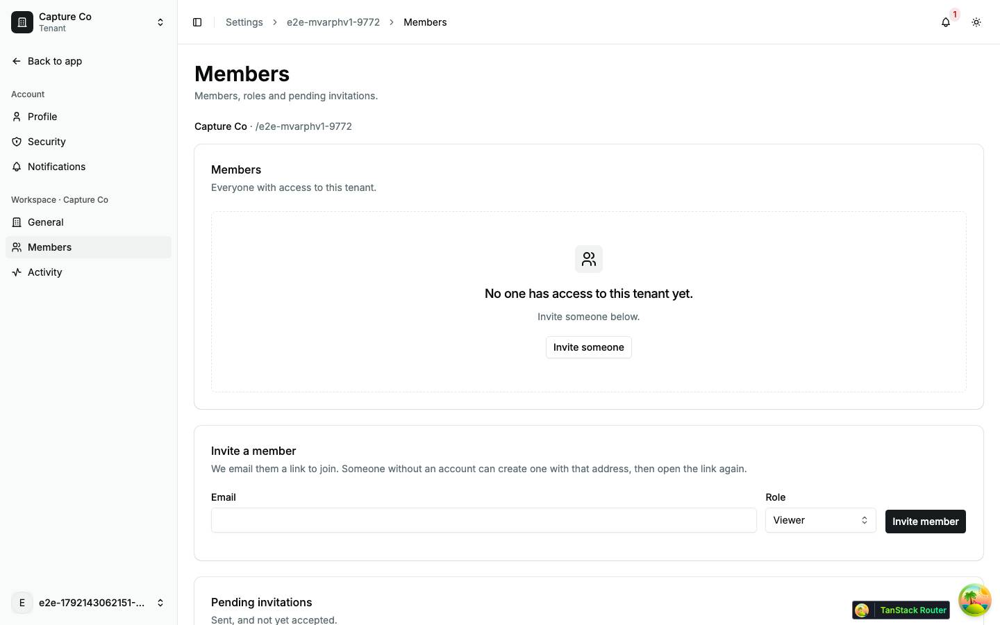                                           |
| skeleton · the settings template under the real heading | alert · the tenant `LoadError` under the `h1`  | "No one has access to this tenant yet." and "No invitations are waiting to be accepted." |

| Dark                                          | Mobile                                                                   |
| --------------------------------------------- | ------------------------------------------------------------------------ |
| 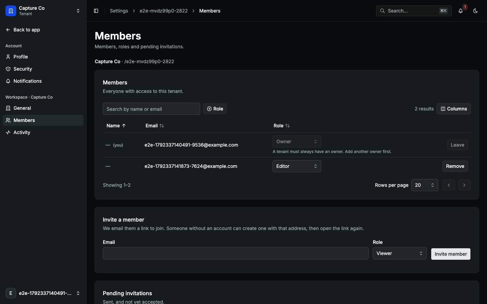 | 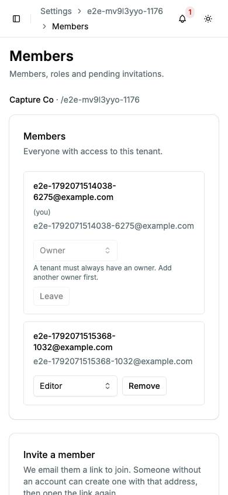                          |
| Table and selects on the dark surfaces.       | Cards instead of the table; the address breaks mid-word and shows twice. |

| Role-denied                                                                                                                                                                                                                                                                                                                         |
| ----------------------------------------------------------------------------------------------------------------------------------------------------------------------------------------------------------------------------------------------------------------------------------------------------------------------------------- |
| 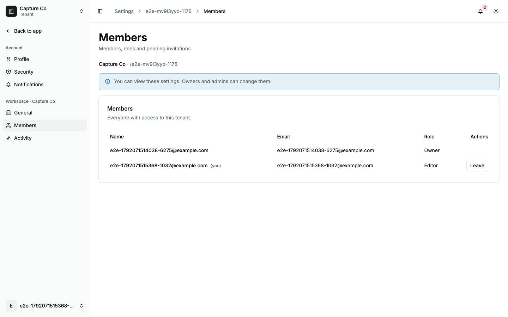                                                                                                                                                                                                                                                                                |
| An editor (`canManageTenant` and `canChangeRoles` are false): `ReadOnlyBanner` above the card; each role is plain text, not a `Select`; the Actions column has Leave on the editor's own row and nothing on the others. No Invite a member card and no Pending invitations card, so `GET /tenants/:slug/invitations` is never sent. |

Findings: [F-settings-1](findings.md#f-settings-1), [F-settings-2](findings.md#f-settings-2), [F-settings-5](findings.md#f-settings-5), [F-settings-6](findings.md#f-settings-6), [F-settings-7](findings.md#f-settings-7), [F-settings-8](findings.md#f-settings-8), [F-settings-13](findings.md#f-settings-13)

### `/settings/workspace/$slug/activity` — Activity

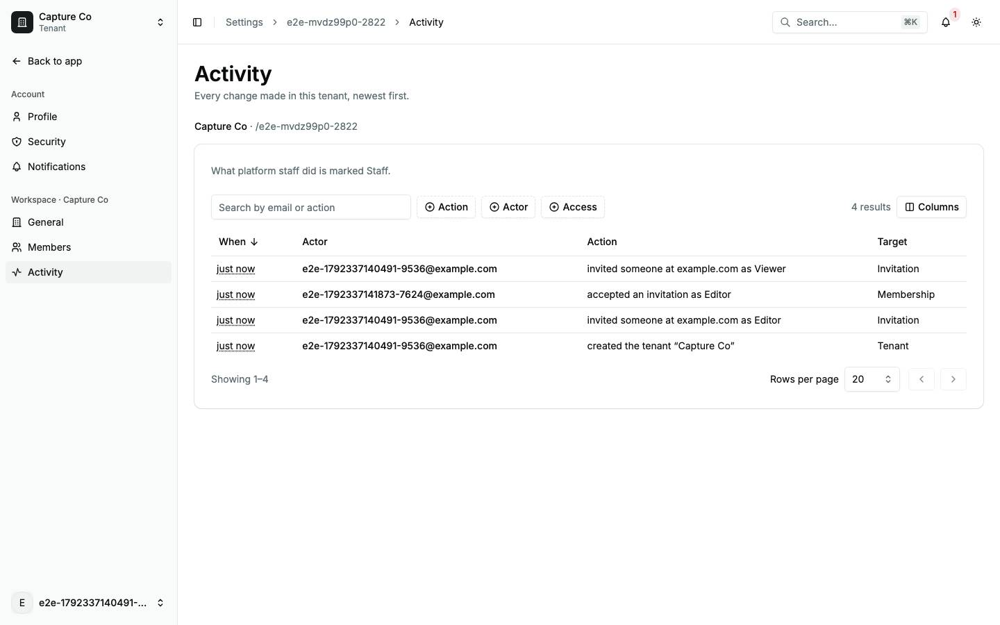

|                     |                                                                                                                                                                                                                                                                                                                                                                                          |
| ------------------- | ---------------------------------------------------------------------------------------------------------------------------------------------------------------------------------------------------------------------------------------------------------------------------------------------------------------------------------------------------------------------------------------- |
| Purpose             | The tenant's audit log, newest first, for owners and admins.                                                                                                                                                                                                                                                                                                                             |
| File                | `src/pages/_app/settings/workspace.$slug.activity.tsx`, rendering `TenantActivityPanel` and `ActivityList`                                                                                                                                                                                                                                                                               |
| Guard and redirects | `_app`, the [workspace gate](#settingsworkspaceslug--workspace-gate); `/tenants/$slug/activity` lands here. Viewers and editors see "Only this tenant's owners and admins can see its activity." and nothing is requested.                                                                                                                                                               |
| Layout              | `AppLayout` › settings shell › workspace gate                                                                                                                                                                                                                                                                                                                                            |
| Data                | started: `GET /tenants/:slug/members` (`['tenants', slug, 'members']`, the actor filter's names), `GET /tenants/:slug/audit-log?limit=50` (`['tenants', slug, 'audit-log', filters]`, an infinite query) with `action`, `actorUserId` or `access=platform` from the filters and `cursor` for more; `staleTime: 0`, so each filter change shows the skeleton again. A 403 is not retried. |
| Sections            | One `Card` with a screen-reader-only `h2`: "What platform staff did is marked Staff.", the All actions and Anyone filters (`Select`), then the entries (actor, a sentence, a relative time with the exact time in a tooltip, a Staff badge) and Load more activity.                                                                                                                      |
| Components          | `Card`, `Select`, `Tooltip`, `Badge`, `Skeleton` (`h-24` for the role, 2× `h-14` for the log), `EmptyState` (compact), `LoadError` (load, load more and refresh each worded apart); `BusyButton` (Load more); hand-rolled: the entry list                                                                                                                                                |
| Transitions         | none                                                                                                                                                                                                                                                                                                                                                                                     |

| Loading                                                 | Error                                           | Empty                                                                                   |
| ------------------------------------------------------- | ----------------------------------------------- | --------------------------------------------------------------------------------------- |
| 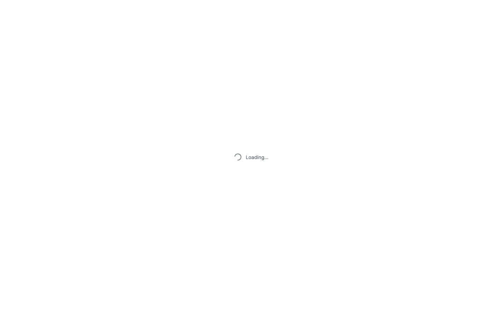       | 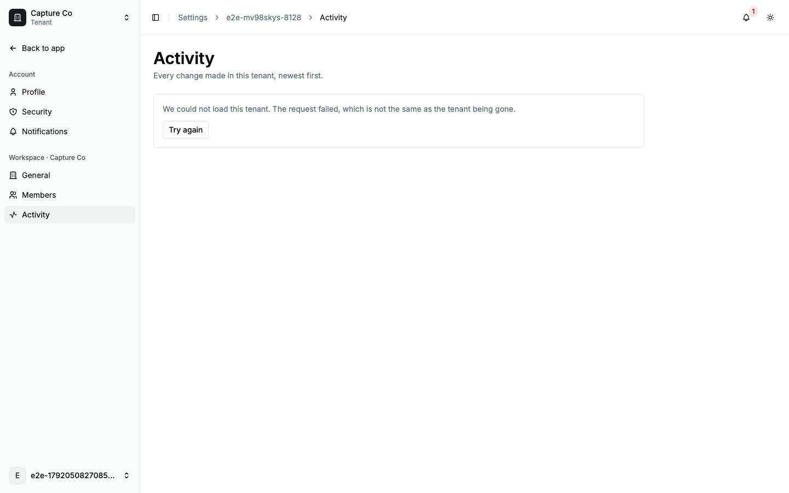 | 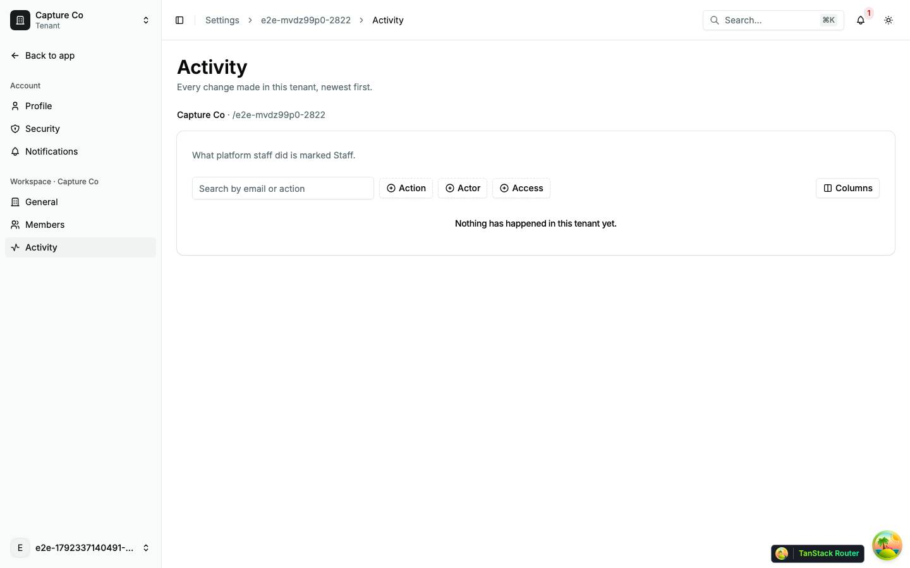                                         |
| skeleton · the settings template under the real heading | alert · the tenant `LoadError` under the `h1`   | "Nothing has happened in this tenant yet." (filtered: "Nothing matches these filters.") |

| Role-denied                                                                                                                                                                                                                                                          |
| -------------------------------------------------------------------------------------------------------------------------------------------------------------------------------------------------------------------------------------------------------------------- |
| 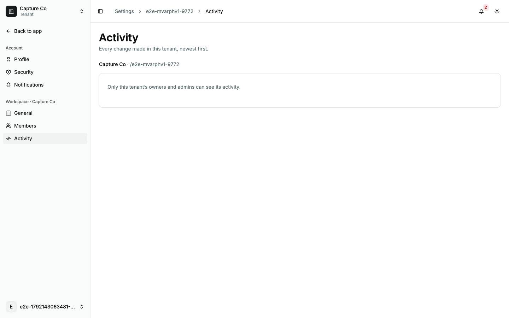                                                                                                                                                                                                                |
| An editor (`canViewActivity` is false): the card's description reads "Only this tenant's owners and admins can see its activity." and its content is empty: no filters, no entries. Neither `GET /tenants/:slug/members` nor `GET /tenants/:slug/audit-log` is sent. |

Findings: [F-settings-1](findings.md#f-settings-1), [F-settings-2](findings.md#f-settings-2), [F-settings-5](findings.md#f-settings-5), [F-settings-7](findings.md#f-settings-7), [F-settings-8](findings.md#f-settings-8), [F-settings-9](findings.md#f-settings-9)

## Redirects

Each throws a `redirect` in `beforeLoad` with `replace: true`, keeping the search and hash. In the walk each landed on its target directly.

| Route                        | File                                                | Goes to                             |
| ---------------------------- | --------------------------------------------------- | ----------------------------------- |
| `/profile`                   | `src/pages/_app/profile.tsx`                        | `/settings/account/profile`         |
| `/settings/account/`         | `src/pages/_app/settings/account.index.tsx`         | `/settings/account/profile`         |
| `/settings/workspace/$slug/` | `src/pages/_app/settings/workspace.$slug.index.tsx` | `/settings/workspace/$slug/general` |
