# Settings

This file covers the settings shell (`/settings`), account settings (profile, security, notifications) and workspace settings (general, members, billing, activity). Back to the [route map](README.md#route-map).

The groups and pages are declared once, in `src/constants/settings.ts` (`SETTINGS_GROUPS`, `SETTINGS_SECTIONS`). The sidebar nav, the landing page and the layout's title all read them.

Every settings page sets `errorComponent: SettingsRouteError`: the router's "This page didn’t load" card, titled `h2` under the layout's `h1`. The card is kept in the page's own chunk, so a failed fetch can still show it.

Terms used below:

- **API:** the application programming interface (express). Paths are relative to `/api/v1`.
- **URL:** a Uniform Resource Locator, the page address.
- **The walk:** the Playwright walk of the app made for pull request (PR) #108 on 15 October 2026.
- **The capture:** `pnpm capture:pages` and its records in `capture-records/`.

## Layout

### `/settings` — Settings shell

|             |                                                                                                                                                                                                                                                                                                          |
| ----------- | -------------------------------------------------------------------------------------------------------------------------------------------------------------------------------------------------------------------------------------------------------------------------------------------------------- |
| File        | `src/pages/_app/settings.tsx`                                                                                                                                                                                                                                                                            |
| Fetches     | nothing of its own; it sits under `_app`, whose `TenantSearchGuard` reads `GET /tenants` after mount and keeps `?tenant=` on account pages                                                                                                                                                               |
| Renders     | a `header` with the active section's label as a large `h1` and its description (on the landing page, "Settings" and "Manage your account and the current workspace."), then the page                                                                                                                     |
| Nav         | `AppLayout` swaps the sidebar's content for `NavSettings`: Back to app (→ `/dashboard`), then "Account": Profile, Security, Notifications; "Workspace · {tenant name}": General, Members, Billing, Activity. With no current tenant the workspace items are disabled and say "Choose a workspace first." |
| Breadcrumbs | Settings › {page}; on workspace pages Settings › {slug} (plain text) › {page}                                                                                                                                                                                                                            |

### `/settings/workspace/$slug` — Workspace gate

|                |                                                                                                                                                                                                                                                                                            |
| -------------- | ------------------------------------------------------------------------------------------------------------------------------------------------------------------------------------------------------------------------------------------------------------------------------------------ |
| File           | `src/pages/_app/settings/workspace.$slug.tsx`                                                                                                                                                                                                                                              |
| Fetches        | the same loader as the tenant layout ([tenants.md](tenants.md#layout)): starts `GET /tenants/:slug` (`['tenants', slug]`) and awaits `GET /tenants/:slug/flags` (`['flags', 'tenant', slug]`, `staleTime` 5 min, 10 s cap), `preloadStaleTime: 0`, blocking stale reload; strips `?tenant` |
| While it loads | the flags read holds the route (`pendingComponent: SettingsPagePending`); then the gate shows the settings template (`PageSkeleton variant="settings" nested`) under the layout's `h1` until the tenant lands                                                                              |
| Gate panels    | `TenantGate` titled `h2`: **Workspace not available** for a 404, **Workspace suspended** for a suspended tenant of yours, a `LoadError` when the list also failed                                                                                                                          |
| Load failed    | the gate's `QueryState`: one `LoadError`, "We couldn’t load this workspace because the request failed. Select Try again.", under the layout's `h1`, in place of every card of the page                                                                                                     |
| Renders        | a `PlatformAccessBanner` for staff on platform access, the `BillingBanner` on a customer tenant (on Billing its sentence only, without the card button or Upgrade link), a line "{name} · /{slug}", then the page. Choosing another tenant in the switcher opens the same section for it.  |

Findings: [F-settings-1](findings.md#f-settings-1), [F-settings-2](findings.md#f-settings-2), [F-settings-14](findings.md#f-settings-14)

## Pages

### `/settings/` — Settings home

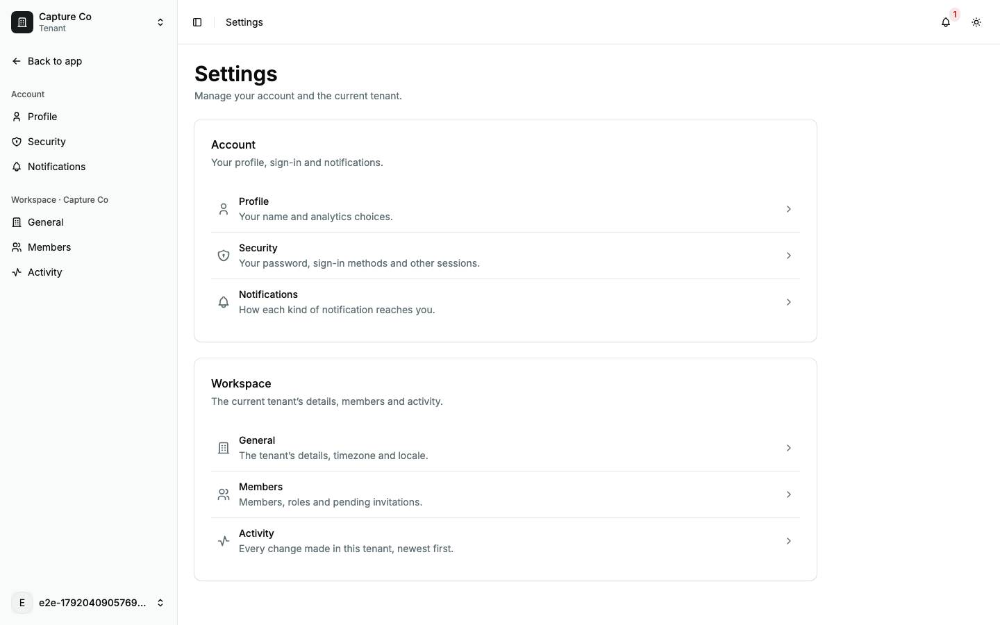

|                     |                                                                                                                                                                                                                                                                      |
| ------------------- | -------------------------------------------------------------------------------------------------------------------------------------------------------------------------------------------------------------------------------------------------------------------- |
| Purpose             | One card per settings group, each page a row that links to it.                                                                                                                                                                                                       |
| File                | `src/pages/_app/settings/index.tsx`                                                                                                                                                                                                                                  |
| Guard and redirects | `_app`                                                                                                                                                                                                                                                               |
| Layout              | `AppLayout` › settings shell                                                                                                                                                                                                                                         |
| Data                | none of its own; the workspace links use `useCurrentTenantSlug()` (the shell's `?tenant`)                                                                                                                                                                            |
| Sections            | `SettingsLinkList` per group: Account (Profile, Security, Notifications) and Workspace (General, Members, Billing, Activity), each row an icon, label, description and chevron. Without a tenant the Workspace rows are plain text under "Choose a workspace first." |
| Components          | `Card`, `ItemGroup`, `Item` (link rows), `ItemMedia`, `ItemContent`, `ItemTitle`, `ItemDescription`                                                                                                                                                                  |
| Transitions         | each row → its page; Back to app → `/dashboard`                                                                                                                                                                                                                      |

### `/settings/account/profile` — Profile

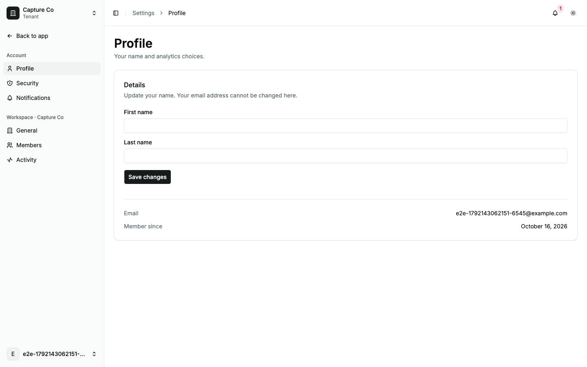

|                     |                                                                                                                                                                                                                    |
| ------------------- | ------------------------------------------------------------------------------------------------------------------------------------------------------------------------------------------------------------------ |
| Purpose             | Change your name, see your address and join date, and choose whether to share usage analytics.                                                                                                                     |
| File                | `src/pages/_app/settings/account.profile.tsx`                                                                                                                                                                      |
| Guard and redirects | `_app`; `/profile` and `/settings/account/` redirect here                                                                                                                                                          |
| Layout              | `AppLayout` › settings shell                                                                                                                                                                                       |
| Data                | `useProfile` (`GET /profile`, `['profile']`) with the session's user as `initialData`, so the page makes no request of its own. `PATCH /profile` on Save changes (changed names only) and on the analytics switch. |
| Sections            | Details card: first and last name, Save changes, then Email and Member since; Privacy: the Share usage analytics switch (`AnalyticsSection`)                                                                       |
| Components          | `Card`, `Form` fields, `Input`, `BusyButton`, `Switch`, `Pii`, `QueryState`, `FormFieldsSkeleton` (4 fields; shown only when the session holds no user)                                                            |
| Transitions         | none beyond the nav; Save changes toasts "Profile updated."                                                                                                                                                        |

The capture has no loading or error shot for this page, because the session's user is always there to paint. Without that user, the read decides what shows: four label-and-input pairs and a button bar until it answers, then, on a failure, `LoadError` "Profile didn’t load. Select Try again." with Try again.

### `/settings/account/security` — Security

No shot in `img/`: running `pnpm capture:pages` against a live express 6 stack takes it.

|                     |                                                                                                                                                                                                                                                                    |
| ------------------- | ------------------------------------------------------------------------------------------------------------------------------------------------------------------------------------------------------------------------------------------------------------------ |
| Purpose             | See how you sign in, and sign out other sessions.                                                                                                                                                                                                                  |
| File                | `src/pages/_app/settings/account.security.tsx`, rendering `SecuritySection` (`src/components/features/profile/security-section.tsx`) in one `Card`                                                                                                                 |
| Guard and redirects | `_app`                                                                                                                                                                                                                                                             |
| Layout              | `AppLayout` › settings shell                                                                                                                                                                                                                                       |
| Data                | started: `GET /auth/providers` (`['auth', 'providers']`). `POST /auth/sessions/revoke-others` on its button.                                                                                                                                                       |
| Sections            | Sign-in methods ← providers: "Email link ({address})" first, then each linked provider ("Google"); read-only. Other sessions: "This ends every other browser and device session. You stay signed in here." and Sign out other sessions (no request until clicked). |
| Components          | `Card`, `BusyButton`, `QueryState`, `CardRowsSkeleton`, `ItemGroup`, `Item` (sign-in methods), `Pii`                                                                                                                                                               |
| Transitions         | Sign out other sessions toasts the count it signed out                                                                                                                                                                                                             |

There is no password control. Other sessions renders at once and does not wait on the providers request. Only the sign-in methods hold their place, with a heading and two method rows, while it loads. A failed providers request shows `LoadError` "We couldn’t load your sign-in methods. Select Try again to load them." in their place.

Findings: [F-settings-3](findings.md#f-settings-3), [F-settings-12](findings.md#f-settings-12)

### `/settings/account/notifications` — Notifications

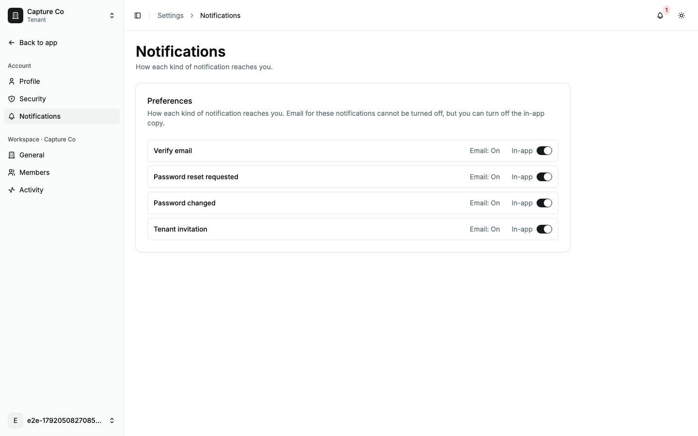

|                     |                                                                                                                                                 |
| ------------------- | ----------------------------------------------------------------------------------------------------------------------------------------------- |
| Purpose             | Choose, per kind of notification, whether the in-app copy is kept. Email for these kinds cannot be turned off.                                  |
| File                | `src/pages/_app/settings/account.notifications.tsx`, rendering `PreferencesCard` (`src/components/features/notifications/preferences-card.tsx`) |
| Guard and redirects | `_app`; the account menu's Notifications item opens this page                                                                                   |
| Layout              | `AppLayout` › settings shell                                                                                                                    |
| Data                | started: `GET /notifications/preferences` (`['notifications', 'preferences']`); `PUT /notifications/preferences` on each switch (optimistic)    |
| Sections            | Preferences card: one bordered row per kind the API lists, such as Workspace invitation, with "Email: On" as text and an In-app `Switch`        |
| Components          | `Card`, `Switch`, `QueryState`, `CardRowsSkeleton`, `EmptyState` (compact), `ItemGroup`, `Item`, `ItemContent`, `ItemTitle`, `ItemActions`      |
| Transitions         | none                                                                                                                                            |

| Loading                                              | Error                                              | Empty                                              |
| ---------------------------------------------------- | -------------------------------------------------- | -------------------------------------------------- |
| 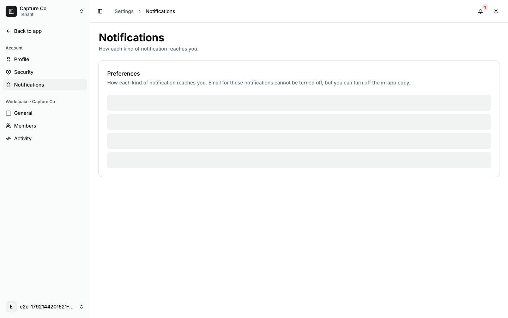 | 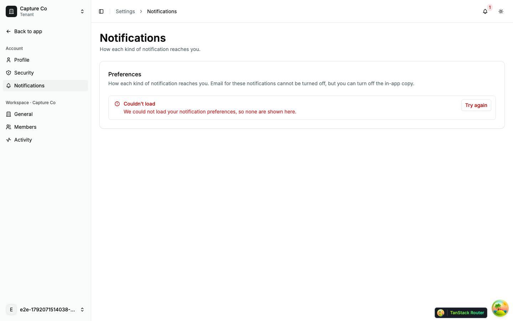 | 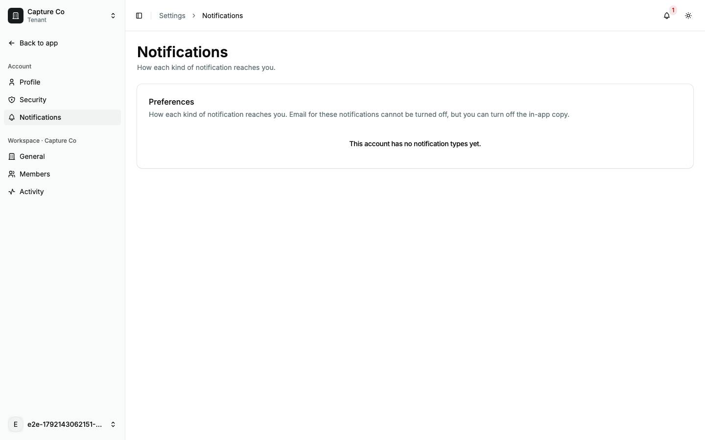 |
| skeleton · 4 rows of `2.875rem`                      | alert · `LoadError`                                | "This account has no notification types yet."      |

Findings: [F-settings-4](findings.md#f-settings-4), [F-settings-8](findings.md#f-settings-8), [F-settings-10](findings.md#f-settings-10), [F-notifications-5](findings.md#f-notifications-5)

### `/settings/workspace/$slug/general` — General

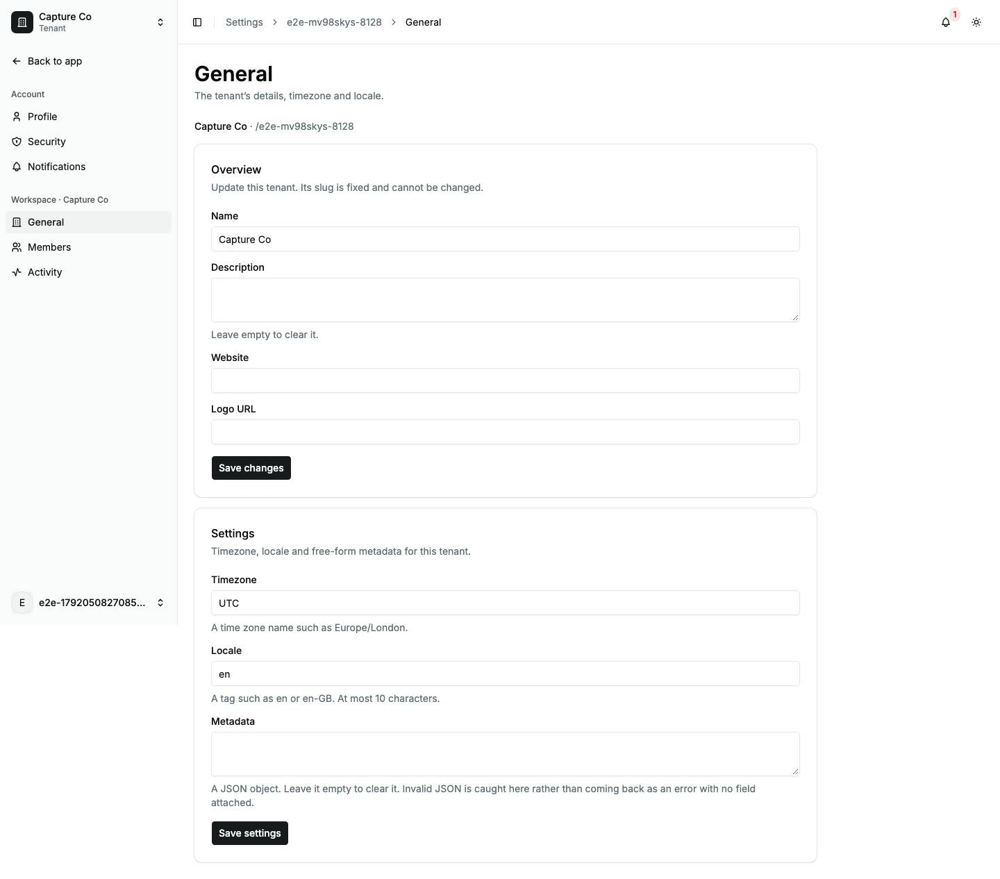

|                     |                                                                                                                                                                                                                                                                                                                                                                                                                  |
| ------------------- | ---------------------------------------------------------------------------------------------------------------------------------------------------------------------------------------------------------------------------------------------------------------------------------------------------------------------------------------------------------------------------------------------------------------- |
| Purpose             | Edit the tenant's name, description, website and logo, and its timezone, locale and metadata.                                                                                                                                                                                                                                                                                                                    |
| File                | `src/pages/_app/settings/workspace.$slug.general.tsx`                                                                                                                                                                                                                                                                                                                                                            |
| Guard and redirects | `_app`, the [workspace gate](#settingsworkspaceslug--workspace-gate); `/settings/workspace/$slug/`, `/tenants/$slug/settings`, the overview's Workspace settings link and the Configure step land here                                                                                                                                                                                                           |
| Layout              | `AppLayout` › settings shell › workspace gate                                                                                                                                                                                                                                                                                                                                                                    |
| Data                | awaited by the layout's loader: the tenant's flags (`['flags', 'tenant', slug]`, `staleTime` 5 min, 10 s cap). Started, and waited for by the gate: `GET /tenants/:slug` (`['tenants', slug]`). Started: `GET /tenants/:slug/settings` (`['tenants', slug, 'settings']`). `PATCH /tenants/:slug` and `PATCH /tenants/:slug/settings` on their Save buttons. The role comes from the tenant detail (`useMyRole`). |
| Sections            | `ReadOnlyBanner` for viewers and editors ("You can view these settings. Owners and admins can change them."); Overview card ← the detail (name, description, website, logo URL); Settings card ← settings (Time zone as free text, Language and region, and Custom data (for developers), a JavaScript Object Notation (JSON) textarea). Read-only roles see `dl` lists instead of forms.                        |
| Components          | `Card`, `Form` fields, `Input`, `Textarea`, `BusyButton`, `QueryState`, `FormFieldsSkeleton` (Overview 4 fields; Settings 3 fields, each with a button bar), `LoadError` per card, `Note` (info, `ReadOnlyBanner`)                                                                                                                                                                                               |
| Transitions         | none beyond the nav; each Save toasts                                                                                                                                                                                                                                                                                                                                                                            |

Each card has its own loading state: the Settings card keeps its form skeleton until both its settings and the role have landed. Each card also has its own error. In the walk, with only `GET /tenants/:slug/settings` answering 500, the Settings card showed its `LoadError` and the Overview form stayed usable.

The capture's loading and error shots hold or fail the tenant read that the gate waits for. They therefore show the settings template under the real heading, and the tenant `LoadError`.

| Loading                                                 | Error                                          |
| ------------------------------------------------------- | ---------------------------------------------- |
| 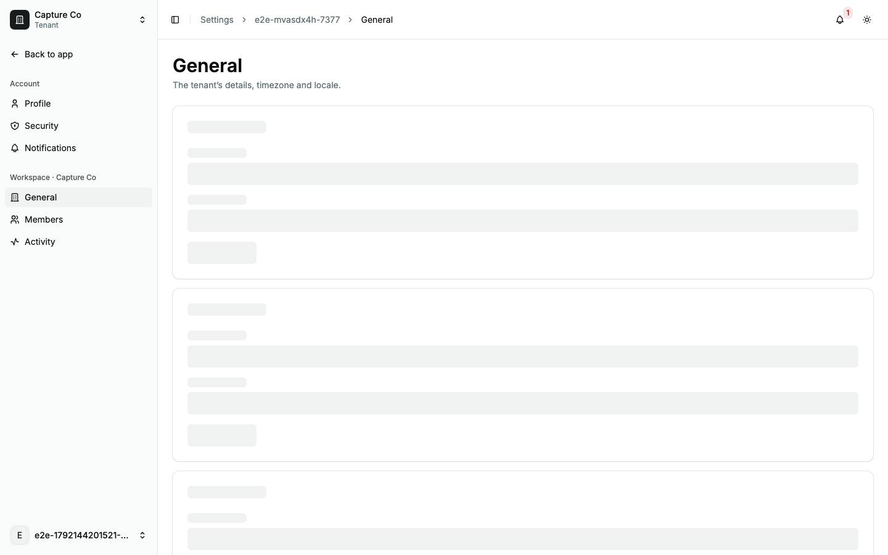        | 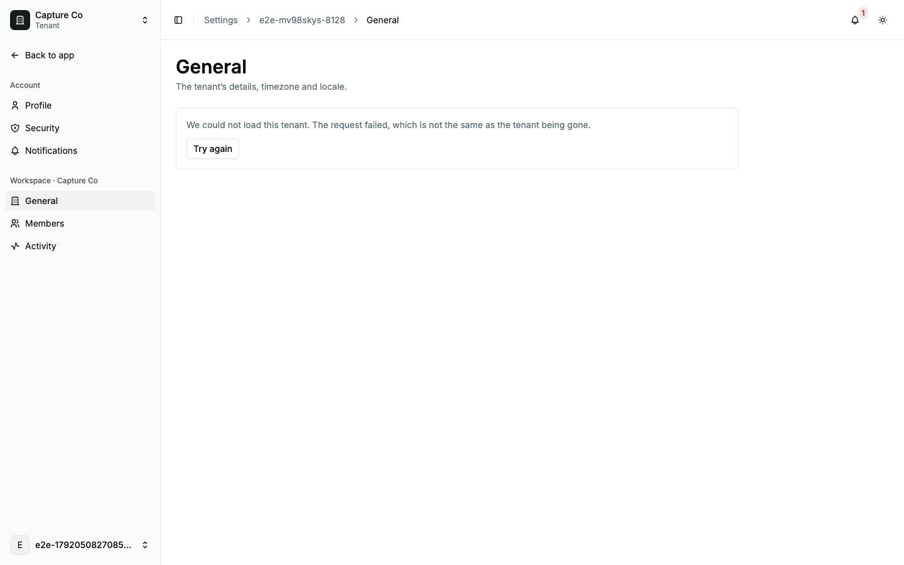 |
| skeleton · the settings template under the real heading | alert · the tenant `LoadError` under the `h1`  |

| Role-denied                                                                                                                                                                                                                                                                                                                                                       |
| ----------------------------------------------------------------------------------------------------------------------------------------------------------------------------------------------------------------------------------------------------------------------------------------------------------------------------------------------------------------- |
| 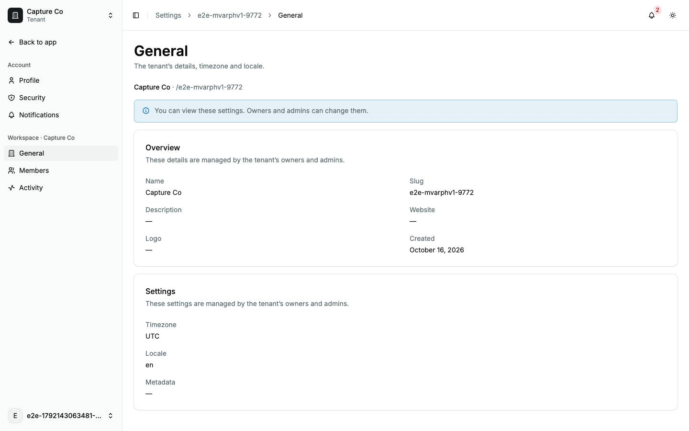                                                                                                                                                                                                                                                                                                              |
| An editor (`canManageTenant` is false): `ReadOnlyBanner` above the cards; the Overview card says "Only this workspace’s owners and admins can change these details." over the read-only `TenantDetails` list, and the Settings card says "Only this workspace’s owners and admins can change these settings." over `SettingsDetails`. No form and no Save button. |

Findings: [F-settings-1](findings.md#f-settings-1), [F-settings-2](findings.md#f-settings-2), [F-settings-5](findings.md#f-settings-5), [F-settings-11](findings.md#f-settings-11)

### `/settings/workspace/$slug/members` — Members

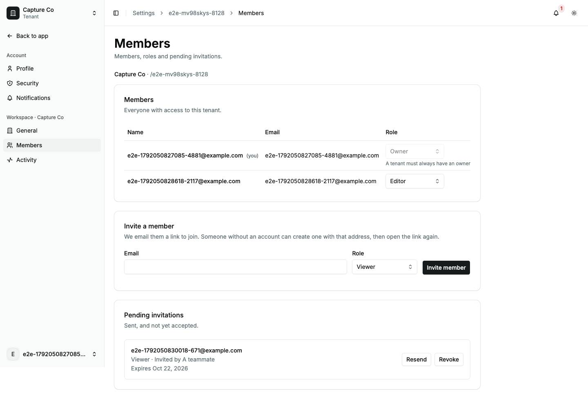

|                     |                                                                                                                                                                                                                                                                                                                                                                                    |
| ------------------- | ---------------------------------------------------------------------------------------------------------------------------------------------------------------------------------------------------------------------------------------------------------------------------------------------------------------------------------------------------------------------------------- |
| Purpose             | See who has access, change roles, remove members or leave, invite people, and manage pending invitations.                                                                                                                                                                                                                                                                          |
| File                | `src/pages/_app/settings/workspace.$slug.members.tsx`, rendering `TenantMembersPanel` and `PendingInvitations` (`src/components/features/tenant/`)                                                                                                                                                                                                                                 |
| Guard and redirects | `_app`, the [workspace gate](#settingsworkspaceslug--workspace-gate); `/tenants/$slug/members` lands here                                                                                                                                                                                                                                                                          |
| Layout              | `AppLayout` › settings shell › workspace gate                                                                                                                                                                                                                                                                                                                                      |
| Data                | See [Members: requests](#members-requests).                                                                                                                                                                                                                                                                                                                                        |
| Sections            | Members, Invite a member and Pending invitations. See [Members: sections](#members-sections). Platform access shows all of it read-only.                                                                                                                                                                                                                                           |
| Components          | `Card`, `DataTable` (members, pending invitations), `Select`, `Button`, `BusyButton` (invite), `AlertDialog` (remove, leave, revoke), `TableRowsSkeleton`, `LoadError`, `EmptyState` (members full, invitations compact), `Pii`, `Note` (info, `ReadOnlyBanner`), `Item` (member and invitation cards), `ItemContent`, `ItemTitle`, `ItemDescription`, `ItemFooter`, `ItemActions` |
| Transitions         | Leave → `/tenants` with a toast; a role change toasts "{member} is now {role}." with no confirm step                                                                                                                                                                                                                                                                               |

#### Members: requests

| When                                                   | Request                                                                                                                                                                                                                     |
| ------------------------------------------------------ | --------------------------------------------------------------------------------------------------------------------------------------------------------------------------------------------------------------------------- |
| started                                                | `GET /tenants/:slug/members` (`['tenants', slug, 'members', 'list', …]`) with `search`, `sort` (`name`, `email`, `role`, `-joined`), `role`, `cursor`, `limit`                                                              |
| started                                                | `GET /tenants/:slug/members?role=owner&limit=100` (`['tenants', slug, 'members', 'owners']`), the last-owner rule's owner count                                                                                             |
| started, once the card mounts (owners and admins only) | `GET /tenants/:slug/invitations` (`['tenants', slug, 'invitations', 'list', …]`) with `search`, `sort` (`-created`, `email`), `role`, `cursor`, `limit`; its URL keys are prefixed (`invitationsSearch`, `invitationsSort`) |
| on actions                                             | `PATCH /tenants/:slug/members/:userId` (role), `DELETE /tenants/:slug/members/:userId` (remove), `DELETE /tenants/:slug/membership` (leave), `POST /tenants/:slug/invitations`, resend, `DELETE …/invitations/:id`          |

#### Members: sections

- **Members** ← members + role: a table (Name, Email, Role, Actions) with search by name or email, a Role filter and paging; bordered cards below the `md` breakpoint (768 px).
  - Each row has a role `Select`. Only owners change roles.
  - The last owner's select and Leave are disabled with "A workspace must always have an owner. Add another owner first."
  - A failed owners read says "Owners didn’t load, so owner changes are locked." and keeps them disabled.
- **Invite a member** (no request until submit): email, role, Invite member. The description reads "We email them an invitation that expires in {days} days. After they select Join, we email them a link to confirm."
  - {days} is `invitationTtlSeconds` from `GET /status/client-settings` in whole days, rounded up as the invitation email rounds it.
  - Until that read loads, the description reads "We email them an invitation. After they select Join, …"
- **Pending invitations** ← invitations: a table (Email, Role, Invited, Expires, Actions) with search by email, a Role filter and paging; bordered cards below `md`; Resend and Revoke per row.
  - While the invitation's resend cooldown runs, Resend reads "Resend in 4 min" ("Resend in 42 seconds" under a minute), disabled but focusable.
  - The cooldown lasts until the later of the row's `resendAvailableAt` and a 429's `Retry-After`.

What the walk saw on this page:

- Each list has its own error. With only `GET /tenants/:slug/invitations` answering 500, Pending invitations showed its `LoadError` while the table and the invite form stayed usable.
- As the owner, the member's role changed from Editor to Viewer in one click (`PATCH` 200, then members, tenant and list refetched). The owner's own select and Leave were disabled.
- At 1440 px the table's scroll box was 848 px wide for 1075 px of table. The Actions column (Remove, Leave) sat past the card's right edge, reachable only by scrolling the table sideways.
- Skeletons gave way to the table and pushed Invite a member from y 438 to y 515.

| Loading                                                 | Error                                          | Empty                                                                                       |
| ------------------------------------------------------- | ---------------------------------------------- | ------------------------------------------------------------------------------------------- |
| 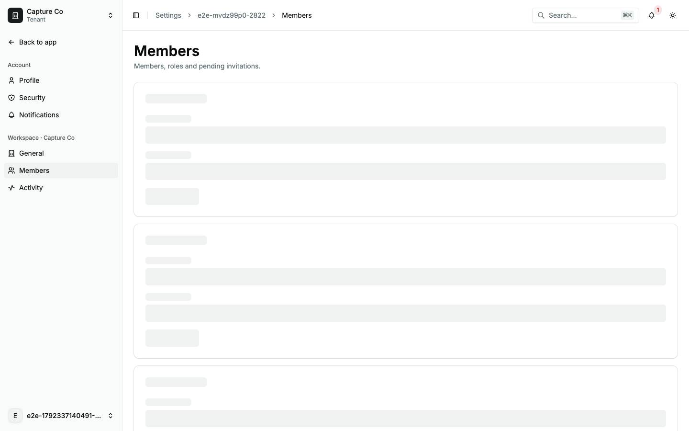        | 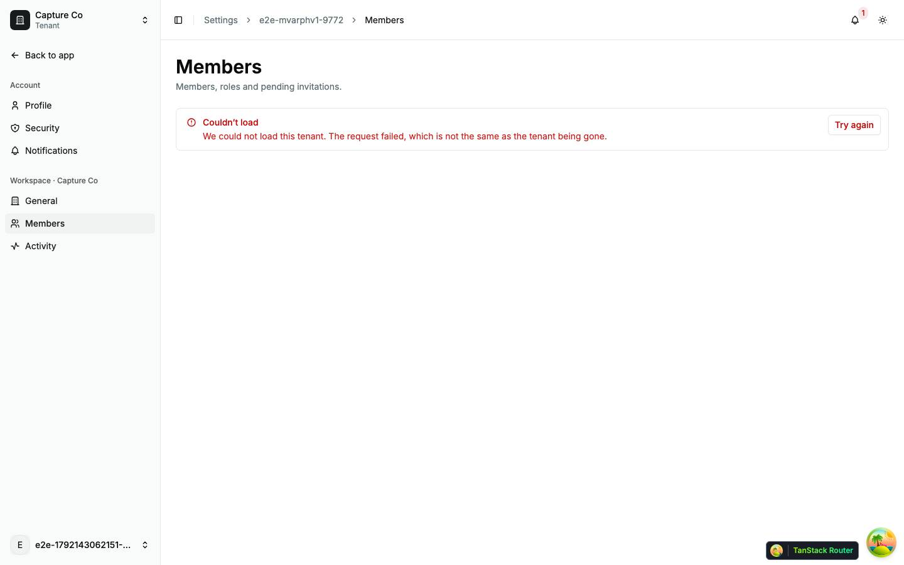 | 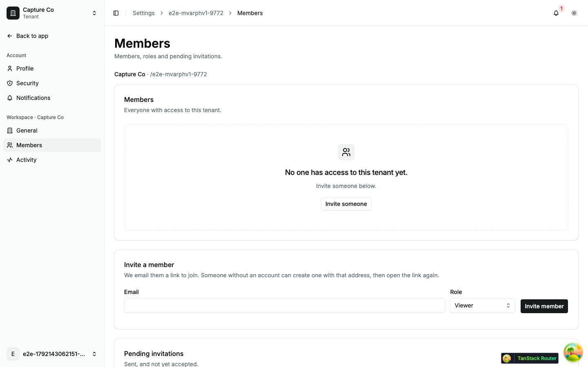                                              |
| skeleton · the settings template under the real heading | alert · the tenant `LoadError` under the `h1`  | "No one has access to this workspace yet." and "No invitations are waiting to be accepted." |

| Dark                                          | Mobile                                                                   |
| --------------------------------------------- | ------------------------------------------------------------------------ |
| 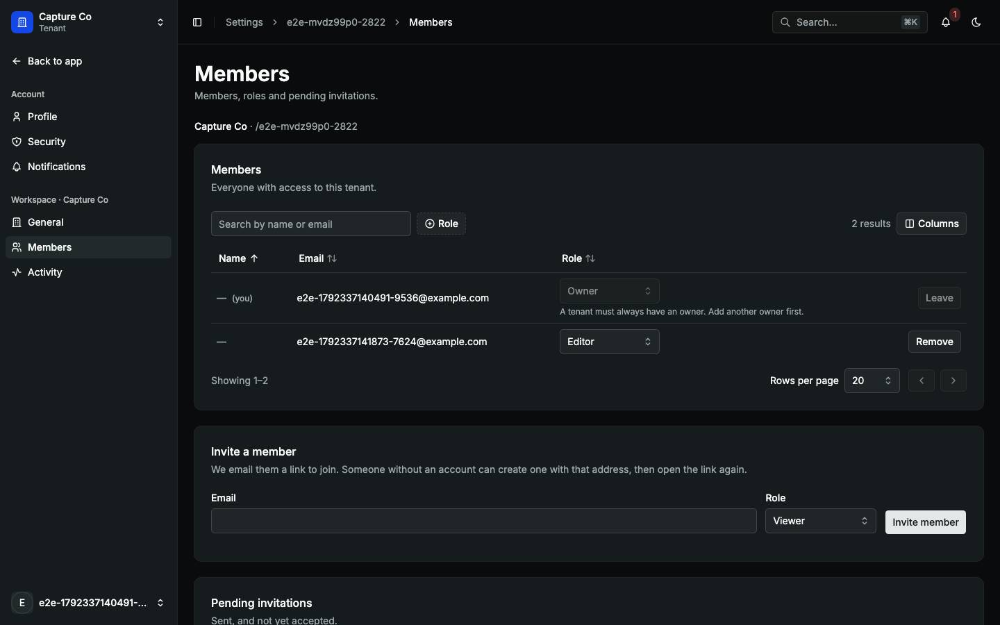 | 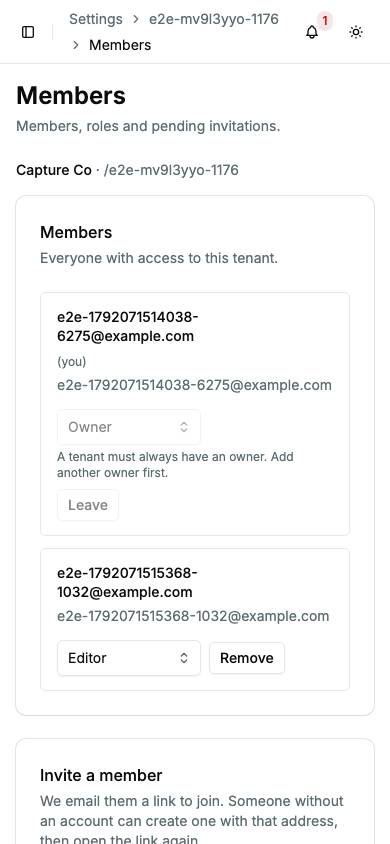                          |
| Table and selects on the dark surfaces.       | Cards instead of the table; the address breaks mid-word and shows twice. |

| Role-denied                                                                                                                                                                                                                                                                                                                         |
| ----------------------------------------------------------------------------------------------------------------------------------------------------------------------------------------------------------------------------------------------------------------------------------------------------------------------------------- |
| 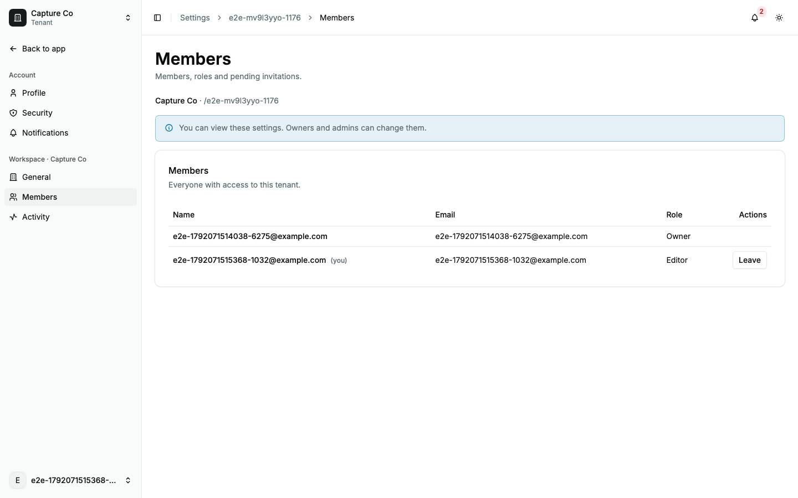                                                                                                                                                                                                                                                                                |
| An editor (`canManageTenant` and `canChangeRoles` are false): `ReadOnlyBanner` above the card; each role is plain text, not a `Select`; the Actions column has Leave on the editor's own row and nothing on the others. No Invite a member card and no Pending invitations card, so `GET /tenants/:slug/invitations` is never sent. |

Findings: [F-settings-1](findings.md#f-settings-1), [F-settings-2](findings.md#f-settings-2), [F-settings-5](findings.md#f-settings-5), [F-settings-6](findings.md#f-settings-6), [F-settings-7](findings.md#f-settings-7), [F-settings-8](findings.md#f-settings-8), [F-settings-13](findings.md#f-settings-13)

### `/settings/workspace/$slug/billing` — Billing

This page has no screenshots in `img/`. A `pnpm capture:pages` run takes them:

- the default, loading, error, empty and role-denied shots;
- the states `workspace-billing--state-trialing.jpg`, `--state-free-over.jpg`, `--state-active.jpg` and `--state-past-due.jpg`, each with the billing and entitlements reads stubbed from the end-to-end (e2e) harness's `?billing=` fixtures (`tests/fixtures/billing.ts`);
- `--state-tax-on.jpg` and `--state-tax-read-only.jpg`, which also stub the tax details, tax documents and invoices reads from its `?tax=` fixtures (`tests/fixtures/tax.ts`).

|                     |                                                                                                                                                                                                                                                                                                                                                                                                                                                          |
| ------------------- | -------------------------------------------------------------------------------------------------------------------------------------------------------------------------------------------------------------------------------------------------------------------------------------------------------------------------------------------------------------------------------------------------------------------------------------------------------- |
| Purpose             | See the workspace's plan, usage and features; owners take Paid, switch the interval, change the card, cancel, read invoices and see who asked to upgrade.                                                                                                                                                                                                                                                                                                |
| File                | `src/pages/_app/settings/workspace.$slug.billing.tsx`, rendering `BillingOverviewCard`, `OwnerBillingActions` (with `PlanChoice` and `CancelPaidDialog`), `TaxDetailsCard`, `UpgradeRequestsCard`, `InvoicesCard` and `TaxDocumentsCard` (`src/components/features/billing/`); the wording and the per-state rules are in `src/lib/billing-page.ts`                                                                                                      |
| Guard and redirects | `_app`, the [workspace gate](#settingsworkspaceslug--workspace-gate). The platform tenant reads "The platform workspace has no billing." and nothing is requested.                                                                                                                                                                                                                                                                                       |
| Layout              | `AppLayout` › settings shell › workspace gate; the billing banner keeps its sentence but drops its card button and Upgrade link, since the page runs its own checkout                                                                                                                                                                                                                                                                                    |
| Data                | See [Billing: requests](#billing-requests).                                                                                                                                                                                                                                                                                                                                                                                                              |
| Sections            | Plan, owner actions, Compare plans, Upgrade requests, Invoices, Tax details and Tax documents. See [Billing: sections](#billing-sections).                                                                                                                                                                                                                                                                                                               |
| Components          | `Card`, `QueryState`, `UsageMeter`, `Button`, `BusyButton`, `AlertDialog` (cancel), `Table`, `EmptyState` (compact), `LoadError`, `Select`, `Checkbox`, `Pii` (payer, receipts address, requester, tax details), `Note`, `UpgradeAction`                                                                                                                                                                                                                 |
| Transitions         | Checkout's success, refusals and waiting come from `useCheckoutFlow`: a toast on success, and the flow's line under the actions while it waits or fails (a refused switch shows the server's sentence there). "Upgrade to Paid" stays disabled while a payment waits. "Compare plans" → `/pricing?tenant={slug}`. Cancel toasts from the state it returned: "Paid ends on {date}.", "Paid cancelled. Your trial runs until {date}." or "You’re on Free." |

#### Billing: requests

| Who and when                                                               | Request                                                                                                                                                                                                                                                       |
| -------------------------------------------------------------------------- | ------------------------------------------------------------------------------------------------------------------------------------------------------------------------------------------------------------------------------------------------------------- |
| started                                                                    | `GET /tenants/:slug/billing` (`['tenants', slug, 'billing']`)                                                                                                                                                                                                 |
| started                                                                    | `GET /tenants/:slug/settings`: the time zone every billing date is written in, "2 November 2026"; Coordinated Universal Time (UTC) when unset                                                                                                                 |
| started                                                                    | `GET /tenants/:slug/entitlements`, `GET /plans` (prices, catalog labels, `gstRegistered`)                                                                                                                                                                     |
| owner with member access                                                   | `GET /tenants/:slug/upgrade-requests`                                                                                                                                                                                                                         |
| owner with member access, while `paymentsEnabled`                          | `GET /tenants/:slug/billing/invoices` (`['tenants', slug, 'billing', 'invoices']`, one infinite query; a billing change keeps only the first page and refetches it)                                                                                           |
| owner with member access, while `taxDocumentsEnabled` or `hasTaxDocuments` | `GET /tenants/:slug/billing/tax-details` (`['tenants', slug, 'billing', 'tax-details']`) and `GET /tenants/:slug/billing/tax-documents` (one infinite query, which also runs with payments off)                                                               |
| on actions                                                                 | `POST …/billing/checkout`, `…/billing/interval`, `…/billing/payment-method` (each through Razorpay Checkout and `…/billing/checkout/confirm`), `POST …/billing/cancel`, `PATCH …/billing/tax-details`, and `GET …/billing/tax-documents/:id/pdf` (a download) |

#### Billing: sections

**Plan card.** The plan's name and its state line:

| State                                | Line                                                   |
| ------------------------------------ | ------------------------------------------------------ |
| Free                                 | none                                                   |
| Trial                                | "Paid trial · Ends {date}"                             |
| Paid                                 | "Paid · ₹999 per month · Renews {date}"                |
| Before the first charge              | "Paid · First charge of ₹999 on {date}"                |
| Cancelling                           | "Paid · Ends {date}. You won’t be charged again."      |
| Cancelled, once that date has passed | "Paid · Period ended {date}. Moves to Free on {date}." |
| A switch or Paid again scheduled     | "Paid · ₹9,990 per year from {date}", never "Ends"     |
| Past due                             | "Paid plan · Payment failed on {date}"                 |
| Paused                               | "Paid plan · Payments paused on {date}"                |

Under the line: the payer and the receipts address while Paid is live (active, cancelling, past due or paused), a meter per limit ("3 of 3 members", "1 member · No limit"), and the features with a tick or a lock.

**Owner actions,** by state:

- On Free, in the trial, or cancelling: a Monthly/Yearly toggle, the price ("₹9,990 per year · ₹833 a month · 2 months free"), "Includes 18% Goods and Services Tax (GST)" when registered, the trial's ₹5-hold note, and "Upgrade to Paid", or "Keep Paid after {date}" while that date is ahead.
- On Paid: "Switch to yearly" or "Switch to monthly", "Update card" and "Cancel Paid".
  - Before the first charge, a line replaces the switch button: "You can switch after your first charge on {date}."
  - When a switch is scheduled, the line reads "Switches to yearly on {date}."
- With payments off, all of them give way to "Payments aren’t set up for this app, so you can’t pay here yet. Contact support at {support address} to change plans." (`supportEmail` from `GET /status/client-settings`; "Contact support to change plans." until that read loads).

**The other cards:**

- **Compare plans:** a link under the Plan card, for everyone.
- **Upgrade requests:** "{name} asked to upgrade on {date}.", only when there are any.
- **Invoices:** Date, Amount, Status (Paid, Not paid, Expired, Cancelled; any other status written out) and "View" where Razorpay gave an `https:` link; "Show more" for the next page; "No invoices yet." when empty. With `showTax`, each invoice row gains a Tax documents column.
- **Tax details:** an owner sees this card, between "Compare plans" and the upgrade requests, while tax documents are on or exist. It is a form while they are on: legal name, Goods and Services Tax Identification Number (GSTIN), address, state, and Special Economic Zone (SEZ). It is a read-only summary when they are off.
- **Tax documents:** lists every tax invoice and credit note as a Portable Document Format (PDF) download. It shows after the invoices, and also with payments off.

| Role-denied                                                                                                                                                                                                                       |
| --------------------------------------------------------------------------------------------------------------------------------------------------------------------------------------------------------------------------------- |
| An editor or viewer: "Only owners can change billing." above the Plan card, which has no actions; on Free, "Request upgrade". No upgrade-requests, invoices or tax request. Staff through platform access see the Plan card only. |

### `/settings/workspace/$slug/activity` — Activity

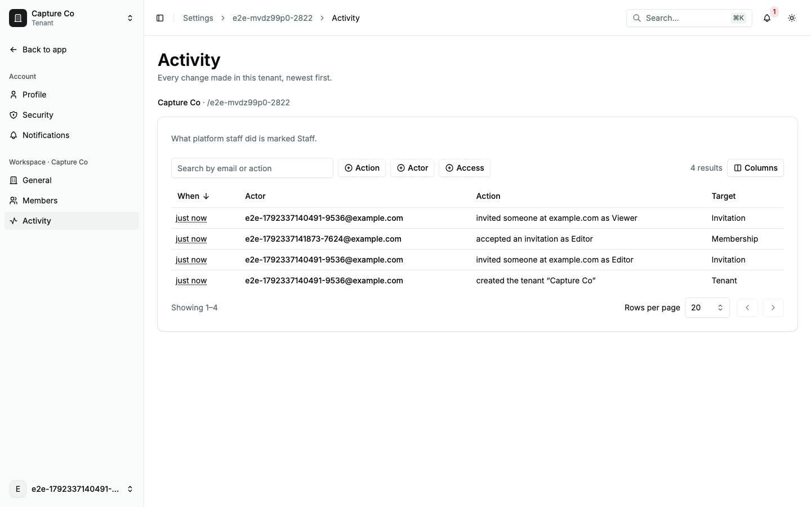

|                     |                                                                                                                                                                                                                                                                                                                                                                                                                                                                                                                                                                                                                                    |
| ------------------- | ---------------------------------------------------------------------------------------------------------------------------------------------------------------------------------------------------------------------------------------------------------------------------------------------------------------------------------------------------------------------------------------------------------------------------------------------------------------------------------------------------------------------------------------------------------------------------------------------------------------------------------- |
| Purpose             | The tenant's audit log, newest first, for owners and admins.                                                                                                                                                                                                                                                                                                                                                                                                                                                                                                                                                                       |
| File                | `src/pages/_app/settings/workspace.$slug.activity.tsx`, rendering `TenantActivityPanel` and `ActivityTable`                                                                                                                                                                                                                                                                                                                                                                                                                                                                                                                        |
| Guard and redirects | `_app`, the [workspace gate](#settingsworkspaceslug--workspace-gate); `/tenants/$slug/activity` lands here. Viewers and editors see "Only this workspace’s owners and admins can see its activity." and nothing is requested.                                                                                                                                                                                                                                                                                                                                                                                                      |
| Layout              | `AppLayout` › settings shell › workspace gate                                                                                                                                                                                                                                                                                                                                                                                                                                                                                                                                                                                      |
| Data                | started: `GET /tenants/:slug/members?limit=100` (`['tenants', slug, 'members', 'list', { limit: 100 }, 'no-total']`, the Actor facet's names; no `total`), `GET /tenants/:slug/audit-log` (`['tenants', slug, 'audit-log', 'list', request]`, one page at a time) with `search`, `sort`, `action`, `actor`, `access`, `cursor`, `direction` and `limit` from the URL; `staleTime: 0`, so each view shows the skeleton again. A 403 is not retried. Search matches the raw action name and the actor's email; actions with no wording (many platform-tenant ones) are not in the Action facet and read through a fallback sentence. |
| Sections            | One `Card` with a screen-reader-only `h2`: "Changes made by React Boilerplate support staff are marked Staff.", then the table: When (the absolute date and time, with the relative time in a tooltip), Actor, Action and Target columns, a search box, the Action, Actor and Access facets, and Previous and Next page.                                                                                                                                                                                                                                                                                                           |
| Components          | `Card`, `DataTable` (When, Actor, Action, Target), `Tooltip`, `Badge`, `Skeleton` (the role), `EmptyState` (compact), `Pii`, `Note`                                                                                                                                                                                                                                                                                                                                                                                                                                                                                                |
| Transitions         | none                                                                                                                                                                                                                                                                                                                                                                                                                                                                                                                                                                                                                               |

| Loading                                                 | Error                                           | Empty                                                                                      |
| ------------------------------------------------------- | ----------------------------------------------- | ------------------------------------------------------------------------------------------ |
| 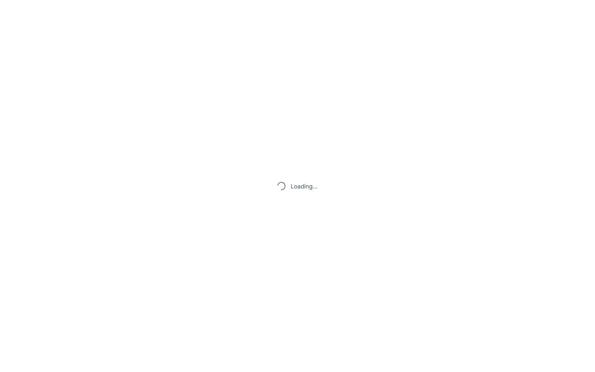       | 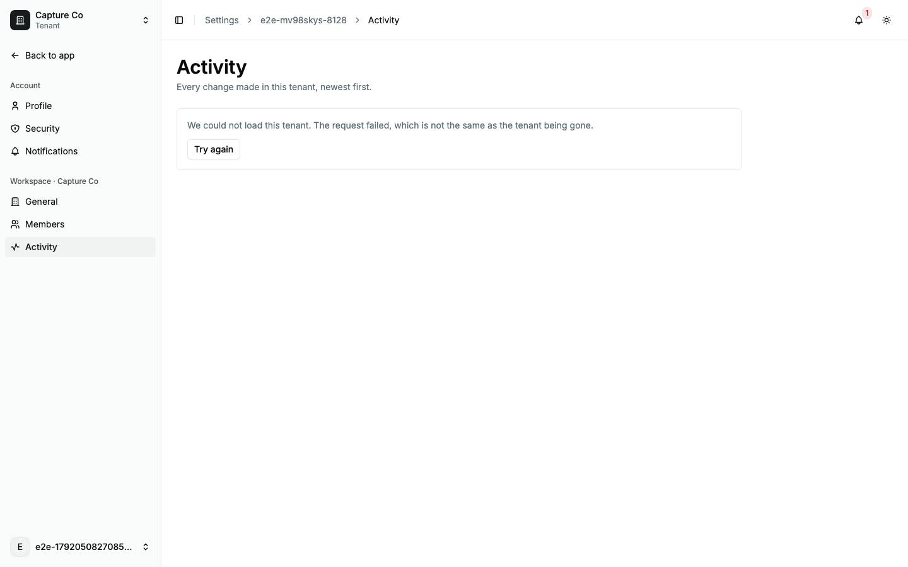 | 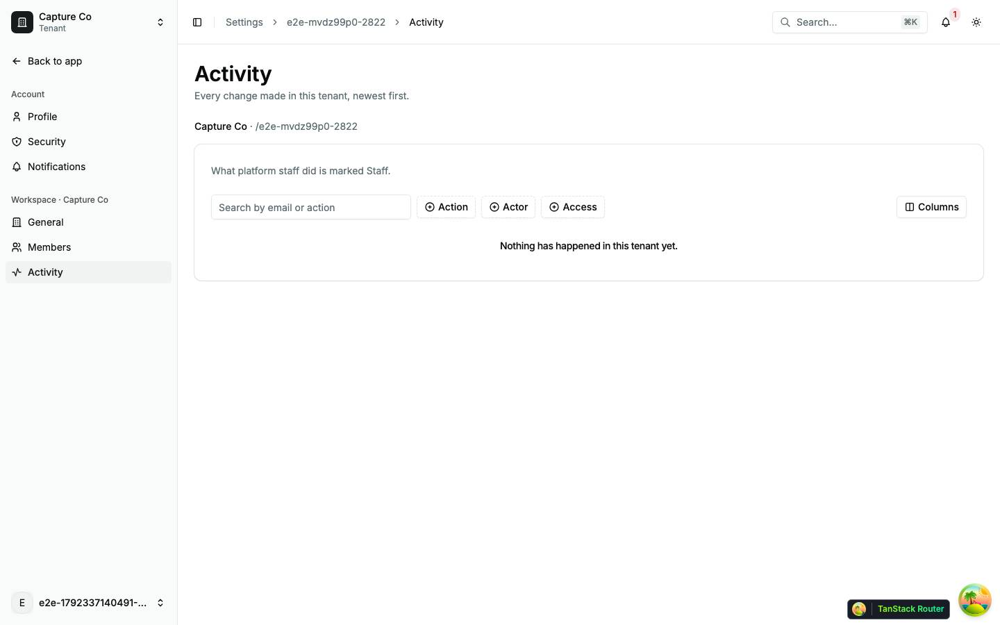                                            |
| skeleton · the settings template under the real heading | alert · the tenant `LoadError` under the `h1`   | "Nothing has happened in this workspace yet." (filtered: "Nothing matches these filters.") |

| Role-denied                                                                                                                                                                                                                                                             |
| ----------------------------------------------------------------------------------------------------------------------------------------------------------------------------------------------------------------------------------------------------------------------- |
| 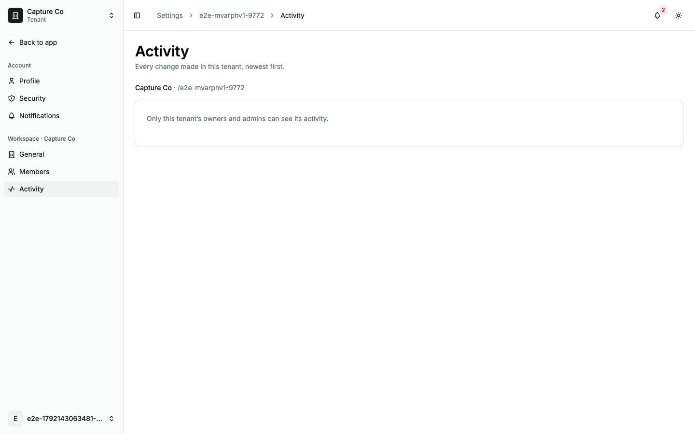                                                                                                                                                                                                                   |
| An editor (`canViewActivity` is false): the card's description reads "Only this workspace’s owners and admins can see its activity." and its content is empty: no filters, no entries. Neither `GET /tenants/:slug/members` nor `GET /tenants/:slug/audit-log` is sent. |

Findings: [F-settings-1](findings.md#f-settings-1), [F-settings-2](findings.md#f-settings-2), [F-settings-5](findings.md#f-settings-5), [F-settings-7](findings.md#f-settings-7), [F-settings-8](findings.md#f-settings-8), [F-settings-9](findings.md#f-settings-9)

## Redirects

Each throws a `redirect` in `beforeLoad` with `replace: true`, keeping the search and hash. In the walk, each landed on its target directly.

| Route                        | File                                                | Goes to                             |
| ---------------------------- | --------------------------------------------------- | ----------------------------------- |
| `/profile`                   | `src/pages/_app/profile.tsx`                        | `/settings/account/profile`         |
| `/settings/account/`         | `src/pages/_app/settings/account.index.tsx`         | `/settings/account/profile`         |
| `/settings/workspace/$slug/` | `src/pages/_app/settings/workspace.$slug.index.tsx` | `/settings/workspace/$slug/general` |
