# Workspaces (`/tenants`)

This file covers the tenant list (`/tenants/`), a tenant's overview (`/tenants/$slug/`), its insights and beta pages, and the tenant paths that redirect to workspace settings. The user interface (UI) calls a tenant a workspace. Back to the [route map](README.md#route-map).

"The walk" below is the Playwright walk of the app made for pull request (PR) #108 on 15 October 2026. API is the application programming interface.

## Layout

`/tenants/$slug` (`src/pages/_app/tenants/$slug.tsx`) is the layout every tenant page renders in, under `AppLayout` ([dashboard.md](dashboard.md#the-app-shell)).

|                 |                                                                                                                                                                                                                                                                                                                                                                                                                                                                |
| --------------- | -------------------------------------------------------------------------------------------------------------------------------------------------------------------------------------------------------------------------------------------------------------------------------------------------------------------------------------------------------------------------------------------------------------------------------------------------------------- |
| Fetches         | Its loader (`startTenantRoute`) starts `GET /tenants/:slug` (`['tenants', slug]`; a 404 resolves to `null`) without waiting on it. It awaits `GET /tenants/:slug/flags` (`['flags', 'tenant', slug]`, `staleTime` 5 min) for at most 10 s. A hover preload starts only the detail. `preloadStaleTime: 0` with a blocking stale reload makes a committed navigation run the loader again. The search middleware strips `?tenant`, since the tenant is the path. |
| While it loads  | The flags read holds the route: the boot shell on a cold load, `pendingComponent: DetailPending` after 300 ms on a navigation. Then `TenantGate` shows the detail template (`PageSkeleton variant="detail"`) under the app shell until the tenant lands. It shows the template again while a tenant that answered 404 waits for the tenant list.                                                                                                               |
| Gate panels     | `TenantGate` (`src/components/features/tenant/tenant-gate.tsx`), each an `EmptyState` titled `h1` here. See [Gate panels](#gate-panels).                                                                                                                                                                                                                                                                                                                       |
| Load failed     | Any other failure of the detail read: `TenantGate`'s `QueryState` shows one `LoadError`, "We couldn’t load this workspace because the request failed. Select Try again.", whose Try again refetches the tenant. It replaces the header and tabs as well as the page.                                                                                                                                                                                           |
| Header and tabs | The tenant's name as the `h1`, the caller's role `Badge`, `/{slug}`, then a `nav` "Workspace sections" of link tabs: Overview, Insights, and Beta while `example_beta_page` is on for this tenant. A `PlatformAccessBanner` sits above when staff reached the tenant through platform access.                                                                                                                                                                  |
| Breadcrumbs     | Workspaces › {slug} › {tab}. The tenant crumb is the slug, not the name, because static data resolves before any fetch.                                                                                                                                                                                                                                                                                                                                        |

### Gate panels

| Case                                                             | Panel                                                                                                                                                                                                                            |
| ---------------------------------------------------------------- | -------------------------------------------------------------------------------------------------------------------------------------------------------------------------------------------------------------------------------- |
| A 404                                                            | **Workspace not available**: "We couldn’t open /{slug}. It doesn’t exist, or you aren’t a member." and Back to your workspaces                                                                                                   |
| A suspended tenant of yours (told apart through the tenant list) | **Workspace suspended**, ending "Contact support at {support address} to restore access." (`supportEmail` from `GET /status/client-settings`; "Contact support to restore access." while that read is loading, failed or absent) |
| The detail is missing and the list failed                        | a `LoadError`                                                                                                                                                                                                                    |

A navigation from the list to a tenant whose detail is held shows the breadcrumb Workspaces › {slug} › Overview over the detail template (heading, tabs and two cards) under the app shell ([shot](img/tenants/tenant-overview--nav-route.jpg)). Then the whole page appears at once.

Findings: [F-tenants-1](findings.md#f-tenants-1), [F-tenants-2](findings.md#f-tenants-2), [F-tenants-5](findings.md#f-tenants-5)

## Pages

### `/tenants/` — Tenants

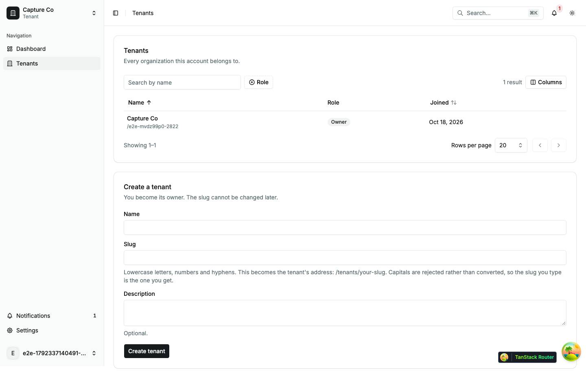

|                     |                                                                                                                                                                                                                                                                                                 |
| ------------------- | ----------------------------------------------------------------------------------------------------------------------------------------------------------------------------------------------------------------------------------------------------------------------------------------------- |
| Purpose             | List every tenant this account belongs to, and create another.                                                                                                                                                                                                                                  |
| File                | `src/pages/_app/tenants/index.tsx`                                                                                                                                                                                                                                                              |
| Guard and redirects | `_app`; `TenantSearchGuard` fills `?tenant=` after mount                                                                                                                                                                                                                                        |
| Layout              | `AppLayout`                                                                                                                                                                                                                                                                                     |
| Data                | Two reads of `/tenants`, by design, not a duplicate fetch. See [The two tenant reads](#the-two-tenant-reads). `POST /tenants` on Create workspace.                                                                                                                                              |
| Sections            | Workspaces card (`h1` inside `CardTitle`): a table with Name (link and `/{slug}`), Role and Joined columns, search by name, a Role filter and paging; a suspended tenant's name is plain text with a Suspended badge. Create a workspace card: name, slug (validated as you type), description. |
| Components          | `Card`, `Badge`, `EmptyState` (full), `MyTenantsTable` on `DataTable` (with `QueryState`), `Form` fields, `Input`, `Textarea`, `BusyButton`                                                                                                                                                     |
| Transitions         | name → `/tenants/$slug`; Create workspace → a toast "{name} created." and the form clears (it stays on the list)                                                                                                                                                                                |

#### The two tenant reads

| Read           | Request and query key                                                                                                    | Who reads it                                                                                                                              |
| -------------- | ------------------------------------------------------------------------------------------------------------------------ | ----------------------------------------------------------------------------------------------------------------------------------------- |
| The full list  | `GET /tenants?limit=100` (`['tenants']`), every membership by following `nextCursor`                                     | `TenantSearchGuard`, which holds the page slot on the dashboard template until it lands; then the switcher, from the cache (`useTenants`) |
| The table page | `GET /tenants` (`['tenants', '_pages', 'list', …]`) with `search`, `sort` (`name`, `-joined`), `role`, `cursor`, `limit` | the table                                                                                                                                 |

The error branch comes before the empty one, so a failed load never invites the reader to create a duplicate. While the list is held, the switcher says "Loading workspaces…" and the page slot holds the list template.

| Loading                                                                                                  | Error                                                       | Empty                                                                    |
| -------------------------------------------------------------------------------------------------------- | ----------------------------------------------------------- | ------------------------------------------------------------------------ |
| 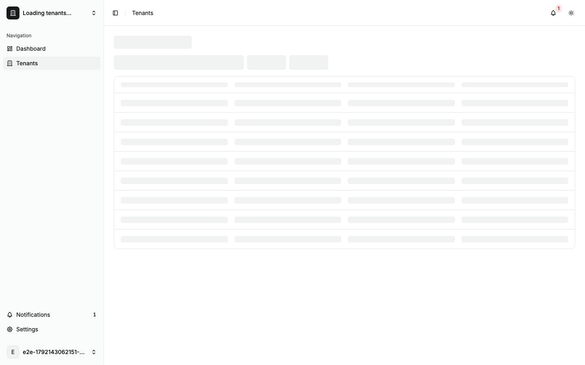                                                                    | 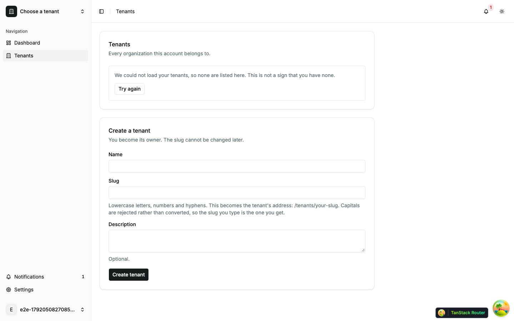                         | 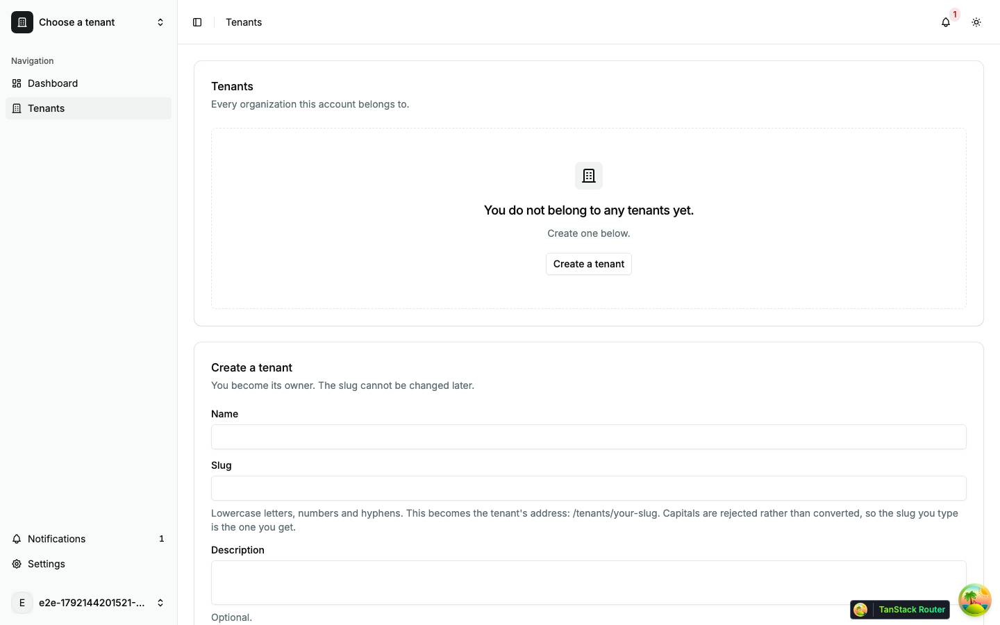                                      |
| skeleton · the list template (heading, toolbar, eight table rows), "Loading workspaces…" in the switcher | alert · `QueryState`'s, through `DataTable`, with Try again | "This account isn’t a member of any workspace." with "Create one below." |

| Dark                               | Mobile                                   |
| ---------------------------------- | ---------------------------------------- |
| 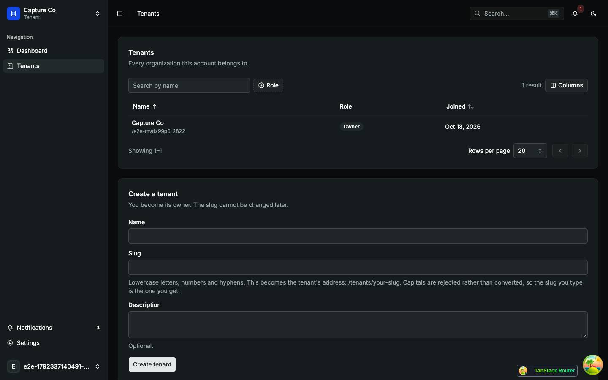 | 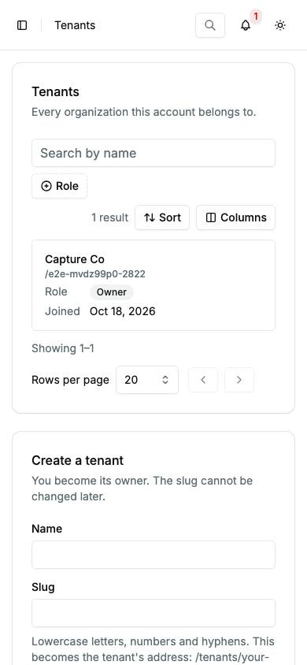     |
| The primary button turns light.    | One column; the sidebar is in the sheet. |

Findings: [F-dashboard-2](findings.md#f-dashboard-2), [F-tenants-4](findings.md#f-tenants-4), [F-tenants-7](findings.md#f-tenants-7)

### `/tenants/$slug/` — Overview

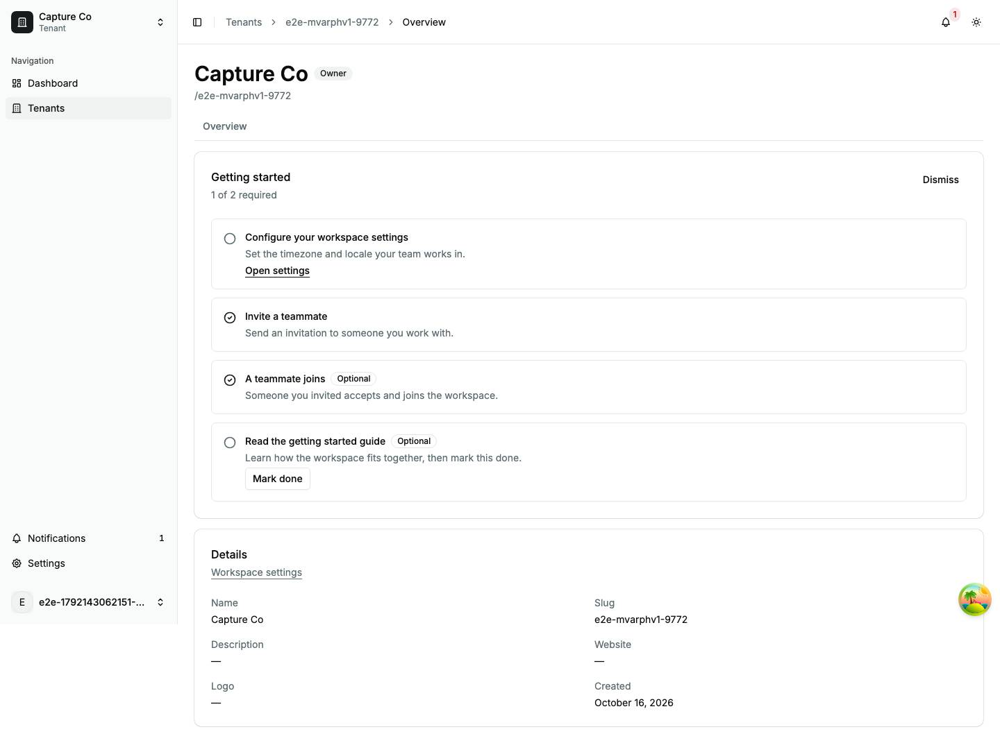

|                     |                                                                                                                                                                                                                                                                                                                                 |
| ------------------- | ------------------------------------------------------------------------------------------------------------------------------------------------------------------------------------------------------------------------------------------------------------------------------------------------------------------------------- |
| Purpose             | The tenant's default tab: the Getting started checklist and the tenant's details, read-only.                                                                                                                                                                                                                                    |
| File                | `src/pages/_app/tenants/$slug.index.tsx`                                                                                                                                                                                                                                                                                        |
| Guard and redirects | `_app`, then the [layout](#layout)                                                                                                                                                                                                                                                                                              |
| Layout              | `AppLayout` › tenant layout                                                                                                                                                                                                                                                                                                     |
| Data                | From the layout: `GET /tenants/:slug` (`['tenants', slug]`, started), `GET /tenants/:slug/flags` (`['flags', 'tenant', slug]`, `staleTime` 5 min, awaited, 10 s cap). Started: `GET /tenants/:slug/onboarding` (`['tenants', slug, 'onboarding']`). Step and dismiss actions post to `/tenants/:slug/onboarding/…`.             |
| Sections            | Getting started (`GettingStartedCard`) ← onboarding: "{n} of {m} required", one bordered row per step with a done marker, an Optional badge, and the step's action (Open settings, Mark done); Dismiss for owners. Details ← the tenant detail: name, slug, description, website, logo, created, and a Workspace settings link. |
| Components          | `Card`, `Badge`, `Button`, `TenantDetails`, `GettingStartedCard`, `QueryState`, `CardRowsSkeleton`; hand-rolled: the step list and its done markers                                                                                                                                                                             |
| Transitions         | Workspace settings and Open settings → `/settings/workspace/$slug/general`; Beta tab → `/tenants/$slug/beta` when its flag is on                                                                                                                                                                                                |

How `GettingStartedCard` handles each state (`tenants/$slug.test.tsx` covers them):

- **In flight:** a skeleton holds the checklist's place, a card with five step-height rows.
- **Failed:** "Getting started didn’t load. Select Try again." with Try again, in the checklist's place.
- **404:** an API older than 1.4.0 answers 404, which leaves no checklist and no alert.
- **Loaded, nothing to show:** onboarding `not_tracked`, `complete` for more than 24 hours (`ALL_SET_WINDOW_MS`), or dismissed (for a non-owner) renders nothing.

The Details card is up in every one of these states.

| Loading                                            | Error                                                            | Empty                                            |
| -------------------------------------------------- | ---------------------------------------------------------------- | ------------------------------------------------ |
| 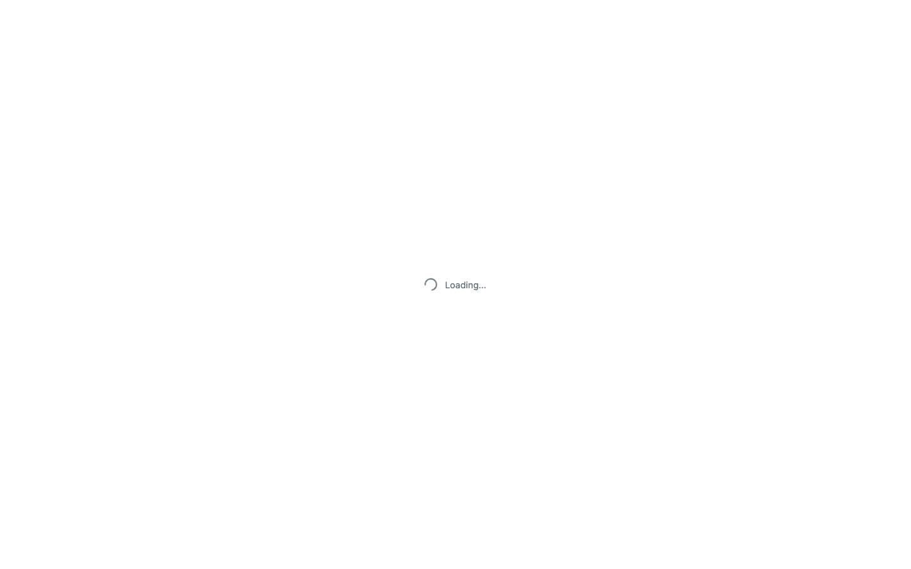      | 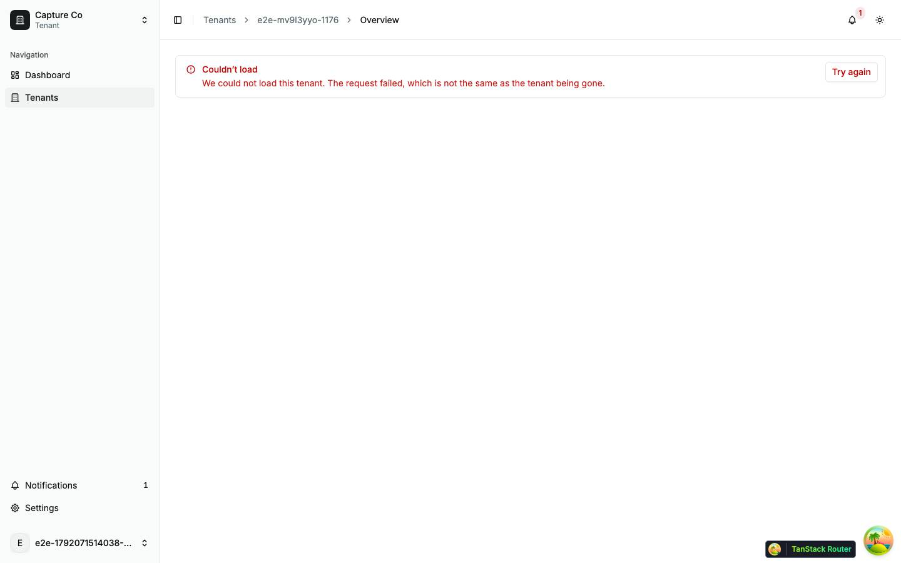                      | 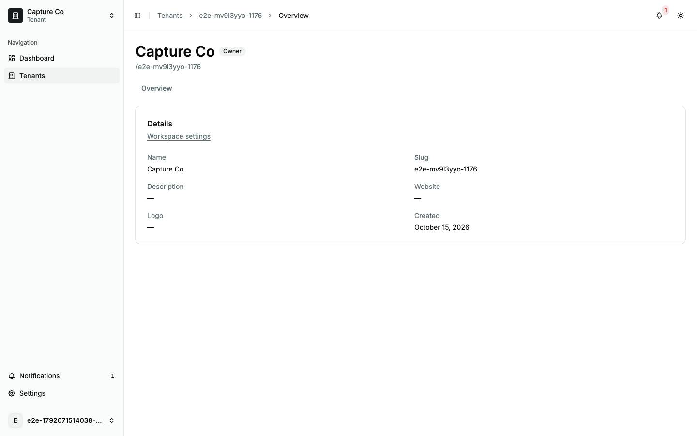      |
| skeleton · the detail template under the app shell | alert · the tenant `LoadError` in place of header, tabs and page | onboarding `not_tracked`: the Details card alone |

| Dark                                       | Mobile                                                            |
| ------------------------------------------ | ----------------------------------------------------------------- |
| 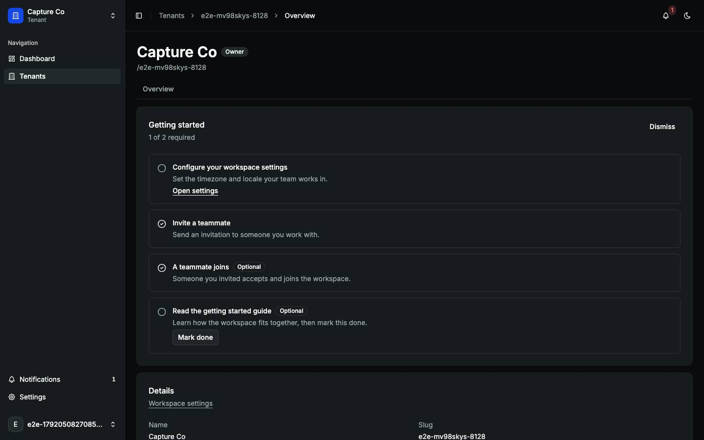 | 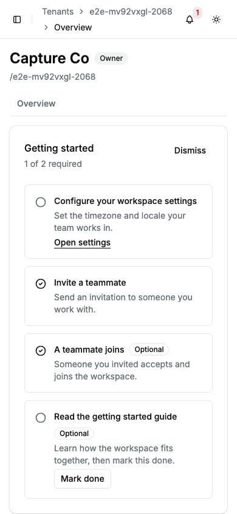                      |
| Cards and step rows on the dark surfaces.  | The breadcrumb wraps to two lines; an Optional badge wraps alone. |

The default shot is full-page. The sidebar is fixed to the viewport, so it is not drawn below 900 px down the page. That is the screenshot, not the page.

| Role-denied                                                                                                                                                                                                                                                                                                                                                  |
| ------------------------------------------------------------------------------------------------------------------------------------------------------------------------------------------------------------------------------------------------------------------------------------------------------------------------------------------------------------ |
| 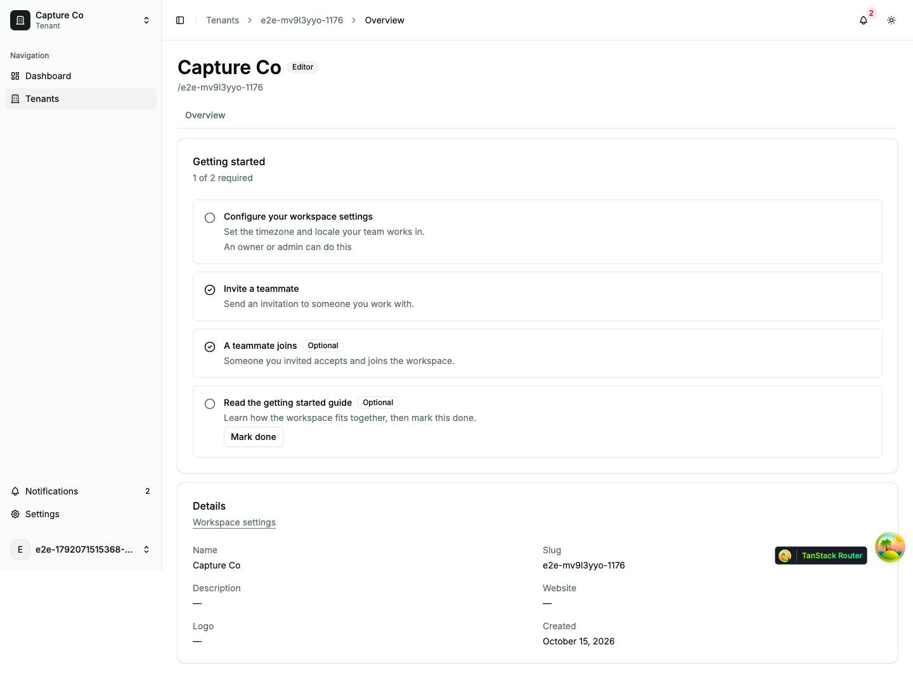                                                                                                                                                                                                                                                                                                            |
| An editor (a member, `canManageTenant` false): Getting started without Dismiss; a linked step (Open settings) and a tenant-scoped manual step read "An owner or admin can do this" in place of their action, while a member-scoped manual step keeps Mark done. A dismissed checklist shows nothing (the owner gets the undo). The Details card is the same. |

Findings: [F-tenants-1](findings.md#f-tenants-1), [F-tenants-2](findings.md#f-tenants-2), [F-tenants-3](findings.md#f-tenants-3), [F-tenants-5](findings.md#f-tenants-5)

### `/tenants/$slug/insights` — Insights

This page has no screenshots in `img/`. A `pnpm capture:pages` run takes them: the default, loading and error shots, and `tenant-insights--state-locked.jpg`, the locked card with the entitlements read stubbed to Free.

|                     |                                                                                                                                                                                                                                                                                                                  |
| ------------------- | ---------------------------------------------------------------------------------------------------------------------------------------------------------------------------------------------------------------------------------------------------------------------------------------------------------------- |
| Purpose             | The reference plan-gated page: workspace counts for the last 30 days, included in Paid (`advanced_example`). Copy it to gate another page.                                                                                                                                                                       |
| File                | `src/pages/_app/tenants/$slug.insights.tsx`                                                                                                                                                                                                                                                                      |
| Guard and redirects | `_app`, the [layout](#layout). No route guard: the page shows the locked card in place of its content when the plan lacks the feature.                                                                                                                                                                           |
| Layout              | `AppLayout` › tenant layout                                                                                                                                                                                                                                                                                      |
| Data                | Started by the layout: `GET /tenants/:slug`. `GET /tenants/:slug/entitlements` (`['tenants', slug, 'entitlements']`) decides the UI gate. Only with the feature on: `GET /tenants/:slug/insights` (`['tenants', slug, 'insights']`, no retry), which answers 402 `PLAN_FEATURE_REQUIRED` when the plan lacks it. |
| Sections            | Included: "Workspace insights" with two stat cards, "Members joined, last 30 days" and "Invitations sent, last 30 days". Locked: a card "Workspace insights" with the value line, "Included in Paid." and the viewer's upgrade path (`UpgradeAction`).                                                           |
| Components          | `FeatureGate`, `QueryState`, `Card`, `Skeleton`, `CardRowsSkeleton`, `LoadError`, `UpgradeAction`                                                                                                                                                                                                                |
| Transitions         | the tabs; Upgrade → `/settings/workspace/$slug/billing`, or Request upgrade for a non-owner                                                                                                                                                                                                                      |

Two guards draw the same locked card: the UI gate from the entitlements, and the API's 402 when the entitlements read was stale. The insights query resolves a 402 to a sentinel value rather than rejecting.

### `/tenants/$slug/beta` — Beta

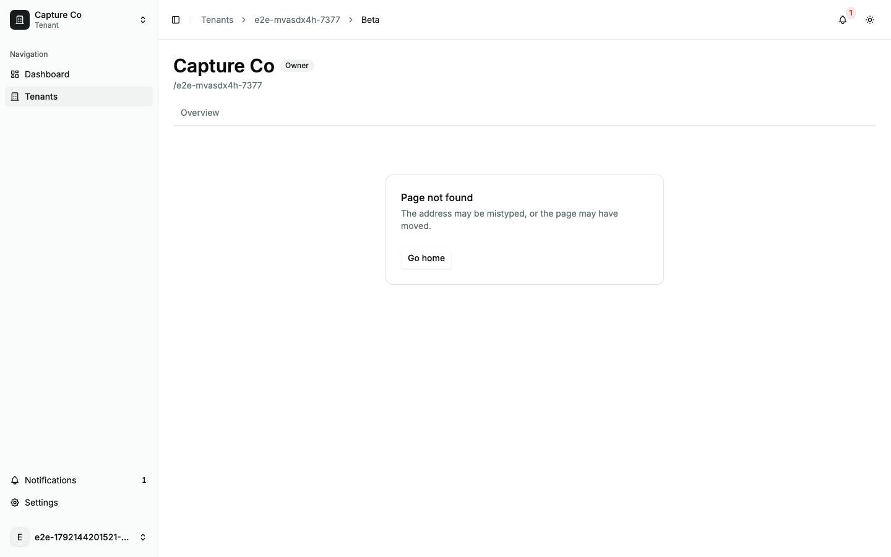

|                     |                                                                                                                                                                                                                                                                                                                                                                                    |
| ------------------- | ---------------------------------------------------------------------------------------------------------------------------------------------------------------------------------------------------------------------------------------------------------------------------------------------------------------------------------------------------------------------------------- |
| Purpose             | The reference flag-gated page: it exists only while `example_beta_page` is on for this tenant.                                                                                                                                                                                                                                                                                     |
| File                | `src/pages/_app/tenants/$slug.beta.tsx`                                                                                                                                                                                                                                                                                                                                            |
| Guard and redirects | `_app`, the [layout](#layout), then `beforeLoad`: `requireClientFlag` reads the tenant's flags and throws `notFound()` when the flag is off, so the router's `RouteNotFound` card renders inside the tenant layout                                                                                                                                                                 |
| Layout              | `AppLayout` › tenant layout                                                                                                                                                                                                                                                                                                                                                        |
| Data                | Started by the layout: `GET /tenants/:slug` (`['tenants', slug]`). Awaited by the layout and `beforeLoad` (10 s cap): `GET /tenants/:slug/flags` (`['flags', 'tenant', slug]`, `staleTime` 5 min). Started: `GET /tenants/:slug/beta` (`['tenants', slug, 'beta']`). A 404 from it means the flag closed after the page opened: the page re-reads the flags and re-runs the guard. |
| Sections            | One `Card` "Beta": "Features this workspace sees before everyone else." and "Beta features are on for {slug}."                                                                                                                                                                                                                                                                     |
| Components          | `Card`, `QueryState`, `CardRowsSkeleton`, `Skeleton`, `LoadError` ("We couldn’t load this workspace’s beta features. Select Try again to load them.")                                                                                                                                                                                                                              |
| Transitions         | the tabs; with the flag off, Go home → `/` → `/dashboard`                                                                                                                                                                                                                                                                                                                          |

The capture creates its tenant for the run, so the flag is off. The default shot is therefore the not-found card inside the tenant layout, and its record has no `GET /tenants/:slug/beta` request.

The beta card, its skeleton (a card with a title bar, a description bar and one line) and its `LoadError` are described from the code. The loading and error shots hold or fail the tenant read, which the layout starts and its `TenantGate` waits for. They therefore show the detail template under the app shell and the tenant `LoadError`.

| Loading                                            | Error                                   |
| -------------------------------------------------- | --------------------------------------- |
| 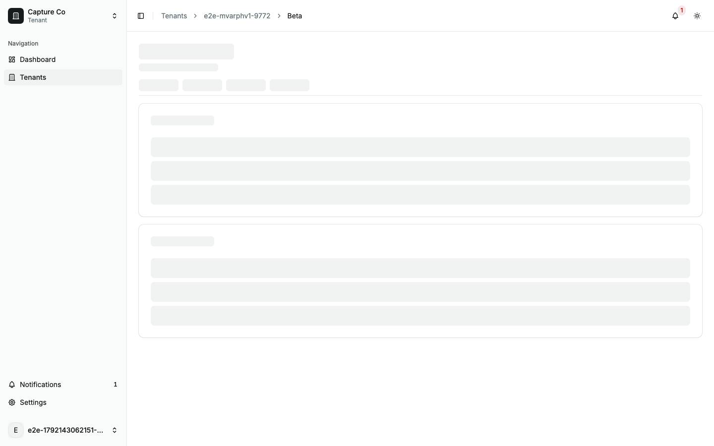          | 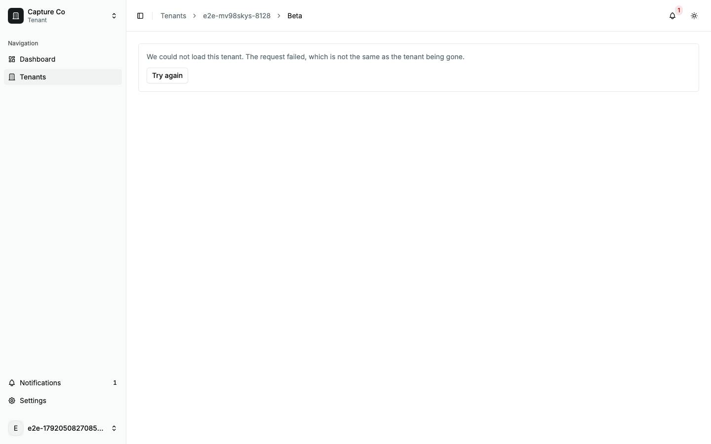 |
| skeleton · the detail template under the app shell | alert · the tenant `LoadError`          |

Findings: [F-tenants-1](findings.md#f-tenants-1), [F-tenants-2](findings.md#f-tenants-2), [F-tenants-6](findings.md#f-tenants-6)

## Redirects

Each throws a `redirect` in `beforeLoad` with `replace: true`, keeping the search and hash, so Back skips it. In the walk, each landed on its target with no flash of a tenant page.

| Route                     | File                                        | Goes to                              |
| ------------------------- | ------------------------------------------- | ------------------------------------ |
| `/tenants/$slug/activity` | `src/pages/_app/tenants/$slug.activity.tsx` | `/settings/workspace/$slug/activity` |
| `/tenants/$slug/members`  | `src/pages/_app/tenants/$slug.members.tsx`  | `/settings/workspace/$slug/members`  |
| `/tenants/$slug/settings` | `src/pages/_app/tenants/$slug.settings.tsx` | `/settings/workspace/$slug/general`  |
