# Tenants

The tenant list (`/tenants/`), a tenant's overview (`/tenants/$slug/`) and beta page, and the tenant paths that redirect to workspace settings. Back to the [route map](README.md#route-map).

## Layout

`/tenants/$slug` (`src/pages/_app/tenants/$slug.tsx`) is the layout every tenant page renders in, under `AppLayout` ([dashboard.md](dashboard.md#the-app-shell)).

|                 |                                                                                                                                                                                                                                                                                                                                                                                                                                                                |
| --------------- | -------------------------------------------------------------------------------------------------------------------------------------------------------------------------------------------------------------------------------------------------------------------------------------------------------------------------------------------------------------------------------------------------------------------------------------------------------------- |
| Fetches         | Its loader (`startTenantRoute`) starts `GET /tenants/:slug` (`['tenants', slug]`; a 404 resolves to `null`) without waiting on it, and awaits `GET /tenants/:slug/flags` (`['flags', 'tenant', slug]`, `staleTime` 5 min) for at most 10 s; a hover preload starts only the detail. `preloadStaleTime: 0` with a blocking stale reload, so a committed navigation runs the loader again. The search middleware strips `?tenant`, since the tenant is the path. |
| While it loads  | The flags read holds the route (the boot shell on a cold load, `pendingComponent: DetailPending` after 300 ms on a navigation); then `TenantGate` shows the detail template (`PageSkeleton variant="detail"`) under the app shell until the tenant lands, and again while a tenant that answered 404 waits for the tenant list.                                                                                                                                |
| Gate panels     | `TenantGate` (`src/components/features/tenant/tenant-gate.tsx`), each an `EmptyState` titled `h1` here: **Tenant not available** ("We could not open /{slug}. Either it does not exist or it is not one of yours." and Back to your tenants) for a 404; **Tenant suspended** for a suspended tenant of yours (told apart through the tenant list); a `LoadError` when the detail is missing and the list failed.                                               |
| Load failed     | Any other failure of the detail read: `TenantGate`'s `QueryState` shows one `LoadError`, "We could not load this tenant. The request failed, which is not the same as the tenant being gone.", whose Try again refetches the tenant. It replaces the header and tabs as well as the page.                                                                                                                                                                      |
| Header and tabs | The tenant's name as the `h1`, the caller's role `Badge`, `/{slug}`, then a `nav` "Tenant sections" of link tabs: Overview, and Beta while `example_beta_page` is on for this tenant. A `PlatformAccessBanner` sits above when staff reached the tenant through platform access.                                                                                                                                                                               |
| Breadcrumbs     | Tenants › {slug} › {tab}. The tenant crumb is the slug, not the name, because static data resolves before any fetch.                                                                                                                                                                                                                                                                                                                                           |

In the walk, a navigation from the list to a tenant whose detail was held for 2.5 s showed the breadcrumb Tenants › {slug} › Overview over an empty page with one spinner for about 2.3 s, then the whole page at once.

Findings: [F-tenants-1](findings.md#f-tenants-1), [F-tenants-2](findings.md#f-tenants-2), [F-tenants-5](findings.md#f-tenants-5)

## Pages

### `/tenants/` — Tenants

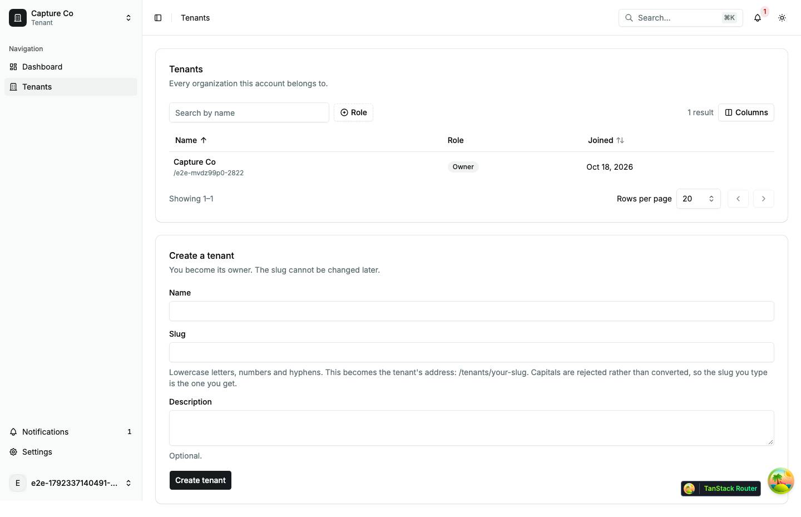

|                     |                                                                                                                                                                                                                                                                     |
| ------------------- | ------------------------------------------------------------------------------------------------------------------------------------------------------------------------------------------------------------------------------------------------------------------- |
| Purpose             | List every tenant this account belongs to, and create another.                                                                                                                                                                                                      |
| File                | `src/pages/_app/tenants/index.tsx`                                                                                                                                                                                                                                  |
| Guard and redirects | `_app`; `TenantSearchGuard` fills `?tenant=` after mount                                                                                                                                                                                                            |
| Layout              | `AppLayout`                                                                                                                                                                                                                                                         |
| Data                | `GET /tenants` (`['tenants']`), read by `TenantSearchGuard`, which holds the page slot on the dashboard template until it lands, and again here from the cache (`useTenants`); `POST /tenants` on Create tenant                                                     |
| Sections            | Tenants card (`h1` inside `CardTitle`): one row per tenant, the whole row a link with the name, `/{slug}` and the role badge; a suspended tenant's row is plain text with a Suspended badge. Create a tenant card: name, slug (validated as you type), description. |
| Components          | `Card`, `Badge`, `Skeleton`, `LoadError`, `EmptyState` (full), `Form` fields, `Input`, `Textarea`, `BusyButton`; `ItemGroup`, `Item` (link rows), `ItemContent`, `ItemTitle`, `ItemDescription`, `ItemActions`                                                      |
| Transitions         | row → `/tenants/$slug`; Create tenant → a toast "{name} created." and the form clears (it stays on the list)                                                                                                                                                        |

The error branch comes before the empty one, so a failed load never invites the reader to create a duplicate. While the list is held, the switcher says "Choose a tenant", the same words it uses when there are none.

| Loading                               | Error                               | Empty                                                     |
| ------------------------------------- | ----------------------------------- | --------------------------------------------------------- |
| 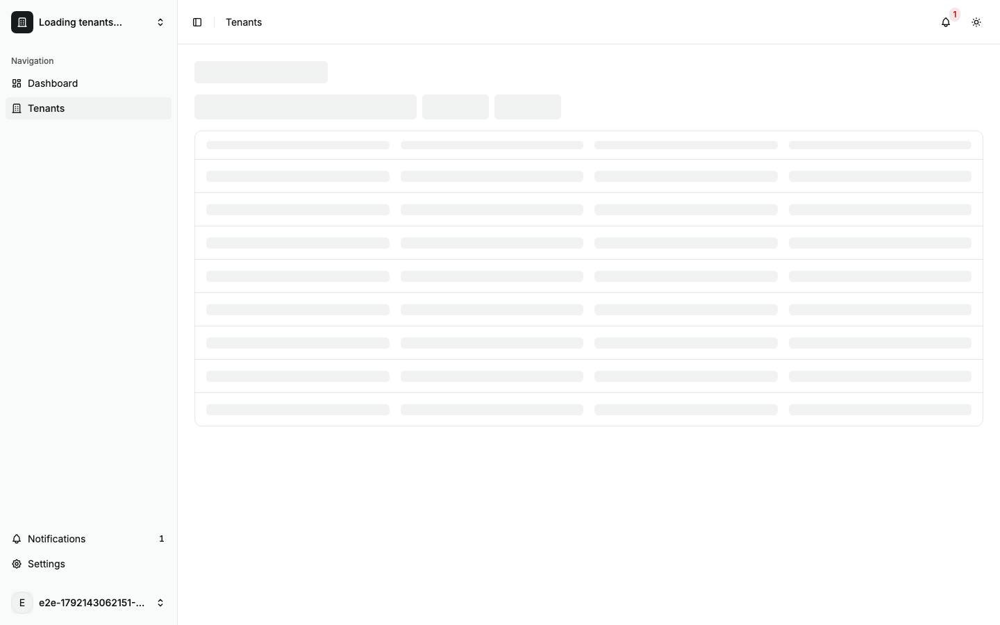 | 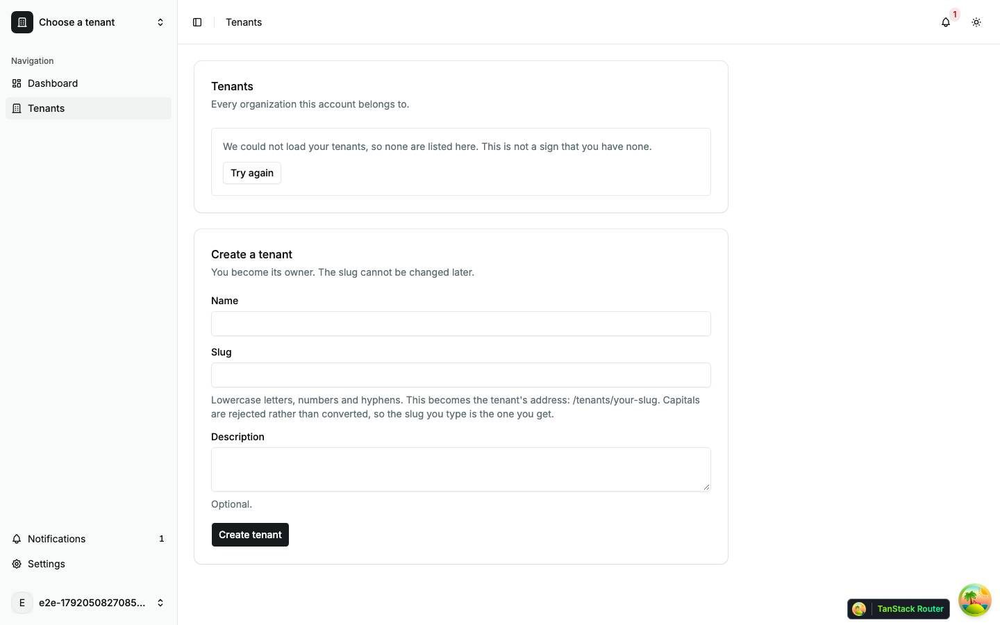 | 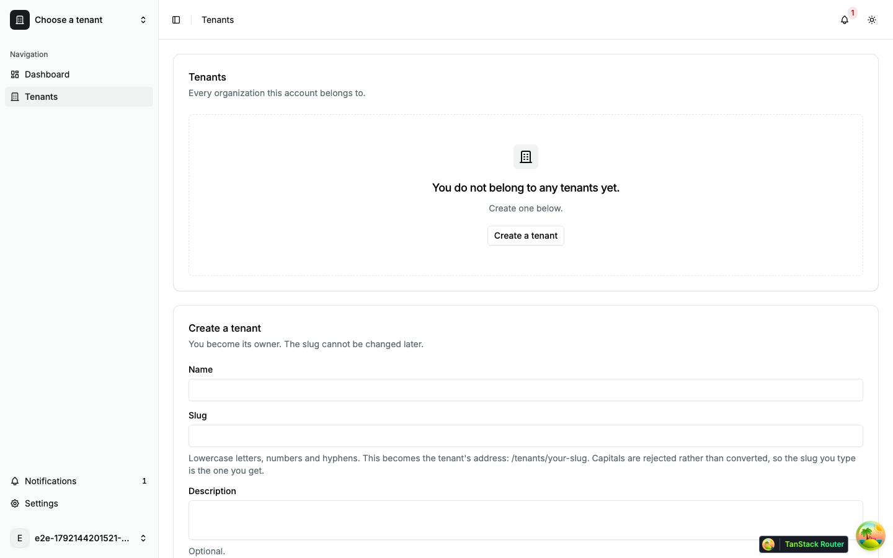                       |
| skeleton · 2× `h-14`                  | alert · `LoadError`                 | "You do not belong to any tenants yet. Create one below." |

| Dark                               | Mobile                                   |
| ---------------------------------- | ---------------------------------------- |
| 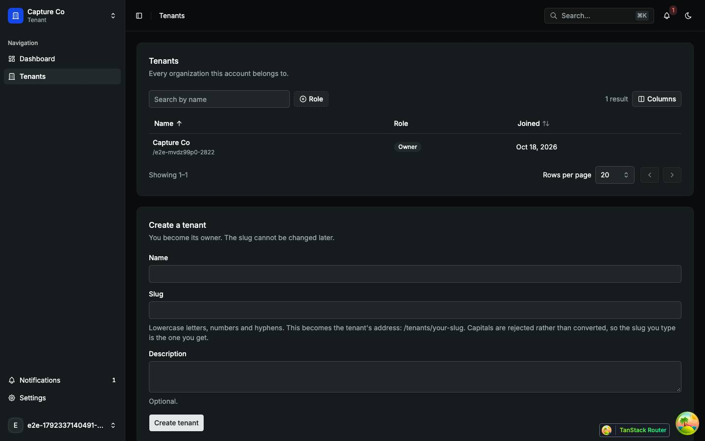 | 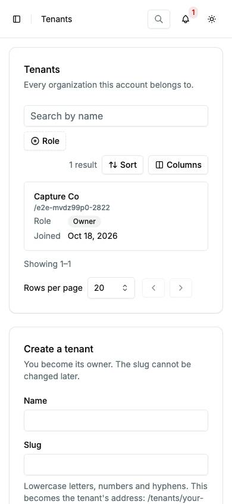     |
| The primary button turns light.    | One column; the sidebar is in the sheet. |

Findings: [F-dashboard-2](findings.md#f-dashboard-2), [F-tenants-4](findings.md#f-tenants-4), [F-tenants-7](findings.md#f-tenants-7)

### `/tenants/$slug/` — Overview

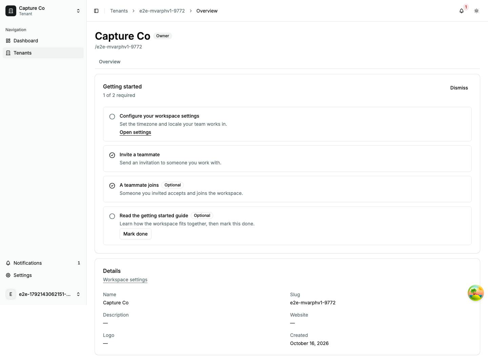

|                     |                                                                                                                                                                                                                                                                                                                                 |
| ------------------- | ------------------------------------------------------------------------------------------------------------------------------------------------------------------------------------------------------------------------------------------------------------------------------------------------------------------------------- |
| Purpose             | The tenant's default tab: the Getting started checklist and the tenant's details, read-only.                                                                                                                                                                                                                                    |
| File                | `src/pages/_app/tenants/$slug.index.tsx`                                                                                                                                                                                                                                                                                        |
| Guard and redirects | `_app`, then the [layout](#layout)                                                                                                                                                                                                                                                                                              |
| Layout              | `AppLayout` › tenant layout                                                                                                                                                                                                                                                                                                     |
| Data                | from the layout: `GET /tenants/:slug` (`['tenants', slug]`, started), `GET /tenants/:slug/flags` (`['flags', 'tenant', slug]`, `staleTime` 5 min, awaited, 10 s cap). Started: `GET /tenants/:slug/onboarding` (`['tenants', slug, 'onboarding']`); step and dismiss actions post to `/tenants/:slug/onboarding/…`.             |
| Sections            | Getting started (`GettingStartedCard`) ← onboarding: "{n} of {m} required", one bordered row per step with a done marker, an Optional badge, and the step's action (Open settings, Mark done); Dismiss for owners. Details ← the tenant detail: name, slug, description, website, logo, created, and a Workspace settings link. |
| Components          | `Card`, `Badge`, `Button`, `TenantDetails`, `GettingStartedCard`, `QueryState`, `CardRowsSkeleton`; hand-rolled: the step list and its done markers                                                                                                                                                                             |
| Transitions         | Workspace settings and Open settings → `/settings/workspace/$slug/general`; Beta tab → `/tenants/$slug/beta` when its flag is on                                                                                                                                                                                                |

`GettingStartedCard` holds the checklist's place with a skeleton (a card with five step-height rows) while the onboarding request is in flight, and says "Getting started could not be loaded." with Try again in that place when it fails; a 404, which an API older than 1.4.0 answers, leaves no checklist and no alert. The Details card is up either way. A tenant whose onboarding is `not_tracked`, long `complete`, or dismissed (for a non-owner) renders nothing once loaded. Covered by `tenants/$slug.test.tsx`.

| Loading                                       | Error                                                        | Empty                                            |
| --------------------------------------------- | ------------------------------------------------------------ | ------------------------------------------------ |
| 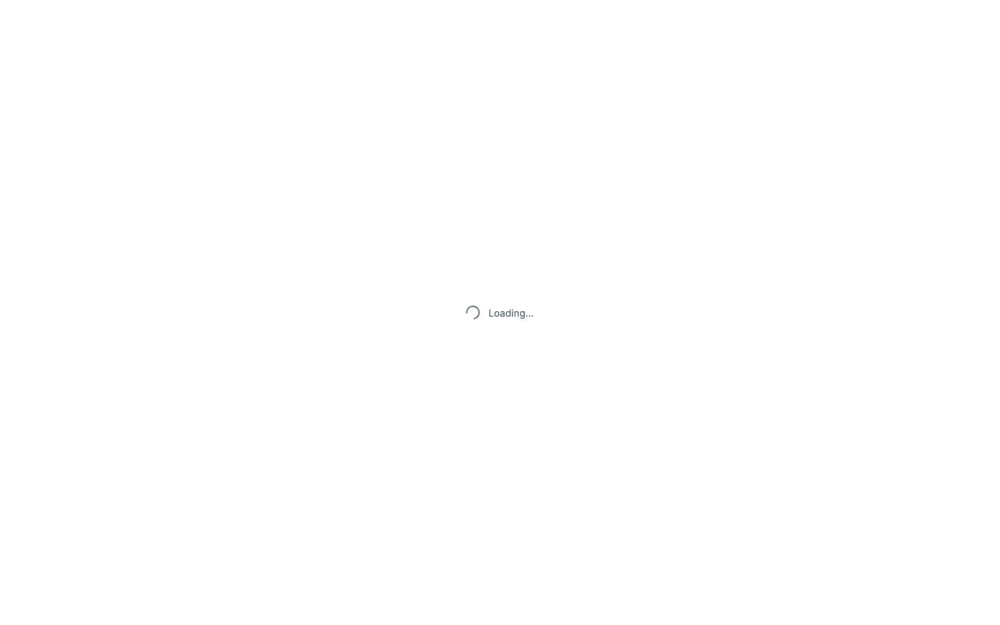 | 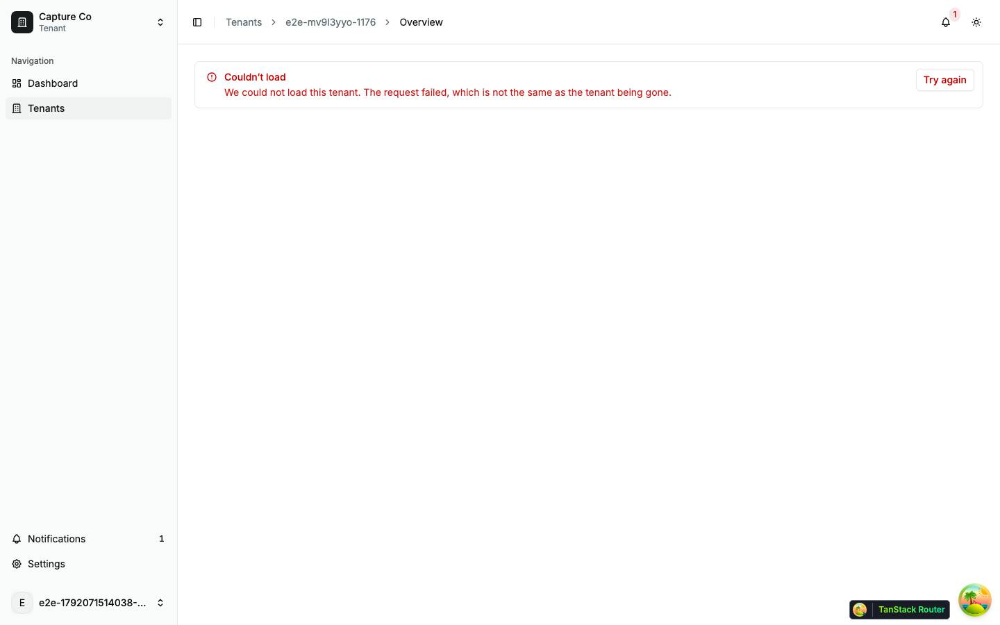                  | 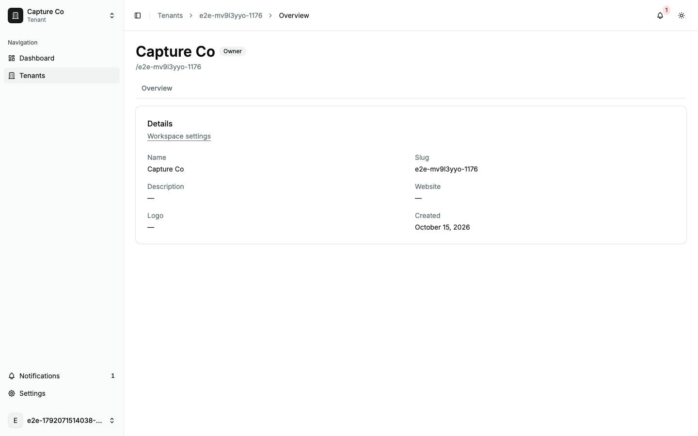      |
| splash · the boot splash, no shell            | alert · `TenantLoadFailed` in place of header, tabs and page | onboarding `not_tracked`: the Details card alone |

| Dark                                       | Mobile                                                            |
| ------------------------------------------ | ----------------------------------------------------------------- |
| 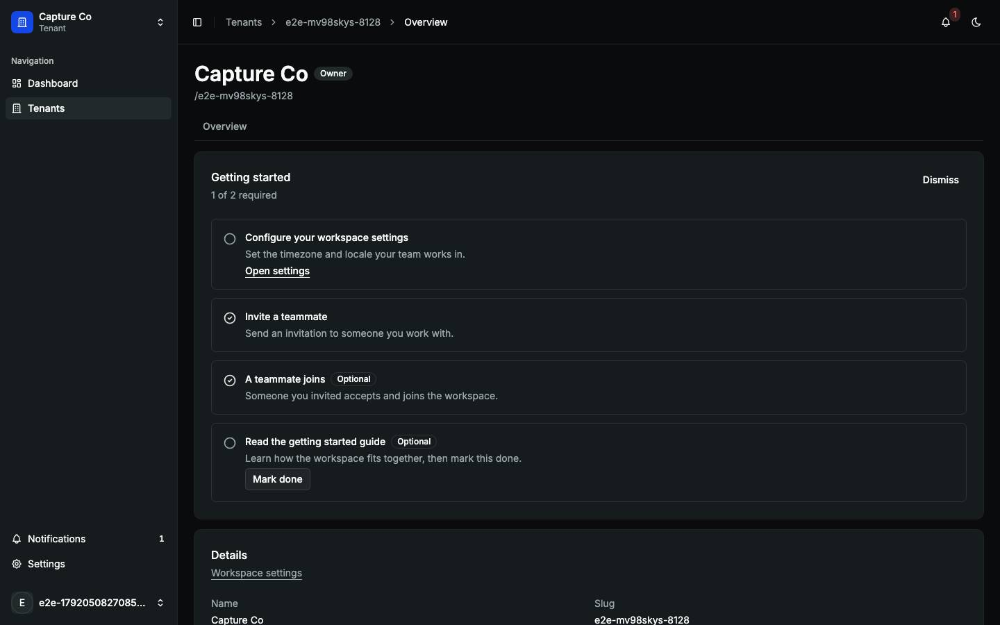 | 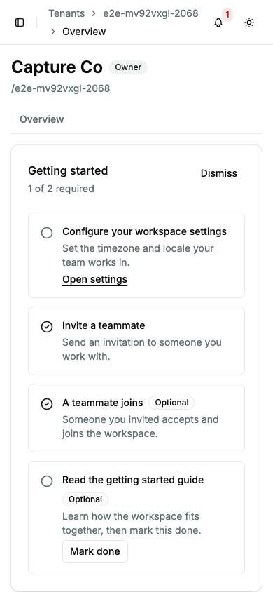                      |
| Cards and step rows on the dark surfaces.  | The breadcrumb wraps to two lines; an Optional badge wraps alone. |

The default shot is full-page: the sidebar is fixed to the viewport, so below 900 px it is not drawn. That is the screenshot, not the page.

| Role-denied                                                                                                                                                                                                                                                                                                                                                  |
| ------------------------------------------------------------------------------------------------------------------------------------------------------------------------------------------------------------------------------------------------------------------------------------------------------------------------------------------------------------ |
| 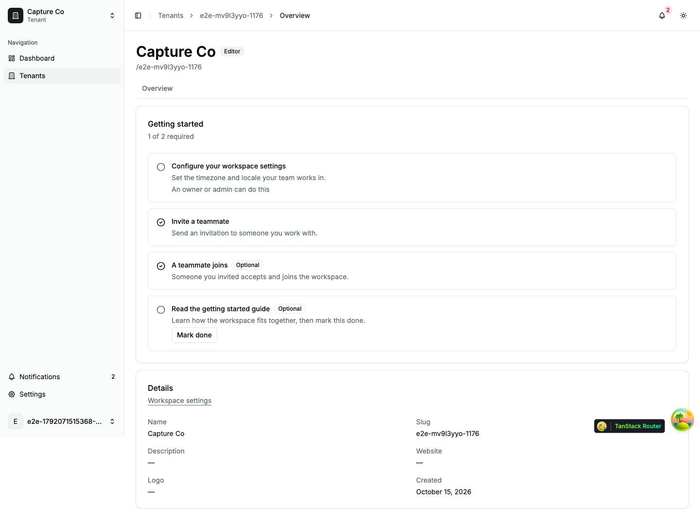                                                                                                                                                                                                                                                                                                            |
| An editor (a member, `canManageTenant` false): Getting started without Dismiss; a linked step (Open settings) and a tenant-scoped manual step read "An owner or admin can do this" in place of their action, while a member-scoped manual step keeps Mark done. A dismissed checklist shows nothing (the owner gets the undo). The Details card is the same. |

Findings: [F-tenants-1](findings.md#f-tenants-1), [F-tenants-2](findings.md#f-tenants-2), [F-tenants-3](findings.md#f-tenants-3), [F-tenants-5](findings.md#f-tenants-5)

### `/tenants/$slug/beta` — Beta

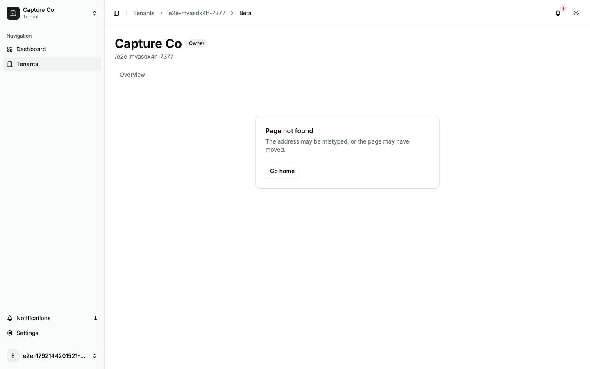

|                     |                                                                                                                                                                                                                                                                                                                                                                                    |
| ------------------- | ---------------------------------------------------------------------------------------------------------------------------------------------------------------------------------------------------------------------------------------------------------------------------------------------------------------------------------------------------------------------------------- |
| Purpose             | The reference flag-gated page: it exists only while `example_beta_page` is on for this tenant.                                                                                                                                                                                                                                                                                     |
| File                | `src/pages/_app/tenants/$slug.beta.tsx`                                                                                                                                                                                                                                                                                                                                            |
| Guard and redirects | `_app`, the [layout](#layout), then `beforeLoad`: `requireClientFlag` reads the tenant's flags and throws `notFound()` when the flag is off, so the router's `RouteNotFound` card renders inside the tenant layout                                                                                                                                                                 |
| Layout              | `AppLayout` › tenant layout                                                                                                                                                                                                                                                                                                                                                        |
| Data                | started by the layout: `GET /tenants/:slug` (`['tenants', slug]`); awaited by the layout and `beforeLoad` (10 s cap): `GET /tenants/:slug/flags` (`['flags', 'tenant', slug]`, `staleTime` 5 min). Started: `GET /tenants/:slug/beta` (`['tenants', slug, 'beta']`). A 404 from it means the flag closed after the page opened: the page re-reads the flags and re-runs the guard. |
| Sections            | One `Card` "Beta": "Features this tenant sees before everyone else." and "Beta features are on for {slug}."                                                                                                                                                                                                                                                                        |
| Components          | `Card`, `QueryState`, `CardRowsSkeleton`, `Skeleton`, `LoadError` ("We could not load the beta features for this tenant.")                                                                                                                                                                                                                                                         |
| Transitions         | the tabs; with the flag off, Go home → `/` → `/dashboard`                                                                                                                                                                                                                                                                                                                          |

The capture's tenant is new, so the flag is off: the default shot is the not-found card inside the tenant layout, and its record has no `GET /tenants/:slug/beta` request. The beta card, its skeleton (a card with a title bar, a description bar and one line) and its `LoadError` are described from the code; the loading and error shots hold or fail the tenant read, which the layout awaits, so they show the boot splash and `TenantLoadFailed`.

| Loading                                   | Error                                   |
| ----------------------------------------- | --------------------------------------- |
| 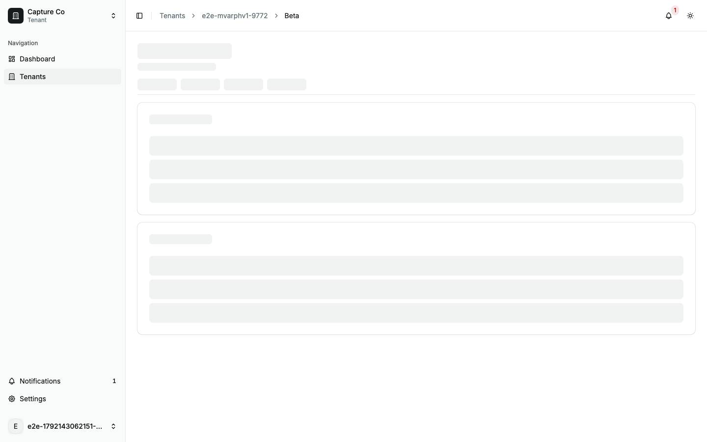 | 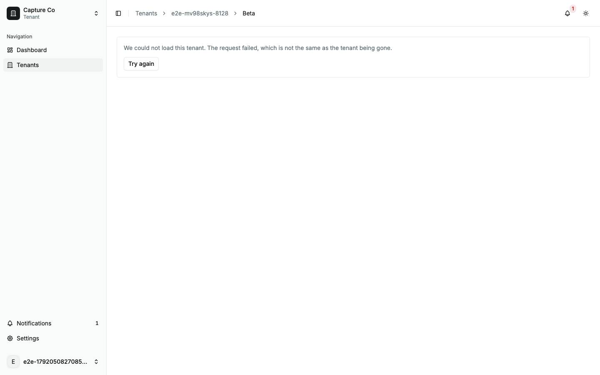 |
| splash · the boot splash, no shell        | alert · `TenantLoadFailed`              |

Findings: [F-tenants-1](findings.md#f-tenants-1), [F-tenants-2](findings.md#f-tenants-2), [F-tenants-6](findings.md#f-tenants-6)

## Redirects

Each throws a `redirect` in `beforeLoad` with `replace: true`, keeping the search and hash, so Back skips it. In the walk, each landed on its target with no flash of a tenant page.

| Route                     | File                                        | Goes to                              |
| ------------------------- | ------------------------------------------- | ------------------------------------ |
| `/tenants/$slug/activity` | `src/pages/_app/tenants/$slug.activity.tsx` | `/settings/workspace/$slug/activity` |
| `/tenants/$slug/members`  | `src/pages/_app/tenants/$slug.members.tsx`  | `/settings/workspace/$slug/members`  |
| `/tenants/$slug/settings` | `src/pages/_app/tenants/$slug.settings.tsx` | `/settings/workspace/$slug/general`  |
